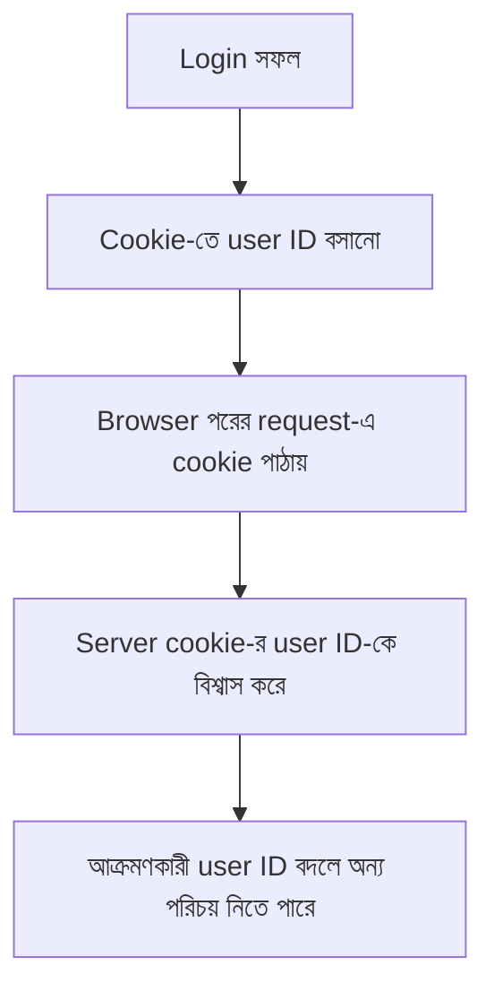
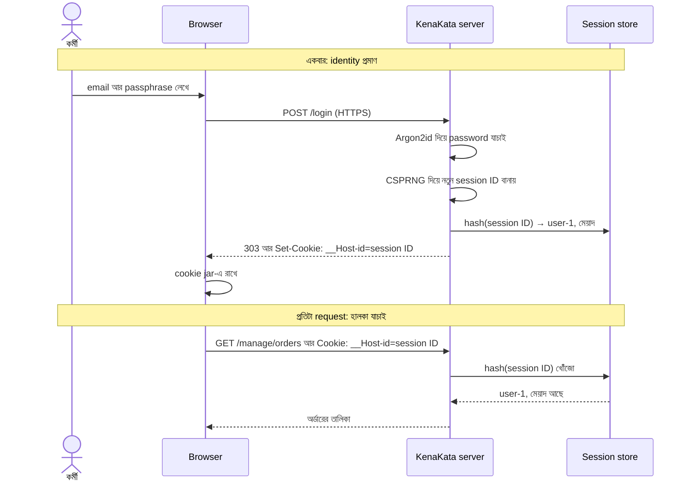
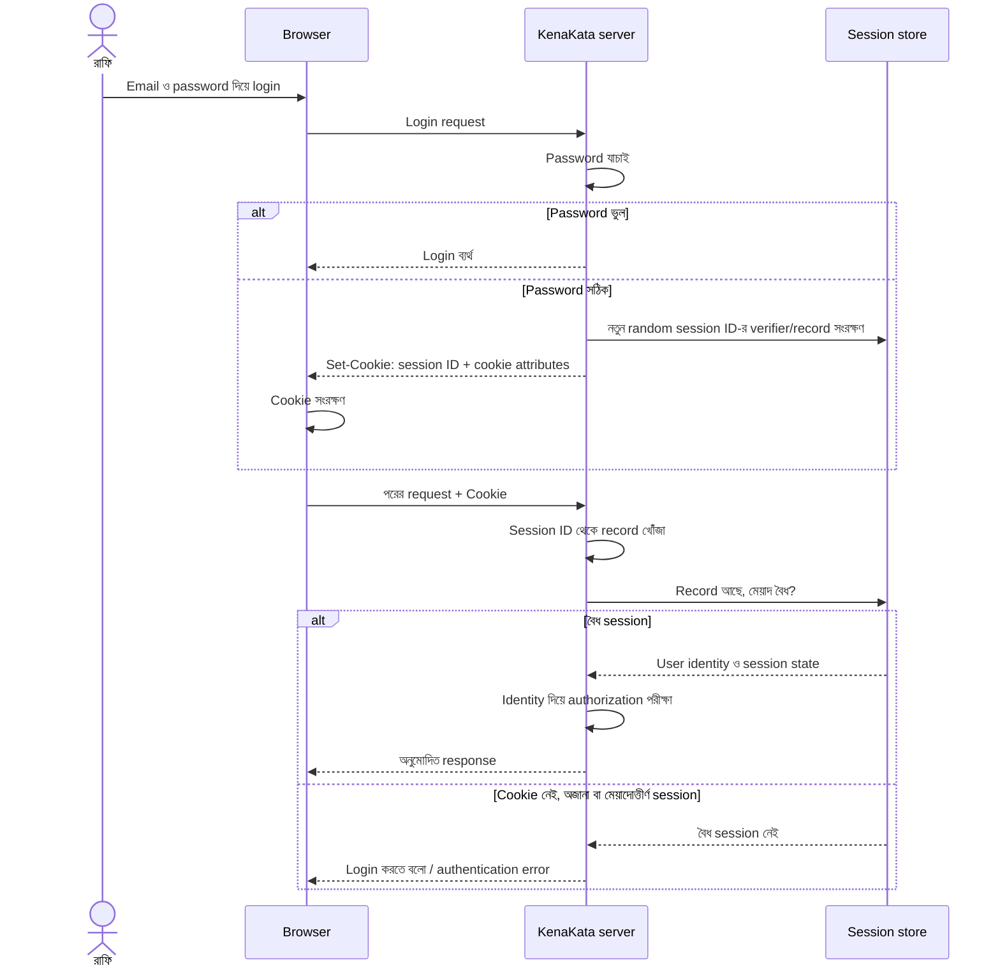
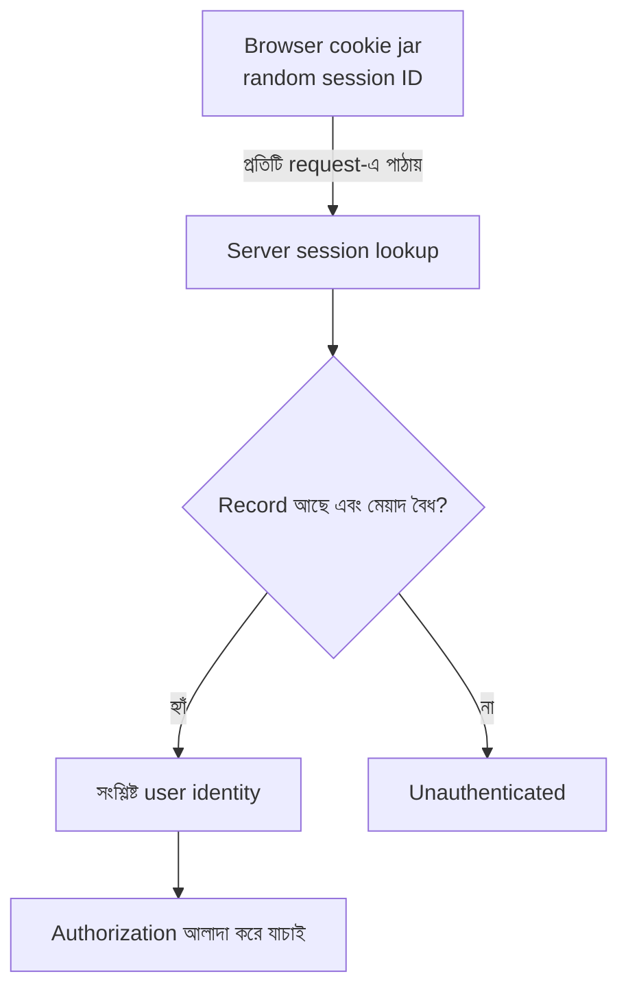
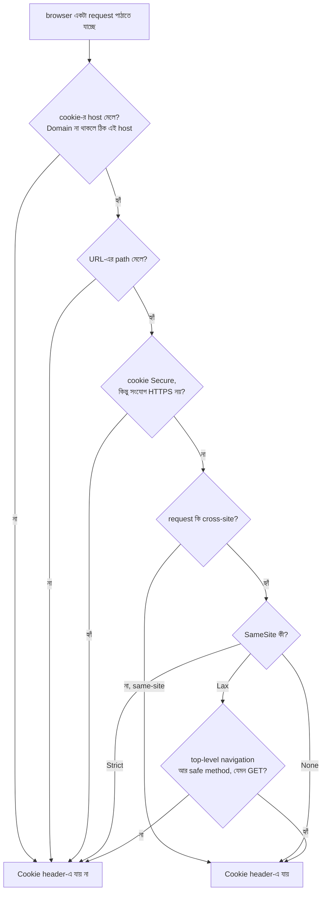
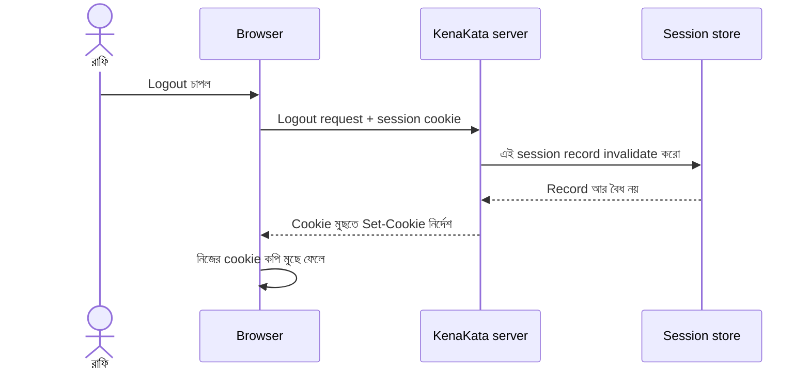
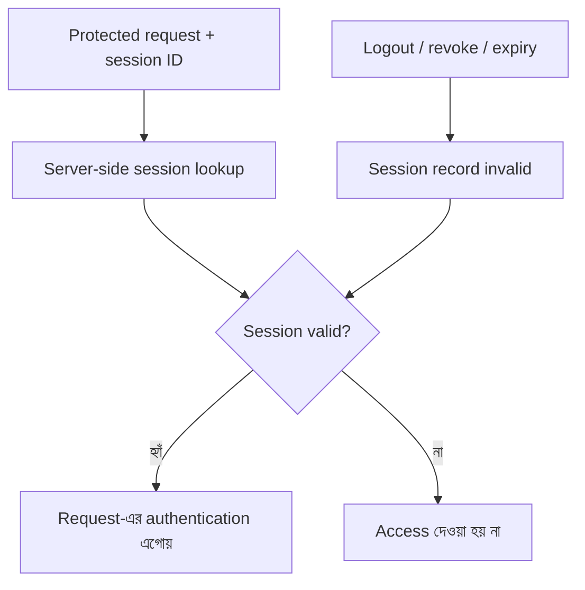
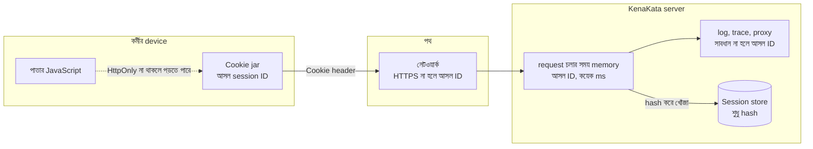

# Session এবং Cookie

সোমবার সকাল। ফাঁসের ঘটনার পর KenaKata-র প্রথম পুরো কর্মদিবস।

রাফি দোকান খুলে নতুন passphrase টাইপ করে login করল। Argon2id তাকে চিনল। তারপর সে অর্ডারের তালিকা খুলল, একটা অর্ডারে ঢুকল, ফিরে এল, আরেকটায় ঢুকল। নীরা ফোনে তার সঙ্গে কথা বলছিল।

"পাতাগুলো আগের চেয়ে একটু ভারী লাগছে," রাফি বলল।

আরিফ server-এর CPU-র গ্রাফ খুলল। কারণ খুঁজতে হলো না। একটা পাতা খুলতে browser পাঠায় প্রায় দশটা request, আর অধ্যায় ১-এর সেই নকশায় প্রতিটার সঙ্গে রাফির passphrase যাচ্ছে। প্রতিটায় নতুন করে Argon2id। এই উদাহরণে ধরা configuration-এ যাচাইয়ে প্রায় ৪০–৫০ ms সময় ও ১৯ MiB memory লাগতে পারে, ইচ্ছা করেই দামি। বাস্তবে latency hardware ও নির্বাচিত parameter অনুযায়ী বদলাবে। দশ request মানে শুধু "রাফি আসলেই রাফি" বলার জন্য প্রায় আধ সেকেন্ডের CPU।

নীরা আরেকটা কথা তুলল। "আর কর্মীরা সারাদিন একই কাজ করে। প্রতিটা পাতায় passphrase চাইলে ওরা কাগজে লিখে মনিটরে সাঁটবে।"

নীরা ঠিকই বলছিল। অধ্যায় ২-এ আমরা দেখেছিলাম, নিরাপত্তার নিয়ম কাজে এতটা বাধা হলে মানুষ পাশ কাটায়।

আরিফ `loginHandler`-এর শেষ লাইনটা আবার পড়ল: `_ = id`। ফাংশনটা একজন মানুষকে চিনল, তারপর চেনার ফলটা ছুড়ে ফেলল।

---

## ১. কী চাই, আর কী চাই না

অধ্যায় ১-এ আমরা দুটো কাজ আলাদা করেছিলাম: identity **প্রমাণ করা** আর প্রমাণিত identity **ধরে রাখা**। প্রথমটা আমরা অধ্যায় ৩-এ ঠিকমতো বানিয়েছি, ভারী আর ধীর, কারণ সেটা হাতে-গোনা বার চলে। এবার দ্বিতীয় কাজটা।

আরিফ তার চাহিদাগুলো লিখল:

1. **হালকা।** প্রতিটা request-এ বইবার মতো। Argon2id-র মতো নয়।
2. **password নয়।** password প্রতি request-এ ঘুরলে অধ্যায় ১-এর ভুলে ফেরা হয়।
3. **চুরি হলে আগের জায়গায় ফেরা নয়।** অধ্যায় ৩-এর শেষ প্রশ্নটা মনে আছে? যে চিহ্ন প্রতিটা request-এ যায়, সেটা চুরি হলে আমরা কি আবার সেই জায়গায়, যেখান থেকে বেরিয়ে এলাম? অন্তত এটা এমন হওয়া চাই, যা server বাতিল করতে পারে।

browser-এ ঠিক এই কাজের জন্য একটা যন্ত্র আছে। নাম **cookie**।

### Cookie কী

**Cookie** হলো browser-এর একটা কৌশল। server একটা ছোট `নাম=মান` জোড়া browser-কে দেয়, browser সেটা জমিয়ে রাখে, আর পরের request-গুলোতে (নির্দিষ্ট নিয়ম মেনে) ফেরত পাঠায়।

```http
HTTP/1.1 200 OK
Set-Cookie: lang=bn
```

```http
GET /products HTTP/1.1
Host: kenakata.example
Cookie: lang=bn
```

`Set-Cookie` হলো server-এর response header: "এটা জমিয়ে রাখো।" `Cookie` হলো browser-এর request header: "তুমি যেটা দিয়েছিলে, এই নাও।" কখন browser ফেরত পাঠাবে, সেই নিয়মগুলো §৭-এ। আপাতত শুধু এটুকু: **server অনুরোধ করে, সিদ্ধান্ত নেয় browser।**

> **একটু পেছনে তাকাই।** ১৯৯৪ সালের জুনে Netscape-এর প্রোগ্রামার Lou Montulli একটা সমস্যায় পড়েছিলেন। Netscape তখন MCI-র জন্য একটা e-commerce application বানাচ্ছিল, আর MCI চায়নি তাদের server অসমাপ্ত লেনদেনের অবস্থা নিজে মনে রাখুক। সমাধান: অবস্থাটা ক্রেতার নিজের browser-এ রাখো। virtual shopping cart-এর জন্য cookie-র জন্ম এভাবেই। (ইতিহাসের এই অংশ Wikipedia-র "HTTP cookie" লেখা থেকে। এটা ইতিহাস, security-র দাবি নয়।)
>
> KenaKata-ও একটা দোকান, তাই মিলটা মজার। আর একটা তিক্ত পরিহাসও আছে। cookie জন্মেছিল server-কে মনে রাখার দায় থেকে মুক্তি দিতে। আমরা আজ ঠিক উল্টো পথে হাঁটব: server মনে রাখবে, cookie শুধু বইবে। কেন, সেটা §২ থেকে §৪-এ।

আর এই অধ্যায়ের সবচেয়ে গুরুত্বপূর্ণ বাক্য সম্ভবত এটাই:

> **Cookie নিজে authentication system নয়।** এটা একটা বাহক। কী বইছে, সেটাই আসল প্রশ্ন।

---

## ২. প্রথম ভাবনা: cookie-তে "আমি কে" লিখে দিই

আরিফের প্রথম সমাধান সবচেয়ে সোজাটা। login সফল হলে user-এর ID cookie-তে বসিয়ে দাও। পরের request-এ cookie দেখে বলো, এ কে।



হালকা, সোজা, আর password আর ঘুরছে না। আরিফ test করল: রাফি login করলে পরের পাতাগুলো খোলে। কাজ শেষ?

এবার আরিফ একটা নতুন অভ্যাস কাজে লাগাল, অধ্যায় ৩ থেকে শেখা। deploy করার আগে সে আক্রমণকারীর চেয়ারে বসল। সে নিজেকে জিজ্ঞেস করল: **এই cookie-র প্রতিটা byte কার হাতে?**

উত্তরটা অস্বস্তিকর। cookie ফিরে আসে browser থেকে, আর browser বসে user-এর হাতে। RFC 6265-ও স্পষ্ট বলে: একটা ক্ষতিকর client `Cookie` header পাঠানোর আগে সেটা বদলে দিতে পারে।

আরিফ browser-এর developer tools খুলল। Application ট্যাবে cookie-র তালিকায় `user | user-7`। সে মানটা বদলে লিখল `user-1`, পাতা reload করল।

পাতার ওপরে লেখা: *স্বাগতম, রাফি।*

একই ধারণাটা HTTP request-এ দেখো। Browser থেকে আসা cookie-কে server যদি যাচাই না করে পরিচয় হিসেবে মেনে নেয়, তাহলে আক্রমণকারী অন্য user-এর ID পাঠাতে পারে:

```http
GET /manage/orders HTTP/1.1
Host: kenakata.example
Cookie: user=user-1
```

এটি শুধু illustrative HTTP example, কোনো executable command নয়।

ভেতরে ঢোকা গেল। আর অধ্যায় ২-এর `user-1` আর `user-7` নাম দুটো তো URL-এই লেখা থাকত (`/manage/users/user-7/profile`)। আক্রমণকারীকে আন্দাজও করতে হলো না।

এখানে কয়েকটা জিনিস একসঙ্গে ভাঙল।

**authorization ঠিকই কাজ করেছে।** `can(user-1, ViewProfile)` সত্যিই `true` দেয়, কারণ ওই পরিচয়ের সেই অনুমতি আছে। ভুল ছিল পরিচয়ে। অধ্যায় ২-এর শেষ নীতিটা এখানে ফিরে এল: request-এ আসা ID একটা **দাবি**, প্রমাণ নয়। ছদ্মবেশ শুধু বদলেছে। আগে ID ছিল path-এ, এখন cookie-তে।

**log মিথ্যে বলবে।** অধ্যায় ৩-এ দেখেছিলাম, পরিচয় জাল হলে log-এ `by=user-1` লেখা হবে আর সেটা সত্যি দেখাবে। accountability আবার শূন্যে।

**শেখার জিনিস:** শুধু একটা ID দিয়ে "আমি কে" বোঝানো যায় না, কারণ ID জানা মানেই তা ব্যবহার করা যাওয়া। আমাদের দরকার এমন একটা জিনিস, যা **জানা যায় না**।

---

## ৩. দ্বিতীয় ভাবনা: cookie-তে সই করে দিই

আরিফ একটা ব্লগে পড়েছিল, cookie-তে সই (signature) জুড়ে দিতে হয়। ধারণাটা সহজ। server-এর কাছে একটা গোপন চাবি থাকে। cookie-র মান হয় `user-7` আর তার একটা সই (যেমন HMAC), এরকম:

```
user=user-7.9f2c41…
```

server cookie ফেরত পেলে সই আবার হিসাব করে মেলায়। চাবি না জানলে কেউ `user-1`-এর সই বানাতে পারবে না। আর server-এর কিছু মনে রাখতে হচ্ছে না, ঠিক যেমন MCI চেয়েছিল।

জালিয়াতি তো গেল। কিন্তু আরিফ আবার আক্রমণকারীর চেয়ারে বসল, আর তিনটা প্রশ্ন বেরোল।

**এক: কেউ আসল cookie-টাই নিয়ে নিলে?** সই প্রমাণ করে, cookie-টা আমাদের বানানো। প্রমাণ করে না, এটা সেই মানুষটার হাতেই আছে। RFC 6265 নিজেই বলে, cookie-র ভেতরের অংশ encrypt বা sign করলেও আক্রমণকারী এক user agent থেকে আরেকটায় cookie বসিয়ে দিতে বা পরে আবার চালাতে (replay) পারে।

**দুই: বাতিল করব কীভাবে?** ধরো রাফি বুধবার একজন কর্মীকে ছাড়িয়ে দিল। অধ্যায় ২-এর শেষে প্রশ্নটা খোলা রেখেছিলাম: তার চলতে থাকা login-এর কী হবে? সই-করা cookie নিজেই নিজের প্রমাণ। তার মেয়াদ cookie-র ভেতরে লেখা, আর সেটাও সই করা। server-এর কাছে বাতিলের কোনো জায়গা নেই। চাবি বদলালে সবাই বেরিয়ে যায়। একজনকে আলাদা করে বের করতে হলে server-কে আবার মনে রাখতে হয় কারা বাতিল। মানে state ফিরে এল।

**তিন: চাবি ফাঁস হলে?** তখন আক্রমণকারী যে কোনো user-এর cookie বানাতে পারে, চুপচাপ। একটা চাবি, সবার চাবি।

এটা ভুল নকশা নয়। এটা **অন্য একটা trade-off**: server-এর স্মৃতি সরানোর বিনিময়ে বাতিল করার ক্ষমতা আর ক্ষতির সীমা কমে। এই ধারণা পরে ফিরবে token আর JWT-র আলোচনায় (অধ্যায় ৮–৯)। এখন KenaKata-র যে দরকার (কর্মী ছাড়ানো, চুরি-যাওয়া চিহ্ন বাতিল), সেটা এই নকশা দেয় না।

---

## ৪. তৃতীয় ভাবনা: server-এর খাতা, cookie-তে শুধু একটা নম্বর

ভাবনাটা উল্টে দেওয়া যাক। cookie-তে "আমি কে" লেখা থাকবে না। থাকবে শুধু একটা লম্বা, এলোমেলো নম্বর, যার নিজের কোনো মানে নেই। মানেটা থাকবে **server-এর খাতায়**।

অধ্যায় ১-এর wristband মনে আছে? এবার wristband-এ কোনো নাম লেখা নেই, শুধু একটা নম্বর। গেটের খাতায় নম্বরের পাশে লেখা: *user-1, ঢুকেছে ৯:০২-এ, মেয়াদ সন্ধ্যা ৫টা।* wristband হারালে সেই নম্বর বাতিল করে নতুন দেওয়া যায়। কর্মী ছাড়ালে খাতা থেকে লাইনটা কেটে দিলেই হলো।

এই খাতার নাম **session**। নম্বরটা **session ID**। RFC 6265 এই পদ্ধতিকে প্রচলিত বলে: cookie-তে তথ্য না রেখে একটা nonce রাখো, server সেই nonce দিয়ে নিজের তথ্য খোঁজে। আর তার একটা সুবিধাও স্পষ্ট করে: আক্রমণকারী cookie-র মান জেনে ফেললেও সেটা শুধু ওই server-এর সঙ্গে কথা বলতেই কাজে লাগে, মানের ভেতরে কোনো সংবেদনশীল তথ্য নেই।

> **একটা দার্শনিক টীকা।** server কখনো রাফিকে "চেনে" না। সে চেনে একটা নম্বর। পরিচয়ের ধারাবাহিকতা মানে হলো একই গোপন নম্বরের বারবার ফিরে আসা। অধ্যায় ১-এর Memento-র নায়কের মতো: নোট যার হাতে, সে-ই আমি। তাই নোটটা কতটা গোপন, কতটা বাতিলযোগ্য, সেটাই পুরো নকশা।

তিনটা আলাদা জিনিস, তিনটা আলাদা নাম। গুলিয়ে ফেললে পরের অধ্যায়গুলো গুলিয়ে যাবে:

| নাম | কী | কোথায় থাকে |
|---|---|---|
| **Session** | login-এর রেকর্ড: কে, কখন, কতক্ষণ | server-এর খাতায় (store) |
| **Session ID** | ওই রেকর্ডের চাবি, এলোমেলো নম্বর | browser-এর হাতে |
| **Cookie** | session ID বইবার browser-এর কৌশল | browser-এর cookie jar |

cookie-তে session ID ছাড়া আর কিছুও থাকতে পারে (যেমন ভাষার পছন্দ), আবার session ID অন্য উপায়েও যেতে পারে। দুটো এক জিনিস নয়।

প্রবাহটা ছবিতে দেখি। প্রশ্নটা হলো: কোন কাজ একবার হয়, আর কোনটা প্রতি request-এ?



ছবির তিনটা জিনিস লক্ষ করার মতো।

**প্রথমত,** password একবারই ঘুরেছে, `POST /login`-এ। তারপর থেকে পথে ঘুরছে শুধু session ID। ভারী কাজ (Argon2id) একবার, হালকা কাজ (একটা খোঁজ) প্রতিবার।

**দ্বিতীয়ত,** session ID বানাচ্ছে **server**, user নয়। client কোনো নম্বর বেছে নিতে পারে না। এই ছোট সিদ্ধান্তটা অধ্যায় ৫-এ বড় হয়ে ফিরবে।

**তৃতীয়ত,** store-এ session ID নয়, তার **hash** যাচ্ছে। কেন, সেটা §৬-এ।

### তিন নকশা, পাশাপাশি

অধ্যায় ১-এ আমরা দুই ভুল চাল পাশাপাশি দেখেছিলাম। এখানে তিনটা:

| প্রশ্ন | `user=user-1` | সই-করা cookie | random session ID |
|---|---|---|---|
| কে মনে রাখে? | কেউ না | client | server |
| জাল করা যায়? | সঙ্গে সঙ্গে | চাবি ছাড়া না | অনুমান করতে হবে (§৫) |
| cookie চুরি হলে replay? | হ্যাঁ | হ্যাঁ | হ্যাঁ |
| একজনকে আলাদা বাতিল? | না | না (চাবি বদলালে সবাই) | হ্যাঁ, একটা row মুছে |
| ফাঁসের ক্ষতি | যে কেউ যে কেউ | চাবি গেলে সবাই | store-এ শুধু verifier hash থাকলে read-only ফাঁসে session ID সরাসরি replay করা যায় না (§৬) |
| server-এর খরচ | নেই | নেই | প্রতি request-এ একটা খোঁজ |

তৃতীয় সারিটা সবার এক, আর এটা মনে রাখা জরুরি। session ID-ও চুরি করে ব্যবহার করা যায়। আমরা চুরি আটকাইনি। বদলেছে চুরির **পরের** অবস্থা: কতক্ষণ, কতটুকু, আর বাতিল করা যায় কি না।


## 🧠 Decision Game: বুধবার কর্মীকে ছাড়ানো হলো

রাফির একজন কর্মী, `user-7`, আর KenaKata-তে কাজ করবে না। তার browser-এ এখনো login খোলা। কোন নকশায় অন্য সবার login অক্ষত রেখে শুধু তার চলতি session বাতিল করা যায়?

- **A.** Cookie-র মেয়াদ browser-এ শেষ হওয়া পর্যন্ত অপেক্ষা করা
- **B.** Server-এর session store থেকে `user-7`-এর session record মুছে দেওয়া
- **C.** সব user-এর cookie-signing key বদলে দেওয়া

উত্তর দেওয়ার আগে ভাবো: browser-এর কাছে থাকা কপিটা মুছতে পারা আর server-এর কাছে credential-টাকে অকার্যকর করতে পারা কি একই ব্যাপার?

<details>
<summary>উত্তর ও ব্যাখ্যা দেখো</summary>

**সঠিক উত্তর: B।** Server-side session-এ server-এর খাতায় session ID-র সঙ্গে user-এর সম্পর্ক থাকে। `user-7`-এর record মুছে দিলে পরের request-এ ওই ID আর বৈধ session খুঁজে পাবে না, কিন্তু অন্য user-দের session চলবে।

A শুধু browser-এর কপি সরাতে পারে; চুরি-যাওয়া কপি তখনও কাজ করতে পারে। C সই-করা cookie-র ক্ষেত্রে সবাইকে প্রভাবিত করতে পারে, কিন্তু আলাদা user-কে বাতিল করার সুবিধা দেয় না।

**Edge case:** একই user একাধিক device-এ login করে থাকলে, শুধু একটি session মুছবে নাকি তার সব session বাতিল করবে, সেটাও policy-তে স্পষ্ট থাকতে হবে।

</details>

---

## ৫. Session ID কেমন হবে

session ID-র গুণ নিয়ে OWASP-র Session Management Cheat Sheet পরিষ্কার। আমাদের কাজের কথাগুলো:

- **অনুমান-অযোগ্য।** cryptographically secure random generator (CSPRNG) থেকে আসতে হবে, আর কমপক্ষে ৬৪ bit entropy থাকতে হবে। নিজে বানালে OWASP বলে কমপক্ষে ১২৮ bit-এর CSPRNG মান। সাধারণভাবে framework-এর session-management সুবিধা ব্যবহার করাই ভালো। নিজে session ID তৈরি করলে cryptographically secure random generator দরকার; শুধু লম্বা string হলেই সেটা অনুমান-অযোগ্য হয় না।
- **অর্থহীন।** মানের ভেতরে user ID, role, ইমেল, কিছুই নয়। অর্থ থাকবে শুধু server-এর খাতায়।
- **server-এর বানানো।** server যে ID কখনো বানায়নি, সেটা পেলে প্রত্যাখ্যান। OWASP একে strict mode বলে।
- **generic নাম।** `PHPSESSID` বা `JSESSIONID`-এর মতো framework-এর ডিফল্ট নাম বলে দেয় কোন প্রযুক্তি চলছে। আমরা নাম রাখব `__Host-id`। `__Host-`-এর মানে §৭-এ।

### কেন URL-এ নয়, cookie-তে?

অধ্যায় ১-এর গোপন URL মনে আছে? session ID URL-এ রাখলে ঠিক সেই পুরোনো ফাঁসগুলো: browser history, server log, `Referer` header, শেয়ার করা লিঙ্ক। OWASP-ও এই কারণ দেখায় আর বলে, session ID শুধু cookie দিয়ে গ্রহণ করাই ভালো, URL parameter থেকে নয়। কারণ URL-এ নেওয়া মানে আক্রমণকারী আগে থেকে ID বসিয়ে দিতে পারে (অধ্যায় ৫-এ আসবে)।

### কেন cookie-তে, `Authorization` header-এ নয়?

অধ্যায় ১-এ HTTP Basic প্রতি request-এ `Authorization` header-এ password পাঠাত। session ID-ও header-এ পাঠানো যায়। তফাতটা একটাই, কিন্তু ভারী:

| | Cookie | `Authorization` header |
|---|---|---|
| কে পাঠায়? | **browser নিজে**, নিয়ম মেনে, স্বয়ংক্রিয়ভাবে | **client code**, প্রতিটা request-এ জুড়ে দিতে হয় |
| JavaScript পড়তে পারে? | `HttpOnly` থাকলে না | যেখানে রাখা হবে সেখান থেকে পারে |
| অন্য সাইট থেকে request এলে? | browser তবু পাঠাতে পারে (অধ্যায় ৬) | পাঠায় না, কারণ সেই সাইটের কাছে মানটা নেই |

browser নিজে পাঠায়, এই সুবিধাটাই আবার সমস্যা। RFC 6265 এই বৈশিষ্ট্যের নাম দেয় **ambient authority**। request কে শুরু করেছে, সেটা না দেখে browser authority জুড়ে দেয়। অধ্যায় ৬-এর পুরো গল্প এটা। আর অধ্যায় ৮ থেকে ১০ দেখাবে, header-এ রাখলে কোন সমস্যা কমে আর কোনটা নতুন করে আসে।

---


## ৬. Request এলে server কীভাবে session চিনবে?

এখানে কোনো নির্দিষ্ট framework-এর implementation নয়, আগে mechanism-টা মাথায় বসাই।

### Login থেকে পরের request পর্যন্ত



খেয়াল করো, **session authentication-এর বিকল্প প্রমাণ নয়; এটি সফল authentication-এর পরের অবস্থা ধরে রাখে।** Session থেকে user-কে চেনার পরও প্রতিটি protected action-এ তার অনুমতি আছে কি না আলাদা করে যাচাই করতে হয়।

### Server-এর খাতায় কী থাকবে?

Session store-এ সাধারণত session-এর সঙ্গে যুক্ত user, কখন তৈরি হয়েছে, কখন মেয়াদ শেষ হবে এবং প্রয়োজনীয় session state থাকে। Browser-এর cookie-তে থাকবে server-এর তৈরি একটি random, অনুমান-অযোগ্য session identifier। ID-র ভেতরে email, role বা অন্য ব্যক্তিগত তথ্য encode করার দরকার নেই।

কিছু গুরুত্বপূর্ণ সিদ্ধান্ত:

- **Session ID-র randomness:** ID অনুমান করা কঠিন হতে হবে। Randomness guessing-এর ঝুঁকি কমায়, কিন্তু ID চুরি হয়ে গেলে replay ঠেকায় না।
- **Server-side state:** server record মুছে বা invalidate করে session বন্ধ করতে পারে। এর বদলে server-side state রাখতে হয় এবং একাধিক server থাকলে session store-এ সমন্বয় দরকার।
- **Store-এ raw ID নাকি verifier:** raw ID store-এ রাখলে read-only database leak-এ সেই ID-গুলো replay করা যেতে পারে। Threat model-এ store leak থাকলে ID-র one-way verifier রাখা ঝুঁকি কমাতে পারে। এটা একটি design choice, সব system-এর একমাত্র বাধ্যতামূলক architecture নয়।
- **কেন password-এর মতো ধীর hash নয়?** Session ID server-ই cryptographically secure random উৎস থেকে তৈরি করে; password-এর মতো মানুষের অনুমানযোগ্য পছন্দ নয়। তাই verifier-এর জন্য সাধারণত দ্রুত cryptographic hash যথেষ্ট। এতে request-এর খরচ কম থাকে।
- **কখন session তৈরি হবে?** Password যাচাই সফল হওয়ার পরে নতুন session তৈরি করো। Login-এর আগে attacker-এর বেছে দেওয়া session ID-কে authenticated session হিসেবে চালিয়ে দিও না। Login-এর সময় session ID বদলানো session fixation প্রতিরোধের গুরুত্বপূর্ণ অংশ, যা পরের অধ্যায়ে দেখব।

### Cookie-র মান আর server-এর record এক জিনিস নয়



Cookie-তে session ID থাকা মানে cookie নিজে server-side record নয়। Browser শুধু credential-টি বহন করে; server-ই ঠিক করে সেই credential এখনো বৈধ কি না।

### Browser page আর API response

Browser-এর HTML page চাইলে login page-এ redirect করা যেতে পারে; API request সাধারণত authentication error পায়, যাতে client নিজে সিদ্ধান্ত নিতে পারে কী দেখাবে। HTTP-এর `401` response-এর challenge-সংক্রান্ত নিয়ম আলাদা protocol detail, তাই এখানে তার implementation নিয়ে যাচ্ছি না। মূল কথা: response-এর আচরণ client-এর ধরন অনুযায়ী বেছে নিতে হয়, কিন্তু authentication ব্যর্থ হলে protected resource-এ প্রবেশ দেওয়া যাবে না।

---

## 🛡️ ৭. Cookie-র অ্যাট্রিবিউট: browser-কে দেওয়া নির্দেশ

Cookie-র প্রতিটি attribute browser-কে দেওয়া নির্দেশ। তার আগে একটা মূল সত্য, যেটা বুঝলে বাকিটা সহজ হয়ে যায়। browser যখন cookie ফেরত পাঠায়, তাতে থাকে শুধু `নাম=মান`। RFC 6265 স্পষ্ট বলে: `Cookie` header থেকে server জানতে পারে না cookie-র মেয়াদ কবে, কোন host আর path-এর জন্য, বা সেটা `Secure` বা `HttpOnly` ছিল কি না।

```http
Cookie: __Host-id=jd3COo2PDshkWEsI2mswgz39yB6IXw9k1_zW4jdIN2o
```

মানে, অ্যাট্রিবিউটগুলো **কথা দেয় না**। এগুলো একটা ভদ্র browser-কে দেওয়া নির্দেশ। যে `curl` দিয়ে সরাসরি request পাঠায়, তার কাছে `HttpOnly` বা `SameSite`-এর কোনো মানে নেই। এই নির্দেশগুলো রক্ষা করে **browser-এর ভেতরের আর পথের** বিপদ থেকে: অন্য পাতা, অন্য script, নেটওয়ার্ক। যার হাতে মানটা আছে, তাকে এরা থামায় না।

browser আসলে কখন cookie পাঠায়? ছবিটা সরল করে দিলাম, আসল নিয়ম বর্তমান cookie draft-এর retrieval algorithm-এ।



মেয়াদ-শেষ বা browser-এর মুছে-ফেলা cookie তো আগেই বাদ। আর `HttpOnly` এই ছবিতে নেই, কারণ সেটা **request-এ যাওয়া** নিয়ে নয়, **JavaScript-এর পড়া** নিয়ে। MDN ঠিক এটাই বলে: `HttpOnly` cookie JavaScript থেকে শুরু করা request-এও যায়।

একে একে দেখি, প্রতিটা কী ঠেকায় আর কী ঠেকায় না।

| অ্যাট্রিবিউট | browser-কে কী বলে | কী ঠেকায় | কী ঠেকায় না |
|---|---|---|---|
| `Secure` | শুধু HTTPS-এ পাঠাও | নেটওয়ার্কে আড়ি পেতে cookie পড়া, ভুল করে HTTP-তে যাওয়া | active আক্রমণকারী insecure পথ থেকে cookie **বদলে দেওয়া** (RFC), device থেকে চুরি |
| `HttpOnly` | `document.cookie` থেকে লুকাও | script দিয়ে cookie-র মান **পড়া** | script-এর পাঠানো request (cookie তবু যায়), CSRF, নেটওয়ার্ক, device থেকে চুরি |
| `SameSite` | cross-site request-এ পাঠাবে কি না | কিছু cross-site request-এ cookie যাওয়া | চুরি, same-site আক্রমণ (যেমন সহোদর subdomain), `Lax`-এ top-level GET |
| `Path` | কোন path-এ পাঠাবে | সুবিধা, security নয় | অন্য path থেকে `document.cookie`, অন্য path থেকে cookie বসানো |
| `Domain` | কোন host-এ পাঠাবে | না দিলে cookie শুধু ঠিক ওই host-এ | দিলে সব subdomain, আর তাদের দুর্বলতা |
| `Max-Age`/`Expires` | কতদিন রাখবে | (এটা hint) | server-এর দিক থেকে মেয়াদ, §৮ |
| `__Host-` | browser জোর করে শর্তগুলো মানবে | subdomain বা insecure origin থেকে বসানো/বদলানো | চুরি, XSS, CSRF, port-ভিত্তিক ফাঁক |

### `Secure`: কাফের Wi-Fi

রাফি এক সন্ধ্যায় কোনো কাফের খোলা Wi-Fi থেকে KenaKata-য় ঢুকল। সাইট HTTPS-এই চলে। তবু RFC 6265 এই ঝুঁকির একটা উদাহরণ দেয়। `Secure` না থাকলে active আক্রমণকারী রাফির যে কোনো বাইরের HTTP request ধরে সেটাকে KenaKata-র HTTP ঠিকানায় ঘুরিয়ে দিতে পারে। server সেই পোর্টে না শুনলেও browser cookie জুড়ে পাঠিয়ে দেবে, আর আক্রমণকারী সেটা পড়ে ফেলবে। `Secure` থাকলে browser clear-text request-এ cookie দেয়ই না। OWASP এর সঙ্গে HSTS-ও (HTTP Strict Transport Security) চালু করতে বলে, যেন browser শুরু থেকেই HTTPS ছাড়া যায় না। এখানে HSTS-এর খুঁটিনাটিতে ঢুকছি না।

কিন্তু `Secure`-এর একটা সীমা RFC নিজেই স্বীকার করে: এটা শুধু **গোপনীয়তা** দেয়। active network আক্রমণকারী insecure পথ থেকে একটা cookie বসিয়ে দিতে বা বদলে দিতে পারে, অর্থাৎ **অখণ্ডতা** নেই। `__Host-` prefix এখানে সাহায্য করে: browser সেই cookie শুধু HTTPS origin থেকেই মানে।

### `HttpOnly`: যা লুকোয়, আর যা লুকোয় না

`HttpOnly` cookie-কে `document.cookie` থেকে সরিয়ে রাখে, আর এটা সত্যিই কাজের। কিন্তু একটা ভুল ধারণা এখান থেকেই শুরু: "তাহলে XSS-এ ক্ষতি নেই।" না। পাতায় চলা script cookie **পড়তে** না পারলেও `fetch` দিয়ে request পাঠাতে পারে, আর browser সেই request-এ cookie জুড়ে দেবে। OWASP-র ভাষায়: `HttpOnly` শুধু cookie-র confidentiality রক্ষা করে, আক্রমণকারী সেটা offline ব্যবহার করতে পারে না। অধ্যায় ৭-এ এটা পুরো গল্প।

### `SameSite`: ডিফল্টের ওপর ভরসা নয়

`SameSite` ঠিক করে cross-site request-এ cookie যাবে কি না। তিনটা মান:

- `Strict`: শুধু same-site request-এ যাবে।
- `Lax`: same-site request-এ, আর **cross-site top-level navigation যদি safe method (যেমন GET) হয়**, তাতে। মানে অন্য সাইট থেকে link-এ ক্লিক করলে cookie যায়, কিন্তু অন্য সাইটের form থেকে `POST` গেলে যায় না।
- `None`: সব request-এ, শর্ত `Secure` থাকতে হবে।

আমরা `Lax` বেছেছি, আর স্পষ্ট করে লিখেছি, কারণ আছে। MDN বলে, কিছু browser `SameSite` না থাকলে `Lax` ধরে, কিন্তু সেটা **আরও শিথিল** একটা সংস্করণ: cookie বানানোর দুই মিনিটের মধ্যে cross-site `POST`-এও যেতে পারে। OWASP স্পষ্ট বলে, browser-এর ডিফল্ট মান browser আর version ভেদে আলাদা, তাই ডিফল্টের ওপর ভরসা না করে স্পষ্ট লিখতে।

`Strict` না কেন? OWASP `Strict`-কে পছন্দের বলে, কিন্তু তাতে একটা বাস্তব ঘর্ষণ আছে। অধ্যায় ১-এ আমরা দেখেছিলাম, কর্মীরা link শেয়ার করে চ্যাটে। কেউ যদি ওয়েব-ভিত্তিক email বা chat থেকে link ধরে `/manage/orders`-এ আসে, `Strict` cookie সেই প্রথম navigation-এ যাবে না। session ঠিক থাকলেও পাতা তাকে login-এ পাঠিয়ে দেবে, আর দ্বিতীয় ক্লিকে আবার কাজ করবে। রাফির কর্মীদের জন্য এটা বিরক্তিকর, তাই এই দৃশ্যে `Lax`। (native app থেকে খোলা link-এর আচরণ browser ভেদে ভিন্ন, নিজে পরীক্ষা করে নিয়ো।)

আর `SameSite` CSRF-এর সমাধান নয়। cookie draft নিজেই বলে, `Lax` CSRF-এর বিরুদ্ধে defense in depth, কিন্তু "সাধারণ আক্রমণ-শ্রেণি"র বিরুদ্ধে শক্ত সুরক্ষা নয়। আক্রমণকারী নতুন window খুলে top-level navigation ঘটাতে পারে। অধ্যায় ৬।

একটা নামের ফাঁদ: **same-site** আর **same-origin** এক নয়। cookie draft অনুযায়ী site মানে scheme আর registrable domain। `a.kenakata.example` আর `b.kenakata.example` same-site, কিন্তু আলাদা origin। `Domain` প্রসঙ্গে এটা কাজে লাগবে।

### `Path` আর `Domain`: যত সংকীর্ণ, তত ভালো

`Path` দিয়ে cookie শুধু `/manage`-এ পাঠাতে চাইলে চাইতে পারো, কিন্তু MDN সাফ বলে, `Path` security-র ব্যবস্থা নয়। অন্য path-এর পাতার script `document.cookie` দিয়ে পড়তে পারে, আর যে কোনো পাতা যে কোনো path-এর cookie বসাতে পারে (RFC 6265 §৮.৫, §৮.৬)। তাই `Path=/`।

`Domain` না দিলে cookie শুধু যে host দিয়েছে সেই host-এ যায় (host-only)। `Domain=kenakata.example` দিলে সব subdomain-এ যায়, আর সহোদর subdomain-গুলো cookie বদলে দিতে পারে। ধরো (কাল্পনিক, KenaKata-র আসল নকশা নয়) কাল কেউ `blog.kenakata.example`-এ একটা পুরোনো CMS বসাল, আর তাতে দুর্বলতা আছে। `Domain` দিলে সেই দুর্বলতা মূল সাইটের session-কে ছুঁয়ে ফেলতে পারে। OWASP-ও বলে `Domain` না দিতে।

### `__Host-` prefix: browser-কে দিয়ে শর্ত মানানো

নামের শুরুতে `__Host-` থাকলে browser শুধু সেই cookie গ্রহণ করে যার `Secure` আছে, `Domain` নেই, আর `Path=/`। অর্থাৎ cookie শুধু ঠিক এই host-এর, সহোদর subdomain বা insecure পথ বদলাতে পারবে না। OWASP session ID-র জন্য এটা সুপারিশ করে। সীমা দুটো। এক, port আলাদা করা হয় না (RFC 6265 §৮.৫ মতে একই host-এর সব port cookie ভাগ করে, আর draft বলে `__Host-` এই একটা ফাঁকই রেখে যায়)। দুই, যে browser prefix বোঝে না, সে cookie-টা তবু গ্রহণ করবে, কোনো শর্ত ছাড়াই (MDN-এর সতর্কতা)।

লোকাল development-এ MDN বলে `localhost`-এ `Secure`-এর https শর্ত শিথিল হয়। তবে `__Host-` prefix সব browser-এ `localhost`-এ একই আচরণ করবে, এমন ধরে নিয়ো না, নিজে পরীক্ষা করো।

---

## ⏳ ৮. মেয়াদ: দুটো ঘড়ি, আর শুধু একটা সত্যি

cookie-র মেয়াদ আর session-এর মেয়াদ আলাদা জিনিস, আর দুটোর ওজনও আলাদা।

**cookie-র মেয়াদ browser-এর ব্যাপার।** `Expires` বা `Max-Age` দিলে cookie persistent হয়। না দিলে সেটা **session cookie**: browser বন্ধ হলে মুছে যাওয়ার কথা। কিন্তু এর সঙ্গে কয়েকটা সতর্কতা:

- browser যে কোনো সময় cookie মুছে ফেলতে পারে। RFC 6265-এর ভাষা: user agent মেয়াদ পর্যন্ত রাখতে বাধ্য নয়, আর server যেন cookie থেকে যাবে ধরে না নেয়।
- `Expires` server-এর ঘড়ির সময়ে লেখা হয়, কিন্তু user agent নিজের ঘড়িতে মাপে। MDN বলে, Firefox আর Chromium-ভিত্তিক browser `Date` header দেখে এই ফারাক সামলায়, কিন্তু spec সেটা বাধ্যতামূলক করে না।
- draft বলে, user agent cookie-র মেয়াদ সর্বোচ্চ ৪০০ দিনে কেটে দেবে (SHOULD NOT তার বেশি)। তুমি দশ বছর লিখলেও।
- "browser বন্ধ করলে session cookie মুছে যায়" এর ওপরও ভরসা নেই। browser-এর session restore থাকলে session cookie ফিরে আসে (MDN আর OWASP দুজনেই এই সতর্কতা দেয়)।

**session-এর মেয়াদ server-এর খাতার ব্যাপার, আর সেটাই আসল।** Server প্রতিটি request-এ session record-এর মেয়াদ পরীক্ষা করে। cookie যতই বলুক, খাতায় মেয়াদ শেষ মানে শেষ। OWASP-ও বলে, session-এর timeout server-এ প্রয়োগ করতে হবে, কারণ client-এর ওপর নির্ভর করলে আক্রমণকারী সময় বদলে দিতে পারে।

এই অধ্যায়ে আমরা শুধু নীতিটা স্থির করছি: browser cookie-তে persistent expiry না থাকলেও server-side session-এর মেয়াদ আলাদাভাবে প্রয়োগ করতে হবে। KenaKata-র নির্দিষ্ট উদাহরণে anonymous session-এর মেয়াদ, authenticated session-এর idle timeout এবং absolute timeout আলাদা করে অধ্যায় ৫-এ নির্ধারিত হয়েছে। নির্দিষ্ট timeout application-এর ঝুঁকি, ব্যবহার এবং সংবেদনশীলতার ওপর নির্ভর করে; কোনো একক সময় সব system-এর জন্য সঠিক নয়। কেন persistent নয়? অধ্যায় ১-এ দোকানের shared কম্পিউটারের history আর autocomplete-এর কথা বলেছিলাম। কিছু কম্পিউটারে কেউ লগআউট না করেই উঠে যায়।

এর দাম আছে, আর নীরা সেটা প্রথম দিনই টের পাবে। রাফিকে প্রতিদিন সকালে login করতে হবে। "আমাকে মনে রাখো" ধরনের দীর্ঘ session মানে চুরি-যাওয়া cookie-র আয়ু বাড়া। এটা একটা ব্যবসার সিদ্ধান্ত, শুধু প্রযুক্তির নয়। আর ৮ ঘণ্টাকে **idle** আর **absolute** এই দুই ঘড়িতে ভাগ করা অধ্যায় ৫-এর কাজ।

এই ভাগের ফলে একটা গুরুত্বপূর্ণ কথা, যা OWASP স্পষ্ট বলে: **browser থেকে cookie মুছে ফেলা session বাতিল করে না।** মুছলে শুধু ওই browser-এর কপিটা যায়। চুরি-যাওয়া কপি কাজ করতেই থাকে, যতক্ষণ না server খাতা থেকে লাইনটা কাটে।

---

## 🔍 ৯. বাতিল: খাতা থেকে লাইন কাটা

বুধবার। রাফি জানাল, কর্মী `user-7`-কে আজ থেকে ছাড়িয়ে দিয়েছে। তার browser-এ login এখনো খোলা। শুধু browser-এর cookie মুছে দিলে কর্মীর কাছে আগে থেকে কপি করা session ID-টি কিন্তু বেঁচে থাকবে।

### Logout এবং session বাতিল



**গুরুত্বপূর্ণ ক্রম:** server-side session আগে invalidate করতে হবে। Browser-এর cookie মুছে ফেলা পরিষ্কার-পরিচ্ছন্নতার অংশ, আসল security action হলো server-কে সেই session ID প্রত্যাখ্যান করানো।

### এক session, নাকি সব session?

- **একটি session বাতিল:** নির্দিষ্ট browser/device থেকে logout।
- **এক user-এর সব session বাতিল:** account compromise, কর্মী চলে যাওয়া, password reset-এর পর সব device থেকে logout করানোর মতো ক্ষেত্রে উপকারী হতে পারে।
- **মেয়াদ শেষ:** server নিজেই record-কে invalid ধরে। Browser cookie এখনো পাঠালেও server সেটি গ্রহণ করবে না।



Browser-এ cookie মুছে ফেলা আর server-side session বাতিল করা এক ব্যাপার নয়। OWASP এই পার্থক্যটি স্পষ্ট করে: চুরি-যাওয়া কপি কাজ করতে পারে যতক্ষণ server সেটিকে বৈধ ধরে। Logout request-কে state-changing action হিসেবে ধরতে হবে; GET request দিয়ে logout করানো উচিত নয়। CSRF নিয়ে বিস্তারিত অধ্যায় ৬-এ।

## ১০. Threat model: session ID-র পাশে আক্রমণকারী

ছবিটা আগে। প্রশ্ন: session ID বা তার ছাপ কোথায় কোথায় পৌঁছায়, আর কোথায় সেটা আসল রূপে?



আসল ID থাকে চার জায়গায়: cookie jar, পথে (TLS ছাড়া), server-এর memory-তে কয়েক মিলিসেকেন্ড, আর যদি আমরা অসাবধান হই তাহলে log বা tracing-এ। store-এ থাকে না। OWASP-র নির্দেশ: log-এ আসল session ID নয়, দরকার হলে salt-যুক্ত hash লেখো, যাতে একটা session-এর ঘটনা মেলানো যায় কিন্তু ID ফাঁস না হয়।

এখন আক্রমণকারীর প্রশ্নগুলো:

| প্রশ্ন | উত্তর |
|---|---|
| কী control করে? | নিজের browser আর নিজের পাঠানো যে কোনো `Cookie` মান। দূষিত পাতা যা browser-কে দিয়ে request করাতে পারে (অধ্যায় ৬)। আমাদের পাতায় চলা script (অধ্যায় ৭)। সহোদর subdomain (যদি `Domain` দেওয়া হয়)। insecure পথে active নেটওয়ার্ক আক্রমণকারী |
| কী steal করতে পারে? | cookie jar থেকে (shared কম্পিউটার, malware, `HttpOnly` না থাকলে script)। নেটওয়ার্ক থেকে (TLS বা `Secure` না থাকলে)। log থেকে (যদি আসল ID লেখা হয়)। store থেকে শুধু hash, যা দিয়ে cookie বানানো যায় না |
| কী observe করতে পারে? | TLS ছাড়া `Cookie` আর `Set-Cookie` পুরোটা। রাফির নিজের browser-এর developer tools-এ রাফি নিজেই সব দেখতে পায় |
| কী modify করতে পারে? | নিজের cookie-র মান যা খুশি করা। server অচেনা ID ফিরিয়ে দেয়। active নেটওয়ার্ক বা সহোদর subdomain নিজের cookie বসিয়ে দিতে পারে (`__Host-` ও `Secure` এটা কঠিন করে) |
| কী replay করতে পারে? | **হ্যাঁ, session ID-র মান পেলে যেখান থেকে খুশি।** server সামনের request দুটোর মধ্যে তফাত দেখে না, কারণ দুটোতেই একই মান |
| ফাঁস হলে কী হবে? | আক্রমণকারী ওই user-এর পরিচয়ে কাজ করে। ক্ষতি সেই user-এর ক্ষমতার সমান (অধ্যায় ২)। তবে password পায় না, তাই অন্য সাইটে reuse-এর ঝুঁকি নেই |
| কতক্ষণ access? | সর্বোচ্চ server-এর খাতার মেয়াদ (এখানে ৮ ঘণ্টা), অথবা বাতিলের আগ পর্যন্ত |
| server কি ধরতে পারবে? | কঠিন। বৈধ ID দিয়ে বৈধ-দেখতে request। OWASP IP বা User-Agent-এর সঙ্গে ID বেঁধে সন্দেহজনক পরিবর্তন ধরতে বলে, কিন্তু সেগুলো একই network-এ থাকা আক্রমণকারী পার করে ফেলতে পারে। অধ্যায় ৫ |
| server কি revoke করতে পারবে? | হ্যাঁ, একটা row মুছে। একজনের জন্য বা সবার জন্য |
| ক্ষতি কীভাবে সীমিত হয়? | ছোট মেয়াদ, `Secure` আর TLS, `HttpOnly`, `__Host-`, store-এ hash, log-এ আসল ID নয়, least privilege (অধ্যায় ২), সংবেদনশীল কাজে আরেক ধাপ (অধ্যায় ২২) |

---

## ১১. আমরা কি ঠিক সেই জায়গায় ফিরলাম?

অধ্যায় ৩-এর শেষ প্রশ্নটা ছিল: যে চিহ্ন প্রতিটা request-এ যায়, সেটা চুরি হলে আমরা কি আবার সেখানেই, যেখান থেকে বেরিয়ে এলাম?

উত্তর: **একই ধরনের bearer-credential ঝুঁকি, তবে আলাদা সীমা ও trade-off-সহ।** OWASP-র কথায়, authenticated session স্থাপিত হলে session ID সাময়িকভাবে ব্যবহৃত সবচেয়ে শক্ত authentication পদ্ধতির সমতুল্য। মানে বিপদটা নেই বলছি না। কিন্তু পাশাপাশি রাখলে তফাত পরিষ্কার:

| | password | session ID |
|---|---|---|
| চুরি হলে অন্য সাইটে ব্যবহার? | হ্যাঁ, reuse থাকলে | না, প্রতিটা login-এ নতুন, random |
| কে বানায়? | user, অনুমানযোগ্য | server, অনুমান-অযোগ্য |
| কতদিন বৈধ? | বদলানো পর্যন্ত, মাস-বছর | ঘণ্টা, আর বাতিলযোগ্য |
| বাতিল করতে? | user-কে নতুন password বানাতে হয় | server একটা row কাটে |
| প্রতি request-এ খরচ? | ভারী (Argon2id) | হালকা (একটা খোঁজ) |
| **যার হাতে, সে-ই?** | **হ্যাঁ** | **হ্যাঁ** |

শেষ সারিটাই এই অধ্যায়ের বিনয়ী উপসংহার। আমরা bearer সমস্যা সমাধান করিনি। আমরা তার **আকার** ছোট করেছি: সীমিত মেয়াদ, বাতিলযোগ্য, আর password-এর সঙ্গে বাঁধা নয়।

---

## ১২. Trade-off: state-এর দাম

- **server-কে মনে রাখতে হয়।** প্রতিটা request-এ একটা খোঁজ। store বন্ধ হলে সবাই login থেকে বঞ্চিত। একাধিক server চালালে সবাইকে একই store দেখতে হয় (database বা Redis-এর মতো কিছু), নইলে একটা server-এর বানানো session আরেকটা চেনে না।
- **store নিজেই একটা লক্ষ্য।** hash রাখলে read-only ফাঁসে ক্ষতি কমে, কিন্তু store-এ লেখার সুযোগ পেলে আক্রমণকারী নিজের সারি বসিয়ে দিতে পারে।
- **পুরোনো record জমে।** মেয়াদ শেষ হওয়া session record store থেকে পরিষ্কার করার ব্যবস্থাও দরকার।
- **`SameSite=Lax`-এর ছাড়।** `Strict` শক্ত কিন্তু link ধরে আসা কর্মীদের ঘর্ষণ। `Lax` সহজ কিন্তু CSRF-এর পুরো সমাধান নয়।
- **৮ ঘণ্টার মেয়াদ।** ছোট মেয়াদ নিরাপদ, কিন্তু রাফিকে রোজ সকালে login। দীর্ঘ মেয়াদ সুবিধাজনক, কিন্তু চুরির সুযোগ বড়।
- **cookie শুধু browser-এর জিনিস।** browser নয় এমন client-এ cookie অস্বস্তিকর। সেই চাপ আসবে অধ্যায় ৮-এ।
- **একসঙ্গে অনেক device।** প্রতিটা login-এর নিজস্ব session। সুবিধা: "আমার চালু device-এর তালিকা" দেখানো যায়। দাম: তালিকা সামলাতে হয়।
- **আরও কিছু operational control।** `Clear-Site-Data` (logout-এ browser-এর cache আর cookie মুছতে বলা), HSTS, একজনের সর্বোচ্চ কয়টা session, ব্যর্থ ID-র অনুমান শনাক্ত করা, আর session ঘটনার log। OWASP-র পাতায় সব আছে।

---

## 🛑 ১৩. এই সমাধান কী সমাধান করে না

- **session ID চুরি।** cookie যার হাতে, সে-ই। শুধু দাম কমেছে (§১১)। অধ্যায় ৫-এর পুরো প্রশ্ন।
- **session fixation।** আমরা login-এর আগে session বানাই না, কিন্তু আক্রমণকারী আগেই ID বসিয়ে দেওয়ার পথ, login-এর সময় ID বদলানো, আর অন্য নকশা, এগুলো অধ্যায় ৫।
- **CSRF।** cookie ambient authority। অন্য সাইটের request-এ browser cookie জুড়ে দিতে পারে। `SameSite` আংশিক সাহায্য করে। অধ্যায় ৬।
- **XSS।** পাতায় চলা script request করাতে পারে। `HttpOnly` কেবল cookie-র মান পড়া আটকায়। অধ্যায় ৭।
- **দুর্বল বা ফিশ করা password।** session শুরু হয় password দিয়ে। পরিচয় ভুল হলে session ভুল মানুষের হাতেও নিঃশব্দে তৈরি হবে (অধ্যায় ৩, ২২)।
- **authorization।** session বলে "এ user-1"। user-1 কী পারে, সেটা অধ্যায় ২ আর ১৫।
- **server বা store-এ ঢোকা আক্রমণকারী।** আসল ID request চলার সময় memory-তে আছে, আর store-এ লিখতে পারলে নিজের session বানাতে পারে।
- **idle আর absolute আলাদা timeout, session-এর মধ্যে সুরক্ষা বাড়ানো।** অধ্যায় ৫।
- **logout-এর পুরো মানে।** আজ শুধু বাতিলের হাতল। পুরো প্রশ্ন অধ্যায় ১৪।
- **browser নয় এমন client।** অধ্যায় ৮।

---

## ১৪. সাধারণ ভুল ধারণা

**"Cookie মানেই authentication।"** cookie একটা বাহক। কী বইছে, তার ওপর সবকিছু।

**"Cookie আর session একই জিনিস।"** cookie browser-এর মেমোরি, session server-এর রেকর্ড। cookie-তে session ID থাকতে পারে, ভাষার পছন্দও থাকতে পারে।

**"cookie encrypt করলে চুরি-নিরাপদ।"** RFC 6265: encrypt বা sign করলেও cookie এক জায়গা থেকে আরেক জায়গায় বসানো বা পরে আবার চালানো যায়। session ID নিজেই credential।

**"`HttpOnly` আর `Secure` দিলে session চুরি অসম্ভব।"** shared কম্পিউটার, malware, log, XSS-এর করা request, এগুলো এই দুটোর বাইরে।

**"`Path=/manage` দিয়ে আলাদা করলাম, তাই নিরাপদ।"** MDN আর RFC দুজনেই বলে, `Path` security-র ব্যবস্থা নয়।

**"browser বন্ধ করলে session শেষ।"** session restore cookie ফেরায়। আর server-এর খাতায় session বেঁচে থাকে।

**"cookie মুছলাম, তাই logout।"** শুধু ওই browser-এর কপি গেছে। চুরি-যাওয়া কপি চলে যতক্ষণ খাতায় লাইন আছে।

**"cookie-তে user ID রাখলাম, এটাই session।"** §২। ID একটা দাবি।

**"`SameSite=Lax` দিলেই CSRF শেষ।"** draft-এর নিজের ভাষায় এটা defense in depth, শক্ত সমাধান নয়।

**"session পুরোনো ধারণা, তাই token নিলেই ভালো।"** কোনোটাই সর্বজনীনভাবে ভালো নয়। session আর token একই জিনিস বহন করে ভিন্ন ভিন্ন দামে। অধ্যায় ৮ থেকে ১০ পাশাপাশি রাখবে।

**"UUID মানেই নিরাপদ session ID।"** UUID কোন version, কোন random উৎস থেকে, না জেনে ভরসা নয়। নিরাপত্তা নির্ভর করে identifier-টি cryptographically secure random number generator (CSPRNG) থেকে যথেষ্ট entropy-সহ তৈরি হয়েছে কি না, শুধু UUID নামটির ওপর নয়।

---

## ১৫. এক নজরে: Session আর Cookie

| প্রশ্ন | উত্তর |
|---|---|
| এটা কী? | **Session:** login-এর পর server-এর রাখা রেকর্ড। **Session ID:** তার চাবি। **Cookie:** ID বইবার browser-এর কৌশল |
| কেন এসেছে? | প্রমাণিত identity প্রতিটা request-এ হালকা ভাবে বহন করতে, password ঘোরানো ছাড়া |
| কী সমাধান করে? | প্রতি request-এ password না পাঠানো, জালিয়াতি (অনুমান-অযোগ্য ID), একজনকে আলাদা বাতিল, password থেকে আলাদা করা |
| কী সমাধান করে না? | চুরি, fixation, CSRF, XSS, দুর্বল password, authorization, server-এ ঢোকা আক্রমণকারী (§১৩) |
| কোথায় থাকে? | cookie jar-এ আসল ID। server-এর খাতায় hash আর রেকর্ড |
| কে ব্যবহার করে? | browser পাঠায়। server খোঁজে। JavaScript সাধারণত পায় না (`HttpOnly`) |
| কীভাবে abuse হয়? | চুরি, আগে-থেকে-বসানো ID, ambient authority, অন্য পাতার script, log-এ ফাঁস |
| ক্ষতি? | ওই user-এর ক্ষমতা, মেয়াদ বা বাতিল পর্যন্ত। password ফাঁস হয় না |
| মেয়াদ? | server-এর খাতায় (এখানে ৮ ঘণ্টা)। cookie-র মেয়াদ শুধু hint |
| বাতিল? | খাতা থেকে row মোছা। একজন বা সবাই |
| বিকল্প? | সই-করা cookie (client-এ state), token (অধ্যায় ৮), HTTP Basic (অধ্যায় ১-এর ব্যর্থতা) |
| কখন লাগে? | server-rendered web application, যেখানে browser-ই client আর বাতিল দরকার |
| কখন লাগে না? | যেখানে browser নেই, বা server কোনো state রাখতে পারে না বা চায় না |
| Production trade-off? | store-এর নির্ভরতা আর scaling, মেয়াদ বনাম ঘর্ষণ, `Lax` বনাম `Strict`, cookie শুধু browser-এ (§১২) |

---

## আমরা কী শিখলাম? (What did we learn?)

- password প্রমাণ করে, session প্রমাণিত অবস্থা ধরে রাখে। একটা ভারী আর একবার, অন্যটা হালকা আর প্রতিবার।
- cookie নিজে authentication নয়, একটা বাহক। কী বইছে, সেটাই আসল প্রশ্ন।
- ID দিয়ে "আমি কে" বোঝানো যায় না, কারণ ID জানা সহজ। দরকার এমন একটা মান, যা অনুমান করা যায় না আর যার অর্থ শুধু server-এর খাতায়।
- সই-করা cookie আর server-side session দুটো আলাদা trade-off: client-এ state বনাম বাতিলের ক্ষমতা। একটা ভুল, অন্যটা ঠিক, এভাবে নয়।
- session ID চুরি আমরা আটকাইনি। চুরির পরের অবস্থা বদলেছে: সীমিত মেয়াদ, বাতিলযোগ্য, password আলাদা।
- store-এ ID-র hash রাখি, কারণ read-only ফাঁসে ID দিয়ে session দখল ঠেকাতে। random মানের জন্য SHA-256 যথেষ্ট, Argon2id নয়।
- cookie-র অ্যাট্রিবিউট browser-কে দেওয়া নির্দেশ। server `Cookie` header-এ সেগুলো দেখে না। যার হাতে মান আছে, তাকে এরা থামায় না।
- `HttpOnly` পড়া আটকায়, ব্যবহার আটকায় না। `SameSite=Lax` CSRF-এর শক্ত সমাধান নয়। `Path` security নয়।
- cookie-র মেয়াদ browser-এর হাতে। আসল মেয়াদ থাকে server-এ। browser থেকে cookie মুছলে session বাতিল হয় না।

## 🎯 নিজের বোঝাপড়া যাচাই

রাফি browser থেকে logout করল। browser cookie মুছে ফেলেছে, কিন্তু server-এর session store-এ record এখনো আছে। কেউ যদি logout-এর আগে কপি করা session ID দিয়ে request পাঠায়, কী হবে?

<details>
<summary>উত্তর ও ব্যাখ্যা দেখো</summary>

যদি server-side session record এখনো বৈধ থাকে, request সফল হতে পারে। Browser-এর cookie মুছে ফেলা শুধু ওই browser-এর কপিটা সরায়, server-এর record বাতিল করে না। সঠিক logout-এ server-side session-ও invalidate করতে হবে, তারপর browser-কে cookie মুছতে নির্দেশ দিতে হবে।

</details>

## 🧠 পাঁচ মিনিটের চিন্তার পরীক্ষা

কোনো command চালানোর দরকার নেই। প্রতিটি পরিস্থিতিতে server কী সিদ্ধান্ত নেবে, সেটা ব্যাখ্যা করো।

**এক. Browser-এর cookie মুছে গেছে, কিন্তু server record এখনো valid।** আগে কপি করে রাখা session ID দিয়ে request এলে কী হবে?

**দুই. Server session record revoke করেছে, কিন্তু browser পুরোনো cookie পাঠাচ্ছে।** Request কি authenticated হবে?

**তিন. Session store-এর read-only backup ফাঁস হয়েছে।** Store-এ raw session ID থাকলে আর শুধু one-way verifier থাকলে আক্রমণকারীর সুযোগ কীভাবে আলাদা হবে?

**চার. Cookie-তে `HttpOnly`, `Secure` ও `SameSite` আছে।** এগুলো কি session ID চুরি বা replay অসম্ভব করে? প্রতিটি attribute কোন ঝুঁকি কমায়, আর কোন ঝুঁকি অমীমাংসিত থাকে, তা বলো।

## একটা অস্বস্তিকর প্রশ্ন (One uncomfortable question)

আজ আমরা দেখলাম, session ID চুরি হলে password চুরির মতোই গুরুতর হতে পারে। তবে session ID সাধারণত অন্য সাইটে password-এর মতো পুনর্ব্যবহারযোগ্য নয়, আর server সেটি বাতিল করতে পারে। ধরো কেউ রাফির cookie-টা পেয়ে গেল: কাফের Wi-Fi থেকে, shared কম্পিউটারের browser থেকে, কোনো ভুলে-লেখা log থেকে। server-এর চোখে এখন দুটো request হুবহু এক: একটা রাফির নিজের, একটা আক্রমণকারীর। একই cookie, একই মান।

**server কীভাবে বুঝবে কোনটা আসল রাফি? আর আরও খারাপ: আক্রমণকারী যদি রাফির cookie চুরিই না করে, বরং নিজেই একটা session ID বানিয়ে রাফিকে দিয়ে সেটা দিয়ে login করিয়ে নেয়?**

---

## পরের অধ্যায়

[অধ্যায় ৫: Session Hijacking এবং Session Fixation](../05-session-hijacking-fixation/README.md)। আক্রমণকারী রাফির session ID পেয়ে যায়। আর তার আরেক ভাই: login-এর আগে থেকেই session ID জানা। সেখানে আমরা idle আর absolute timeout আলাদা করব, login-এর সময় ID বদলাব, আর দেখব এই সুরক্ষাগুলোরও কোথায় সীমা।

---

## তথ্যসূত্র

- [RFC 6265: HTTP State Management Mechanism](https://www.rfc-editor.org/rfc/rfc6265): প্রকাশিত cookie RFC। পুরো পাঠ পড়ে মেলানো হয়েছে: §১ (Secure-এর অখণ্ডতার সীমা, port-এর আলাদা না হওয়া), §৩.১, §৪.১.২ (Expires, Max-Age, Domain, Path, Secure, HttpOnly), §৪.২.২ (Cookie header-এ অ্যাট্রিবিউট নেই), §৫.৩, §৬.১ (user agent যে কোনো cookie মুছতে পারে), §৮.১–৮.৬ (ambient authority, clear text, session identifier, session fixation, weak confidentiality, weak integrity)।
- [draft-ietf-httpbis-rfc6265bis-22](https://datatracker.ietf.org/doc/draft-ietf-httpbis-rfc6265bis/): ২০২৬-১০-২৫ তারিখে datatracker-এ draft-টির IESG state "RFC Ed Queue" এবং RFC Editor status "Blocked: Final Approval Pending"। এটি এখনো RFC নয়, তাই draft হিসেবেই উদ্ধৃত। Internet-Draft নিজেই বলে, একে work in progress ছাড়া অন্যভাবে উদ্ধৃত করা অনুচিত। কেন্দ্রীয় অংশ পড়ে মেলানো হয়েছে: §৪.১.২.৭, §৪.১.৩ (`__Secure-`, `__Host-`), §৫.৫ (৪০০ দিনের সীমা), §৫.৬.৭ (SameSite: Strict, Lax, Lax-allowing-unsafe), §৫.৭ (storage model), §৫.৮.৩ (retrieval algorithm)। §৮-এর SameSite-সংক্রান্ত অংশ (§৮.৮) পুরো পড়া হয়নি, তাই সেখানকার কোনো দাবি এখানে নেই। যেহেতু draft বদলাতে পারে, লেখার আগে আবার দেখে নিয়ো। RFC হয়ে গেলে লিংক বদলাবে।
- [MDN: Set-Cookie](https://developer.mozilla.org/en-US/docs/Web/HTTP/Reference/Headers/Set-Cookie): পাতাটা ২০২৬-এর ১ সেপ্টেম্বর সর্বশেষ বদলানো। পুরোটা পড়া হয়েছে: SameSite-এর ডিফল্ট আর দুই মিনিটের ছাড়, HttpOnly cookie JavaScript-এর request-এ যাওয়া, Path "security measure নয়", localhost-এ Secure, prefix, session restore আর Expires-এর ঘড়ির ফারাক।
- [OWASP Session Management Cheat Sheet](https://cheatsheetseries.owasp.org/cheatsheets/Session_Management_Cheat_Sheet.html): এই লেখার সময় পুরো পড়া হয়েছে। session ID-র entropy (কমপক্ষে ৬৪ bit, নিজে বানালে CSPRNG-এর ১২৮ bit), generic নাম, server-side storage আর hash-এর বিকল্প, সরল hash যথেষ্ট, strict mode, URL-এর বদলে cookie, `__Host-`, SameSite স্পষ্ট লেখা, মেয়াদ server-এ প্রয়োগ, cookie মুছলে session বাতিল হয় না, `Cache-Control: no-store`, log-এ আসল ID নয়, IP বা User-Agent-এর সঙ্গে binding-এর সীমা।
- [RFC 9110: HTTP Semantics](https://www.rfc-editor.org/rfc/rfc9110): §১১.৬.১ (`WWW-Authenticate`) ও §১৫.৫.২ (`401 Unauthorized`) মূল RFC Editor-এর পাঠ থেকে পড়ে মেলানো হয়েছে। 401 response-এ challenge থাকা দরকার; cookie-session উদাহরণে এই বিষয়টি এখনো একটি নথিভুক্ত standards caveat, কারণ প্রচলিত cookie login-এর জন্য উপযুক্ত challenge scheme নির্বাচন করা হয়নি।
- IANA HTTP Authentication Scheme Registry: initial registration-এর draft (draft-ietf-httpbis-authscheme-registrations) থেকে দেখা হয়েছে যে Basic, Bearer, Digest, Negotiate নথিভুক্ত। আজকের পুরো registry এখানে মেলানো হয়নি।
- [Wikipedia: HTTP cookie](https://en.wikipedia.org/wiki/HTTP_cookie): শুধু ১৯৯৪-এর ইতিহাসের জন্য (Montulli, MCI, shopping cart)। এটা একটা secondary source, কোনো security দাবির ভিত্তি নয়।


## লেখার অবস্থা

- [x] Draft (theory-first revision)
- [x] Technical Review (conceptual claims ও authoritative references যাচাই করা হয়েছে; implementation audit নয়)
- [x] Security Review (threat model, control boundaries ও failure paths পর্যালোচিত; production certification নয়)
- [ ] Published