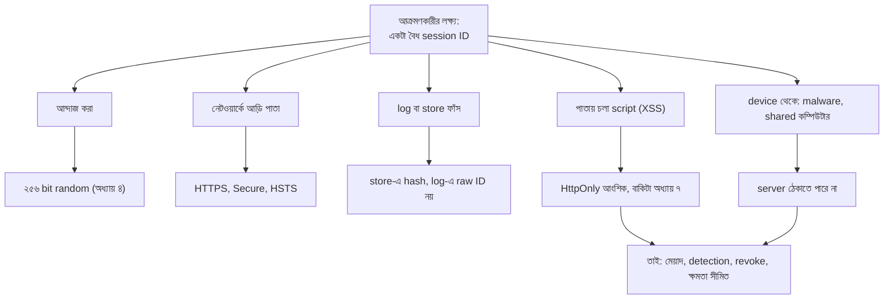
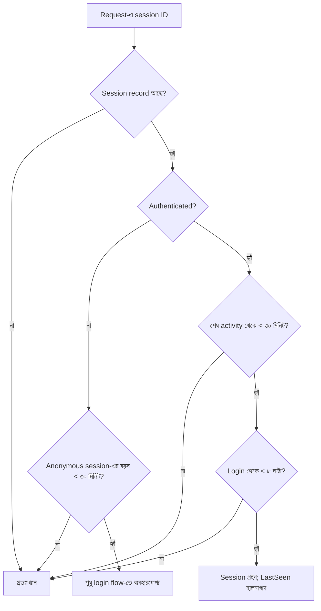
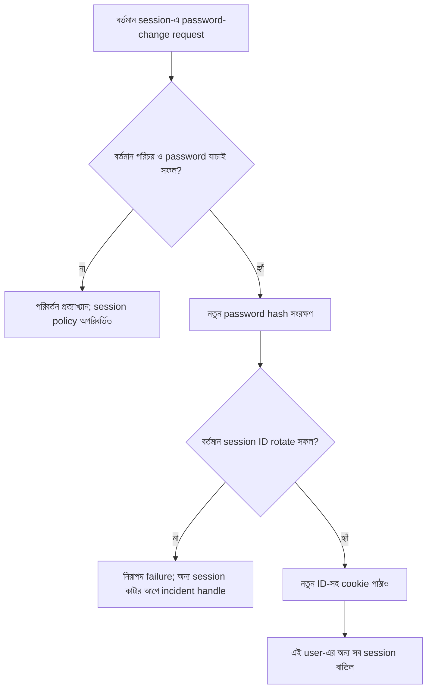
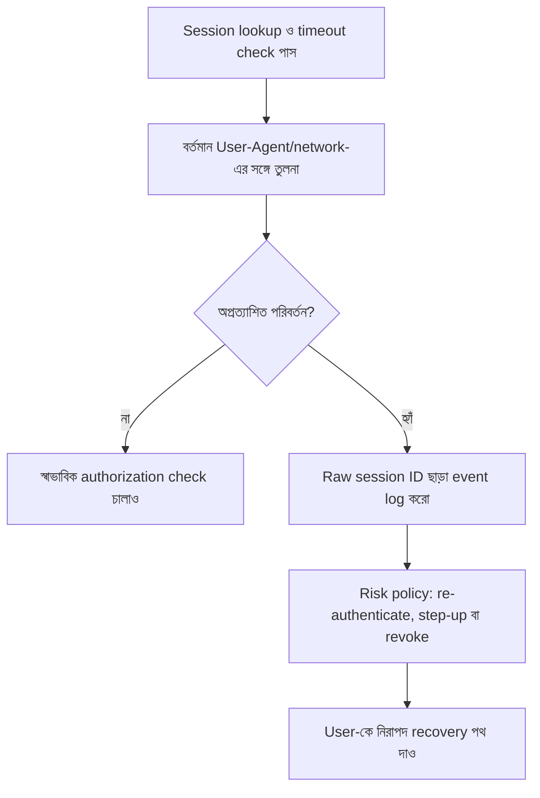
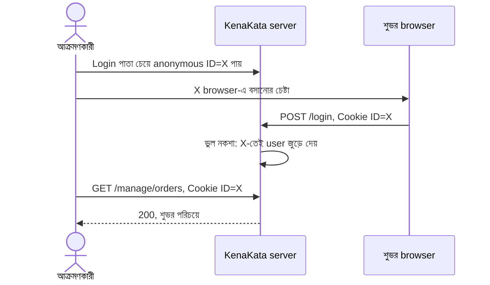
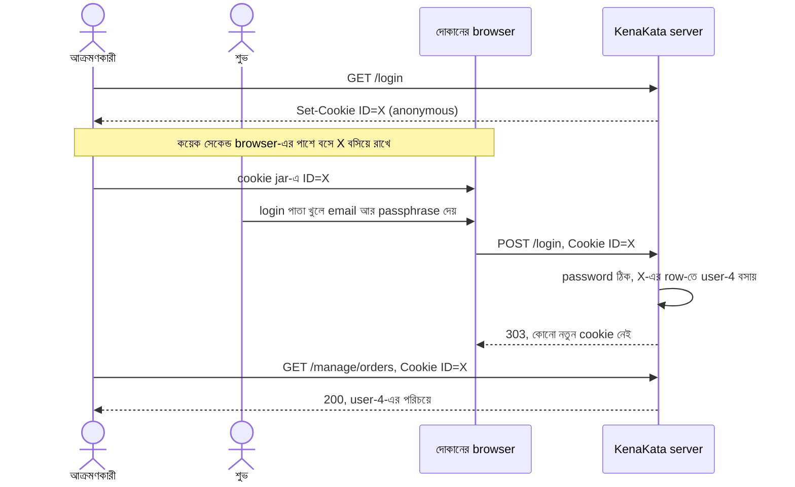
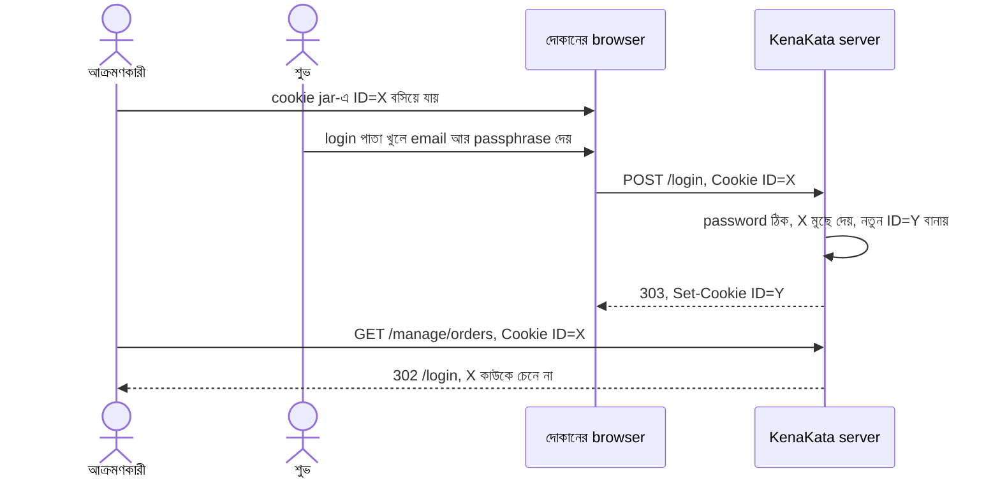
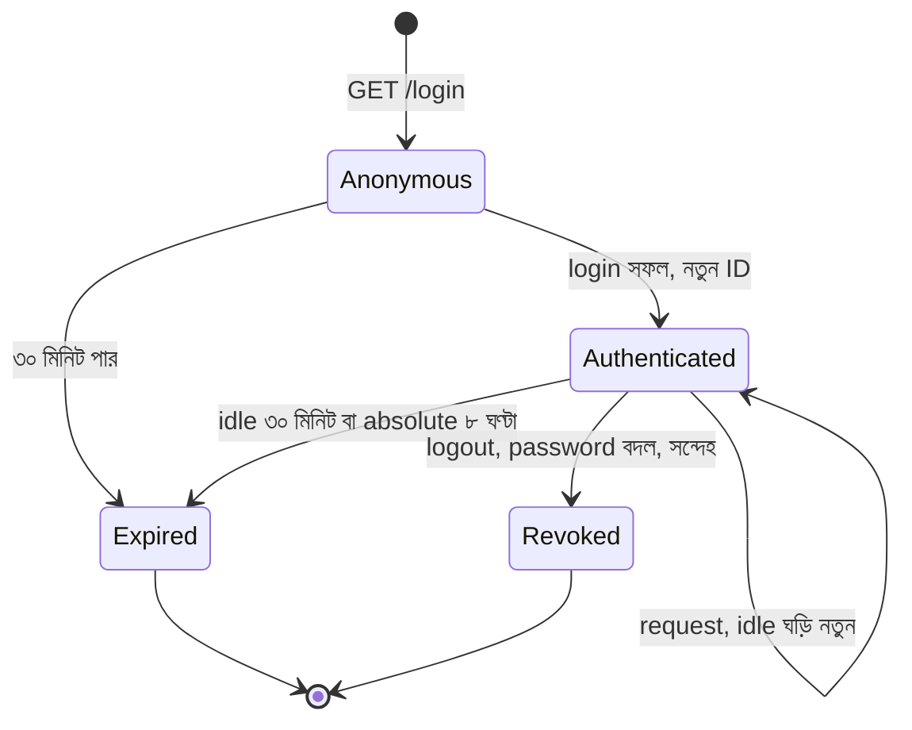

# Session Hijacking এবং Session Fixation

মঙ্গলবার দুপুর। রাফির ফোন এল, গলায় অস্বস্তি।

"ভাই, একজন ক্রেতা ফোন করে বলল, অচেনা এক নম্বর থেকে কেউ তাকে ফোন করেছে। লোকটা তার নাম জানে, ঠিকানা জানে, কোন শাড়িটা কিনেছে সেটাও জানে। আমার দোকানের বাইরে এই তথ্য কার কাছে আছে?"

আরিফের পেটের ভেতর কিছু একটা নড়ে উঠল। ক্রেতার নাম, ফোন আর ঠিকানা আছে শুধু একটা জায়গায়: `/manage/orders`।

গত সপ্তাহে অধ্যায় ৪ শেষ করে সে একটা ছোট কাজ করে রেখেছিল। OWASP-র কথা মেনে সে session-এর ঘটনা log করছিল। ID নিজে নয়, ID-র hash-এর প্রথম আট অক্ষর। তখন মনে হয়েছিল বাড়াবাড়ি। আজ সেই log-ই তার একমাত্র সাক্ষী।

---

## ১. Log যা বলল, আর যা বলল না

আরিফ `/manage/orders`-এ যাওয়া সব request ঘেঁটে একটা সারি আলাদা করল। (IP দুটো নমুনা, ডকুমেন্টেশনের জন্য আলাদা করে রাখা range থেকে। সময় UTC।)

```
09:58:41Z POST /login                        user=user-4  ip=192.0.2.10
09:58:42Z session-start                      sid=7c1e90a2 user=user-4 ip=192.0.2.10
09:58:43Z GET  /manage/orders                sid=7c1e90a2 user=user-4 ip=192.0.2.10
10:41:12Z GET  /manage/orders                sid=7c1e90a2 user=user-4 ip=192.0.2.10
   ... ৬৬ মিনিট কোনো request নেই ...
11:47:30Z GET  /manage/orders                sid=7c1e90a2 user=user-4 ip=198.51.100.7
11:47:58Z GET  /manage/orders                sid=7c1e90a2 user=user-4 ip=198.51.100.7
11:48:40Z POST /manage/orders/1042/refund    sid=7c1e90a2 user=user-4 ip=198.51.100.7
          denied: user=user-4 action=orders:refund
```

`192.0.2.10` দোকানের Wi-Fi। `user-4` শুভ, রাফির এক কর্মী। সে সকালে দোকানের shared কম্পিউটারে login করেছিল, ১০টা ৪১-এর পর আর কিছু করেনি। তারপর ৬৬ মিনিট পরে একই session ID এসেছে একটা অচেনা IP থেকে। সে অর্ডারের তালিকা দুবার পড়েছে, তারপর refund চেষ্টা করেছে। অধ্যায় ২-এর `can` তাকে `403` দিয়ে ফিরিয়েছে।

আরিফ দুটো জিনিস একসঙ্গে অনুভব করল। প্রথমত, অধ্যায় ২-এ least privilege বলে যে সীমাটা টেনেছিল, সেটা আজ কাজে লেগেছে। শুভ Owner নয়, তাই আক্রমণকারী টাকা ফেরত নিতে পারেনি। দ্বিতীয়ত, তাতে ক্রেতাদের তথ্য বাঁচেনি। অর্ডারের তালিকা পড়ার অনুমতি `user-4`-এর আছে, আর আক্রমণকারী এখন `user-4`।

এবার সৎভাবে প্রশ্ন করা যাক: এই log আসলে কী **প্রমাণ** করে?

| কথা | প্রমাণিত? |
|---|---|
| একই session ID দুটো আলাদা IP থেকে এসেছে | হ্যাঁ, log-এ আছে |
| ID-টা কেউ কপি করেছে | সম্ভাব্য, প্রমাণিত নয়। ঘরের Wi-Fi থেকে মোবাইল ডেটায় গেলেও IP বদলায় |
| শুভ কিছু অন্যায় করেছে | না। বরং ৬৬ মিনিট সে চুপ ছিল |
| ক্রেতার ফোন-কলের সঙ্গে এর যোগ আছে | নিশ্চিত নয়। সময়ের মিল একটা সূত্র, সাক্ষ্য নয় |
| ID কীভাবে বেরোল | **জানা নেই** |

শেষ সারিটা এই অধ্যায়ের সবচেয়ে অস্বস্তিকর সত্য। শুভ স্বীকার করল, গত সপ্তাহে একদিন সে বাড়ির পুরোনো laptop থেকেও ঢুকেছিল। দোকানের কম্পিউটারে সবাই সবকিছু ডাউনলোড করে। কোনোটাই প্রমাণ নয়। আরিফ হয়তো কোনোদিনই জানবে না।

এটা কোনো ব্যতিক্রম নয়, এটাই স্বাভাবিক। Cookie চুরি সাধারণত নিঃশব্দ। কেউ কিছু ভাঙে না, কোনো alarm বাজে না। শুধু একটা বৈধ-দেখতে request আসে।

এই অধ্যায়ের নকশা তাই এই স্বীকারোক্তি থেকে শুরু হয়: **সব পথ আমরা বন্ধ করতে পারব না। যেগুলো পারব না, সেগুলোর পরের ক্ষতি ছোট রাখতে হবে।**

---

## ২. নামগুলো: hijacking, আর তার সহোদর fixation

অধ্যায় ১-এর wristband মনে আছে? গেটে পরিচয়পত্র দেখিয়ে হাতে একটা নম্বর-লেখা band পরলাম। অধ্যায় ৪ বলেছিল, সেই band-এর নম্বরই session ID, আর যার হাতে নম্বরটা, server তাকেই আমি ধরে নেয়।

এই band-এর ওপর দুই রকম আক্রমণ হয়। দুটোর ফল এক: আক্রমণকারী victim-এর পরিচয়ে ঢোকে। তফাত হলো ID-টা সে কীভাবে জানল।

- **Session hijacking:** victim login করার **পরে** আক্রমণকারী তার চালু session ID চুরি করে, তারপর সেটা ব্যবহার করে। OWASP-র ভাষায় এটা বৈধ ID চুরি করে victim সেজে যাওয়া।
- **Session fixation:** আক্রমণকারী victim login করার **আগে** একটা ID জোগাড় করে (বা বানায়), আর কোনোভাবে সেটা victim-এর browser-এ বসিয়ে দেয়। Victim সেই ID-সহ login করে। তখন ID-টা authenticated হয়ে যায়, আর ID যেহেতু আক্রমণকারী আগে থেকেই জানে, সে আর চুরি করার দরকারই পড়ে না।

RFC 6265 (§8.4) fixation-কে তিন ধাপে বলে: আক্রমণকারী নিজের browser থেকে একটা ID victim-এর browser-এ বসায়, victim সেই ID নিয়ে server-এর সঙ্গে কাজ করে, তারপর আক্রমণকারী ওই ID দিয়ে server-এর সঙ্গে সরাসরি কথা বলে। আবার wristband-এ ফিরি: কেউ আগেই আপনার হাতে একটা band বেঁধে দিল আর নম্বরটা টুকে রাখল। গেটে আপনি পরিচয়পত্র দেখালেন, গেটম্যান ওই **পুরোনো band-এই** আপনার নাম লিখে দিল। এবার যে নম্বর টুকে রেখেছিল, সে-ও ভেতরে।

এই অধ্যায়ে আগে hijacking (আজকের ঘটনা), তারপর fixation (যেটা আরিফ নিজের হাতে বানাবে, না জেনে)।

> **Session ID চুরি মানে কী ক্ষতি?** OWASP-র Session Management Cheat Sheet বলে, login হয়ে গেলে session ID কিছুক্ষণের জন্য ওই অ্যাপের সবচেয়ে শক্ত authentication পদ্ধতির সমতুল্য। OWASP-র Cookie Theft Mitigation Cheat Sheet আরও সোজা: authentication process যত শক্তই হোক, cookie চুরি হলে সেটা যথেষ্ট প্রতিরক্ষা নয়। আজকের শুভর passphrase ১৫ অক্ষরের, Argon2id-তে রাখা। আক্রমণকারীর তাতে কিছু যায়-আসেনি, কারণ সে password চায়নি।

---

## 🔍 ৩. ID কোন পথে বেরোয়?

আগে ম্যাপ। প্রশ্নটা: **কোন পথ আমরা সার্ভার থেকে বন্ধ করতে পারি, আর কোনটা পারি না?**



প্রথম তিনটা পথের জন্য আমরা অধ্যায় ৪-এ বাধা বানিয়েছি। চতুর্থটা আংশিক: `HttpOnly` script-কে cookie **পড়তে** দেয় না, কিন্তু সেই script-ই browser দিয়ে request পাঠাতে পারে। সেটা অধ্যায় ৭। পঞ্চমটা, device থেকে চুরি, server-এর হাতের বাইরে। শেষ ধাপে দুটো পথই একই জায়গায় এসে ঠেকে: ঠেকাতে না পারলে ক্ষতি ছোট করো।

প্রতিটা পথের হিসাব একটু বিস্তারিত:

| পথ | কী ঠেকায় | কী ঠেকায় না |
|---|---|---|
| আন্দাজ | CSPRNG থেকে ২৫৬ bit (অধ্যায় ৪) | চুরি-যাওয়া ID |
| নেটওয়ার্কে আড়ি | TLS, `Secure`, HSTS | যার device-এই ID আছে |
| URL, `Referer`, history | ID শুধু cookie-তে, URL-এ কখনো নয় | |
| Log বা trace ফাঁস | log-এ ID-র hash, raw নয় | অন্য কোনো পথে পাওয়া ID |
| Store-এর dump | store-এ hash (অধ্যায় ৪) | store-এ লেখার ক্ষমতা |
| ভাইবোন subdomain বা HTTP পথে বসানো/বদলানো cookie | `__Host-` prefix (অধ্যায় ৪) | একই browser-এ বসা কেউ |
| পাতার script | `HttpOnly` পড়া আটকায় | script-এর পাঠানো request (অধ্যায় ৭) |
| Device-এ malware, shared কম্পিউটার | **কিছুই না** (server-এর দিক থেকে) | |

শেষ সারির দিকে তাকাও। Cookie jar কোনো browser-এর ভেতরের জিনিস। RFC 6265 ঠিক এই কারণে বলে, cookie sign বা encrypt করলেও এক user agent থেকে আরেকটায় বসানো বা পরে আবার চালানো আটকায় না। সার্ভারে আমরা এমন কিছু করতে পারি না, যা client-এর মেশিনে বসা কাউকে আটকায়।

Infostealer malware-এর মতো আক্রমণ browser-এর session data-সহ cookie চুরি করতে পারে। তখন password-এ MFA বা passkey যোগ করলেও চুরি-যাওয়া বৈধ session cookie-র অপব্যবহার নিজে থেকে বন্ধ হয় না। OWASP-র Cookie Theft Mitigation Cheat Sheet এই পার্থক্যটি স্পষ্ট করে: login শক্ত করা জরুরি, কিন্তু session cookie চুরি হলে আলাদা detection, revocation ও reauthentication দরকার।

---

## ৪. প্রশ্ন বদলাই: চুরি ঠেকানো থেকে চুরির পরের ক্ষতি

আরিফের প্রথম প্রতিক্রিয়া ছিল অধ্যায় ১-এর পুরোনো ফাঁদে: "কীভাবে বেরোল খুঁজে বন্ধ করি।" সেটা দরকারি, কিন্তু যথেষ্ট নয়। যে পথ সে খুঁজে পাবে না, তার জন্য কী?

তখন প্রশ্নটা বদলে গেল: **ID যদি চলেই যায়, তাহলে আক্রমণকারী কতক্ষণ, কতটুকু, আর কত নিঃশব্দে কাজ করতে পারবে?** এই প্রশ্নের চারটা হাতল আছে:

1. **জানালা ছোট করো:** মেয়াদ। (§৫)
2. **বন্ধ করার উপায় রাখো:** revocation। (§৬)
3. **চোখ রাখো:** detection। (§৭)
4. **ক্ষমতা সীমিত রাখো:** least privilege (অধ্যায় ২, যা আজ কাজে লেগেছে), আর সংবেদনশীল কাজে আরেক ধাপ (অধ্যায় ২২)।

আজ রাতে আরিফের প্রথম কাজ ছিল সবচেয়ে সোজাটা। `sessions.DeleteAllFor("user-4")`, মানে শুভর সব session কেটে দেওয়া। তারপর শুভকে বলা, নতুন passphrase নাও। কেন password-ও? কারণ যে malware cookie নিতে পারে, সে একই মেশিনে keystroke-ও পড়তে পারে। Cookie চুরির খবর পেলে ধরে নিতে হয়, password-ও যেতে পারে। (অধ্যায় ৩-এর সেই ক্রম: আগে পুরোনো secret অকার্যকর, তারপর নতুন।) তারপর সে অন্য সব user-এর log খুঁজে দেখল, কোনো session-এর ID দুটো আলাদা network থেকে এসেছে কি না। আর কোনোটা পাওয়া গেল না, কিন্তু "পাওয়া গেল না" মানে "ঘটেনি" নয়। সে শুধু সেই নিঃশব্দ ধরনের আক্রমণগুলোর কথা ভাবল, যেগুলোর কোনো log-ই হয় না।

এবার একে একে হাতলগুলো।

---

## ⏳ ৫. মেয়াদ: দুটো ঘড়ি, আর একটা সূক্ষ্ম ফাঁদ

অধ্যায় ৪-এ আরিফ একটাই মেয়াদ রেখেছিল: ৮ ঘণ্টা। শুভর ঘটনায় সেটাই সমস্যা। শুভ ১০টা ৪১-এর পর উঠে গিয়েছিল, কিন্তু session চলছিল সন্ধ্যা পর্যন্ত। কেউ ১১টা ৪৭-এ এসে ঢুকতে পারল, কারণ ঘড়িটা শুধু "login থেকে কতক্ষণ" গুনছিল, "শেষ কখন কাজ হলো" নয়।

দুটো আলাদা ঘড়ি দরকার:

- **Idle timeout:** শেষ request-এর পর এতক্ষণ চুপ থাকলে session শেষ। প্রতিটা request ঘড়ি নতুন করে।
- **Absolute timeout:** login-এর পর এত ঘণ্টা পেরোলে শেষ। কাজ চলুক বা না চলুক।

OWASP আরেকটা বিকল্পও বলে, **renewal timeout**: সময় পরপর session ID-ই বদলে ফেলা, মাঝপথে, user-এর অজান্তে। এতে চুরি-যাওয়া ID-র আয়ু ছোট হয়। দাম: পুরোনো আর নতুন ID কিছুক্ষণ একসঙ্গে বৈধ রাখতে হয়, আর সেই ফাঁকে একটা race আছে (আক্রমণকারী আগে নতুন ID টেনে নিলে আসল user হঠাৎ logout হয়ে যায়, যেটা নিজেই একটা সংকেত)। আমরা এটা বানাচ্ছি না, শুধু জেনে রাখছি।

### সংখ্যা কত?

এখানে কোনো বিশ্বজনীন উত্তর নেই। সোর্সগুলোই আলাদা সংখ্যা বলে, কারণ আলাদা threat model-এর জন্য লেখা:

| সোর্স | Idle | Absolute |
|---|---|---|
| OWASP (উচ্চ-মূল্যের অ্যাপ) | ২–৫ মিনিট | অ্যাপ কীভাবে ব্যবহার হয় তার ওপর |
| OWASP (কম ঝুঁকির অ্যাপ) | ১৫–৩০ মিনিট | সারাদিন ব্যবহার হলে ৪–৮ ঘণ্টা |
| NIST SP 800-63B-4, AAL2 | ১ ঘণ্টার বেশি নয় (SHOULD) | ২৪ ঘণ্টার বেশি নয় (SHOULD) |
| NIST, AAL3 | ১৫ মিনিটের বেশি নয় (SHOULD) | ১২ ঘণ্টার বেশি নয় (SHALL) |

KenaKata AAL ধরে চলে না, তবু সংখ্যাগুলো দিক দেখায়। আরিফ ভেবেছিল এভাবে: দোকানের কর্মী সারাদিন অ্যাপ ব্যবহার করে, তাই absolute ৮ ঘণ্টা থাকুক। কিন্তু অ্যাপে ক্রেতাদের নাম-ঠিকানা আছে, আর দোকানের কম্পিউটার shared। তাই idle নিচের দিকে, **৩০ মিনিট**। (এটা এই দৃশ্যের পছন্দ, চিরন্তন সংখ্যা নয়।) আরও কড়া করার বদলে সংবেদনশীল কাজে আলাদা ধাপ চাওয়া ভালো, সেটা অধ্যায় ২২।

Diagram-এ KenaKata-র তিনটি server-side ঘড়ি আলাদা রাখা হয়েছে:



Anonymous session-এর ঘড়ি session তৈরির সময় থেকে চলে। Authenticated session-এ idle আর absolute, দুটো শর্তই পাস করতে হবে। Expired record আর বৈধ নয়, এবং পরের request-এ গ্রহণ করা যাবে না.

আসল শিক্ষাটা এখন আসে। আরিফ একটা test লিখল, আক্রমণকারীর দৃষ্টিকোণ থেকে: **যদি আক্রমণকারী ২০ মিনিট পরপর একটা করে request পাঠিয়ে session জাগিয়ে রাখে?**

ধরো, আক্রমণকারী চুরি করা cookie দিয়ে প্রতি ২০ মিনিটে একটা request পাঠায়। প্রতিবার server `LastSeen` নতুন করলে idle ঘড়ি আবার শুরু হবে। সে যতক্ষণ absolute সীমার মধ্যে আছে, session সচল থাকতে পারে। Absolute timeout-এ পৌঁছালে activity থাকলেও session শেষ হবে.

এই পরিস্থিতি একটি অপ্রিয় সত্য দেখায়: **idle timeout চতুর আক্রমণকারীকে থামায় না।** OWASP-ও এটাই বলে: হাইজ্যাক করা session-এ আক্রমণকারী নিজেই activity তৈরি করে ঘড়ি নতুন করে দিতে পারে। Idle timeout কাজের সেই আক্রমণকারীর জন্য, যে দেরিতে আসে। আজকের ঘটনার আক্রমণকারী ৬৬ মিনিট দেরিতে এসেছিল, নতুন নিয়মে সে `/login`-এ ফেরত যেত। কিন্তু সে ১০টা ৪২-এ এলে? তখন idle কিছুই করত না।

আসল বাধা absolute timeout, কারণ সেটা activity দেখে না। আর একটা ছোট সূক্ষ্মতা: absolute ঘড়ি শুরু হয় **login থেকে**, session তৈরির সময় থেকে নয়। কেন, সেটা fixation-এর অংশে (§১০) বুঝবে। এটিও policy-তে স্পষ্ট থাকা দরকার।

### এই মেয়াদের দাম

- রাফি কাউন্টারে বসে প্যাকেট বাঁধছে, ৩৫ মিনিট অ্যাপ ছোঁয়নি, ফিরে এসে দেখল login পাতা। নীরার প্রথম আপত্তি এটাই আসবে। OWASP আর NIST দুজনেই বলে, মেয়াদ শেষ হওয়ার আগে user-কে সতর্ক করা যায়, আর client-এর countdown শুধু সুবিধা, নিয়ম server-এ।
- প্রতিটা request-এ `LastSeen` লেখা মানে প্রতিটা read একটা write। বড় হলে প্রতি মিনিটে একবার লেখা (throttle) করতে হয়, তবে তখন idle ঘড়ি মিনিট-খানেক ঢিলা।
- **মেয়াদ cookie-তে নয়, server-এ।** `MaxAge` আমরা এখনো দিচ্ছি না (অধ্যায় ৪)। NIST একটা সূক্ষ্ম কথা বলে: cookie-র expiry শুধু cookie জমা কমানোর জন্য, timeout প্রয়োগের জন্য ভরসা করা চলবে না।

---

## 🛑 ৬. বন্ধ করার উপায়: revocation

Session-এর সবচেয়ে বড় সুবিধা অধ্যায় ৪-এ বলেছিলাম: server একটা row কেটে দিলেই সব শেষ। এবার সেই ক্ষমতাকে আসল জায়গায় বসানোর পালা। কখন কাটব?

| ঘটনা | কী কাটব |
|---|---|
| User নিজে logout করল | এই session (অধ্যায় ৪) |
| User বলল "আমার সব device থেকে বের করো" | তার সব session |
| Password বদলাল | **বাকি** সব session। আর এই session-এর ID নতুন (§১০) |
| কর্মী ছাড়ানো হলো | তার সব session (অধ্যায় ৪-এর `DeleteAllFor`) |
| সন্দেহজনক ব্যবহার ধরা পড়ল (§৭) | ওই session |
| মেয়াদ শেষ | ওই session (§৫) |

Password বদলের সারিটা নতুন, আর ঠিক আজকের ঘটনার জন্য। ধরো শুভর password আক্রমণকারীও জানে। শুভ password বদলাল, কিন্তু আক্রমণকারীর হাতে আগের session ID। যদি সেটা না কাটি, তাহলে নতুন password-ও আক্রমণকারীকে বের করল না। OWASP-র নির্দেশও: password বদলকে privilege পরিবর্তনের মতো ধরো, session ID নতুন করো।

Password বদলানোর পর session lifecycle-এর সিদ্ধান্তটি এই flow-তে:



এই উদাহরণে password পরিবর্তন সফল হলে বর্তমান session-এর ID নতুন হয় এবং ওই user-এর অন্য session-গুলো বাতিল হয়। আসল implementation-এ password update ও session changes-এর atomicity, failure handling এবং concurrent request-এর আচরণ আলাদাভাবে নির্ধারণ করতে হবে.

(`X-Test-User` শুধু test-এ দেখার জন্য, অধ্যায় ৪-এর middleware-এর সরলীকরণ। আসল অ্যাপে এটা request context থেকে আসে।)

আরেকটা জিনিস OWASP আলাদা করে বলে: user যেন নিজের চালু session-এর তালিকা দেখতে পারে (কখন, কোন IP, কোন browser), আর দূর থেকে বন্ধ করতে পারে। এতে শুভ নিজেই দেখত, "এই ৩ নম্বর session আমার নয়।" এর দাম: তালিকা বানাতে আর দেখাতে হয়, আর IP আর User-Agent জমানো privacy-র প্রশ্নও তোলে।

---

## 🔍 ৭. চোখ রাখা: detection, আর কেন এটা তালা নয়

আজকের ঘটনায় আরিফ জানল শুধু রাফির ফোনে। কেউ সতর্ক করেনি। Log-এ সবই ছিল, কিন্তু কেউ দেখেনি।

ধারণা সহজ: session তৈরির সময় কিছু প্রসঙ্গ জমাও (কোন network, কোন browser)। প্রতিটা request-এ মিলিয়ে দেখো। বড় বদল হলে সন্দেহ। OWASP-র দুটো পাতাই এটা বলে, সঙ্গে একটা সতর্কতা, আর এখানেই সূক্ষ্মতা।

Session record-এ সাধারণত নিচের ধরনের তথ্য লাগে:

| তথ্য | উদ্দেশ্য |
|---|---|
| User ID ও authentication state | session কোন পরিচয়ের, এবং login সম্পন্ন কি না |
| শুরু ও শেষ activity-র সময় | absolute ও idle timeout |
| Login-এর সময়ের User-Agent ও network prefix | পরিবর্তনকে risk signal হিসেবে দেখা |
| Anonymous session-এর `Next` destination | login-এর পরে কোথায় ফেরত পাঠাতে হবে |

এগুলো illustrative field, কোনো নির্দিষ্ট language বা storage schema নয়. User-Agent/IP mismatch পরিচয়ের প্রমাণ নয়; এটি কেবল অতিরিক্ত যাচাইয়ের সংকেত.

আর middleware-এ:

প্রতিটি request-এ context বদলকে একমাত্র authentication decision না বানিয়ে risk signal হিসেবে ধরো:



Network বা User-Agent বদলেছে বলে session স্বয়ংক্রিয়ভাবে বাতিল করাই সবসময় সঠিক নয়. VPN, mobile network ও shared Wi-Fi false positive দিতে পারে; একই network-এর ভেতরে আক্রমণকারী আবার ধরা নাও পড়তে পারে.

কয়েকটি সম্ভাব্য ফল নিয়ে চিন্তা করো:

| পরিস্থিতি | ফল | কেন |
|---|---|---|
| চুরি-যাওয়া cookie অন্য network থেকে (`198.51.100.7`), একই User-Agent | **ধরা পড়ল**, session মরল | network মেলেনি |
| আসল user পরে একই cookie দিয়ে ফিরল | login পাতায় গেল | session তো মরেছে। এটাই ছোট একটা সংকেত তার জন্য: "কেন আবার login?" |
| আক্রমণকারী **একই /24 network**-এ (`192.0.2.200`), একই UA | **ধরা পড়ল না** | কাফে, দোকান, অফিসের Wi-Fi-তে সবাই একই network। OWASP ঠিক এই সীমার কথা বলে |
| আসল user দোকানের Wi-Fi ছেড়ে মোবাইল ডেটায় গেল | **ভুল করে ধরা পড়ল** (false positive) | network বদলেছে |


### 🧠 Incident triage: IP বদলেছে, এখন কী করবে?

শুভ সাধারণত দোকানের Wi-Fi ব্যবহার করে। আজ তার session একই browser-এর User-Agent নিয়ে নতুন IP থেকে এসেছে। একই সময়ে, শুভ বলছে সে মোবাইল ডেটা দিয়ে কাজ করছিল। কোন সিদ্ধান্তটি সবচেয়ে যুক্তিসঙ্গত?

- **A.** IP বদলালেই নিশ্চিত ধরে নাও session চুরি হয়েছে, সঙ্গে সঙ্গে সব session বাতিল করো।
- **B.** IP আর User-Agent কখনোই দেখবে না, কারণ এগুলো ভুল হতে পারে।
- **C.** এটাকে risk signal হিসেবে ধরো; অ্যাপের ঝুঁকি অনুযায়ী re-authentication বা sensitive action-এ অতিরিক্ত যাচাই চাও, আর false positive-এর প্রভাবও বিবেচনা করো।

<details>
<summary>উত্তর ও ব্যাখ্যা দেখো</summary>

**সবচেয়ে ভালো উত্তর: C।** IP বদলানো চুরির প্রমাণ নয়: mobile data, VPN, proxy বা network handoff-এ আসল user-এর IP বদলাতে পারে। আবার IP একই থাকাও নিরাপত্তার প্রমাণ নয়, কারণ আক্রমণকারী একই office/café network বা proxy ব্যবহার করতে পারে।

A-তে false positive-এর কারণে বৈধ user বারবার logout হতে পারে, আর সব session কাটলে ক্ষতির পরিধি অযথা বাড়ে। B দরকারি signal-টাই ফেলে দেয়। Risk signal-কে একমাত্র তালা না বানিয়ে, মূল্যবান কাজের সময় re-authentication এবং স্পষ্ট incident policy ব্যবহার করো।

**Edge case:** যদি অর্ডারের তালিকা পড়ার মতো কম-ঝুঁকির কাজ হয়, একটি network change হয়তো শুধু log বা alert পাওয়ার কারণ। কিন্তু refund বা payout-এর আগে অতিরিক্ত যাচাই দরকার হতে পারে।

</details>
শেষ দুটো সারি এই পুরো পদ্ধতির সীমা। OWASP-র কথা: IP, User-Agent বা client certificate-এর সঙ্গে session বাঁধা সন্দেহ ধরতে ভালো, কিন্তু নির্ভরযোগ্য প্রতিরক্ষা নয়। দক্ষ আক্রমণকারী victim-এর network (NAT, কাফের Wi-Fi) ভাগ করে নিতে পারে, একই outbound proxy ব্যবহার করতে পারে, আর User-Agent হুবহু নকল করতে পারে। উল্টো দিকে, Cookie Theft Mitigation পাতা বলে, আসল user Wi-Fi বদলালে IP বদলায়, browser আপডেট করলে User-Agent বদলায়। তাই শুধু মান মিলিয়ে হয় না, বদলটা কতটা বড়, সেটাও ভাবতে হয়।

এখানে সেই পুরোনো পাঠ ফিরে আসে, যেটা §১-এর প্রথম টেবিলেই ছিল: **সংকেত আর প্রমাণ আলাদা।** খুব সংবেদনশীল alarm বারবার ভুল বাজালে মানুষ alarm-ই উপেক্ষা করতে শেখে (cry wolf)। খুব ঢিলা alarm কিছুই ধরে না। কোন দিকে ঝুঁকবে, সেটা ব্যবসার সিদ্ধান্ত।

তাই আরিফ এই সংকেতকে তালা বানায়নি, কেবল **সুইচ**। সন্দেহ হলে সে session কেটে দেয়, কারণ KenaKata-র কর্মী প্রায়ই network বদলায় না (দোকানের Wi-Fi), আর ক্ষতি (আবার login) সামান্য। বড় user-সংখ্যার, মোবাইল-নির্ভর অ্যাপে এই নিয়ম অসহ্য হবে। OWASP-র Cookie Theft পাতার পরামর্শ: সন্দেহ হলে সবচেয়ে নির্ভরযোগ্য উপায় আবার authenticate করানো, আর সংবেদনশীল endpoint-এ কড়া নজর রাখা। CAPTCHA এখানে যথেষ্ট নয়, কারণ সেটা প্রমাণ করে না যে অনুরোধকারী আসল user। সেই ধাপ (সংবেদনশীল কাজে আবার প্রমাণ) অধ্যায় ২২-এর বিষয়।

দুটো ছোট সতর্কতা:

- **Proxy-র পেছনের IP:** `r.RemoteAddr` লোড ব্যালান্সারের IP হতে পারে। `X-Forwarded-For`-এর মতো header শুধু নিজেদের proxy থেকে এলেই বিশ্বাস্য। না হলে আক্রমণকারী নিজেই ওটা লিখে দেবে। আমাদের test সরাসরি `RemoteAddr` ধরে।
- **এই সংকেত নিজেই privacy-র বিষয়।** NIST session monitoring-কে অনুমোদন করে, কিন্তু বলে, প্রত্যাশিত বৈশিষ্ট্য জমানো আর প্রক্রিয়া করা privacy risk assessment-এর অংশ হতে হবে। IP আর User-Agent ব্যক্তিগত তথ্যের কাছাকাছি।

---

## ৮. একটা উঁকি: যদি cookie-কে device-এর সঙ্গে বাঁধা যেত

§৩-এর শেষ সারিটা মনে আছে? Device-এ বসা malware-এর বিরুদ্ধে সার্ভারের কিছু করার নেই। এই জায়গাটাই নতুন একটা প্রস্তাবের লক্ষ্য: **Device Bound Session Credentials (DBSC)**।

ধারণা (W3C WebAppSec-এর explainer আর OWASP-র বর্ণনা থেকে): session শুরুর সময় browser একটা key-pair বানায়, যার private অংশ device-এর হার্ডওয়্যারে (যেমন TPM) থাকে, বের করা যায় না। সার্ভার তখন সংক্ষিপ্ত-মেয়াদি cookie দেয়। সেটা ফুরোলে browser নতুন cookie চাইতে গিয়ে প্রমাণ দেয় যে private key এখনো তার কাছে। চুরি-যাওয়া cookie অন্য device থেকে নবায়ন করা যায় না।

কিন্তু প্রতিশ্রুতির সীমাও একই জায়গায় লেখা, আর সেটাই ভালো দিক:

- সাধারণ request-এ cookie তবু bearer হিসেবেই যায়। DBSC প্রতিটা request key-র সঙ্গে বাঁধে না, শুধু নবায়ন বাঁধে।
- চুরি-যাওয়া cookie তার **বাকি ছোট আয়ুতে** replay করা যায়।
- Device এখনো আক্রান্ত থাকলে আক্রমণকারী সেই device দিয়েই ব্যবহার চালিয়ে যেতে পারে। Explainer নিজেই একে non-goal বলে: ক্ষতিগ্রস্ত browser বা মেশিনে চলমান আক্রমণকারীর কাছে নিরাপদ হার্ডওয়্যারও সই করার যন্ত্র হয়ে যেতে পারে।

অবস্থা (লেখার সময়, যা বদলায়): Chrome-এর official announcement অনুযায়ী DBSC Windows-এর Chrome 145-এ available। Chrome Developers-এর ২০২৬ সালের মে মাসের overview এটিকে experimental feature বলেছে এবং macOS support নিয়ে কাজ চলার কথা জানিয়েছে। W3C-র DBSC Editor's Draft-ও চূড়ান্ত specification নয়। তাই অন্য browser ও platform-এ সমর্থন ধরে নেওয়া যাবে না, আর প্রকাশের আগে বর্তমান অবস্থা আবার যাচাই করতে হবে। KenaKata আজ এটা বসাচ্ছে না: এর জন্য আলাদা registration ও refresh endpoint লাগে, আর সুরক্ষা পাবে কেবল সমর্থিত browser-এর ব্যবহারকারী। তবে এটা জানা থাকলে বোঝা যায়: **"cookie চুরি অনিবার্য" কথাটা চিরন্তন সত্য নয়, বর্তমান নকশার সত্য।** DBSC থাকলেও session-এর মেয়াদের সীমা প্রয়োগ করতে হবে।

---

## ৯. নীরার নতুন দাবি, আরিফের নিরীহ সমাধান

পরের সপ্তাহ। নতুন নিয়ম, নতুন timeout, সব চালু। নীরা এল একটা সাধারণ অনুরোধ নিয়ে।

"কর্মীরা WhatsApp-এ অর্ডারের লিংক পাঠায়, তুমি জানোই। কেউ লিংকে ক্লিক করলে login পাতা আসে, login করলে সোজা অর্ডার-তালিকায় যায়। যে অর্ডারের লিংক ছিল, সেখানে যায় না। বিরক্তিকর। login-এর পর যেন ঠিক ওই পাতায় ফেরে।"

(অধ্যায় ৪-এ `SameSite=Lax`-এর আলোচনায় ঠিক এই কর্মীদের কথাই এসেছিল।)

আরিফ ভাবল, সহজ। User যেখানে যেতে চেয়েছিল, সেই path মনে রাখতে হবে। কিন্তু login-এর আগে তো কোনো session নেই, কোথায় রাখবে? সে একটা **anonymous session** বানাল: login পাতা খুললেই একটা ID, যার row-তে শুধু `Next` লেখা থাকে। Login-এর পর সেই `Next`-এ পাঠানো।

এই পর্যন্ত নিরীহ। এরপর যে সিদ্ধান্তটা সে নিল, সেটা এত স্বাভাবিক লাগে যে অনেক অভিজ্ঞ প্রকৌশলীও নেন:

"Login সফল হলে নতুন session বানানোর দরকার কী? একটা তো আগে থেকেই আছে। শুধু ওই row-তে user বসিয়ে দিই।"

আরিফের ভুল সিদ্ধান্তটা ভাষায় লিখলে এমন: login সফল হলে anonymous session-এর আগের ID-টাই রেখে শুধু তার সঙ্গে user জুড়ে দেওয়া। এতে ID-টি login-এর আগেই আক্রমণকারীর জানা থাকতে পারে, কিন্তু login-এর পরে সেটিই authenticated credential হয়ে যায়.



সাধারণ functional check-এ লিংক ধরে login করে ঠিক জায়গায় ফেরা সফল হতে পারে। কিন্তু, অধ্যায় ৩-এর পাঠ আবার: **functional test পাস করা আর নিরাপদ হওয়া এক নয়।**

### আক্রমণকারীর চেয়ার

আরিফ আবার সেই অভ্যাসে বসল। প্রশ্ন: ID-টা login-এর **আগে** কার হাতে?

উত্তর: যে-কেউ `GET /login` করলেই একটা বৈধ anonymous ID পায়। আক্রমণকারী নিজের browser থেকে একটা চেয়ে নিল, ধরো `X`।

তারপর `X`-কে শুভর browser-এ বসাতে হবে। কীভাবে? এখানে অধ্যায় ৪-এর কাজগুলো কাজে লাগে, কারণ প্রতিটা সোজা রাস্তায় একটা করে বাধা বসানো আছে:

| X বসানোর উপায় | অধ্যায় ৪-এর বাধা | এখনো খোলা? |
|---|---|---|
| URL-এ ID (`?sid=X`) বা লুকানো form field | server শুধু cookie থেকে ID নেয়, অন্য কোথাও থেকে নয় | না |
| ভাইবোন subdomain থেকে `Set-Cookie` | `__Host-` prefix, `Domain` নেই | না |
| নেটওয়ার্কের মাঝখান থেকে HTTP পথে cookie বসানো | `Secure`, `__Host-`, HSTS | না |
| আক্রমণকারী নিজের বানানো ID পাঠাল | server অচেনা ID নেয় না (strict mode, পরীক্ষা নিচে) | না |
| পাতায় চলা script বা HTTP response-এ header ঢোকানো | (XSS আর response splitting-এর প্রতিরোধ, অধ্যায় ৭) | যদি অন্য ফাঁক থাকে |
| **একই browser-এ আগে-পরে বসা** (shared কম্পিউটার) | **কিছুই না** | **হ্যাঁ** |

শেষ সারিটা আরিফের মাথা ঠান্ডা করে দিল। অধ্যায় ১-এ বলা সেই shared কম্পিউটার, যেখানে browser খোলা থাকে সারাদিন। (OWASP-র "initial login timeout" অংশ ঠিক এই পরিস্থিতি বর্ণনা করে: আগে ব্যবহৃত বা হাতে বসানো একটা session ID পরের user-এর হাতে পড়ে।) কেউ মিনিটখানেক ওই কম্পিউটারে বসে `/login` খুলল, Developer Tools-এর Application ট্যাব থেকে `__Host-id`-এর মানটা টুকে নিল (`HttpOnly` কাউকে তার **নিজের** browser-এর ভেতর দেখা থেকে আটকায় না), login পাতা খোলা রেখে উঠে গেল। কিছু ভাঙেনি, কোনো log-এ অস্বাভাবিক কিছু নেই, password লাগেনি।

(ঠিক এই কথাই বলে OWASP-র WSTG: fixation সাধারণত তখনই হয় যখন login-এর আগেই cookie-তে state রাখা হয়, যেমন login-এর আগে কার্টে জিনিস রাখা। আমরা রেখেছি "কোথায় ফিরব" লিখে।)

পরের ঘণ্টায় শুভ সেই browser-এই login পাতা পেল, ভাবল এটা তো সাধারণ, এবং login করল।



ছবিতে খেয়াল করো, কোথাও কিছু ভাঙেনি। Password ঠিক ছিল, TLS ঠিক ছিল, Argon2id ঠিকঠাক চলেছে। আক্রমণকারী password জানেই না। যে মুহূর্তে server `X`-কে "user-4-এর" বলে লিখল, সেই মুহূর্তে ID `X` একটা authenticated credential হয়ে গেল, আর `X` আক্রমণকারী আগে থেকেই জানত।

আক্রমণকারীর ভূমিকায় ঘটনাটির ধাপগুলো সাজালে:

এখানে আক্রমণকারীর জন্য নতুন কোনো secret দরকার হয় না. সে server-প্রদত্ত anonymous ID-টি আগেই জানে; victim login করার পর একই ID-কে authenticated হিসেবে গ্রহণ করাটাই fixation-এর ফাটল.

### Strict mode কেন যথেষ্ট নয়

অধ্যায় ৪-এ আমরা `Lookup`-এ লিখেছিলাম, server যে ID বানায়নি তা চেনে না। OWASP একে *strict mode* বলে (উল্টোটা permissive, যেখানে server ক্লায়েন্টের পাঠানো যেকোনো ID নিয়েই session বানিয়ে ফেলে)। আরিফ ভেবেছিল, এটাই fixation আটকায়।

আটকায়, কিন্তু শুধু একটা রূপ। আক্রমণকারী যদি নিজের বানানো `attacker-chosen-123` পাঠায়, server চেনে না, নতুন ID দেয়। আমাদের test এটা দেখিয়েছে, দুর্বল সংস্করণেও। কিন্তু আজকের আক্রমণে `X` **server-ই** বানিয়েছে, তাই strict mode-এর চোখে সেটা পুরোপুরি বৈধ। এই পার্থক্যটা পরের লোকেরা প্রায়ই মিস করে: **strict mode ID-র উৎস দেখে, ID-র ব্যবহার দেখে না।**

---

## 🛡️ ১০. সমাধান: login-এর মুহূর্তে ID বদলাও

সমাধানের মূল ধারণা একটাই: **authentication-এর ফল এমন একটা ID-তে বসবে, যা আক্রমণকারী কখনো দেখেনি।**

Login সফল হলে পুরোনো ID নষ্ট করো, একটা নতুন ID বানাও, আর authenticated অবস্থা বসাও সেটাতে। OWASP, WSTG আর NIST তিনজনই এই কথা বলে। OWASP: privilege-এর স্তর বদলালে ID নতুন করতে হবে, আর পুরোনোটা নষ্ট করতে হবে। NIST-এর ভাষায়, session secret তৈরি হবে authentication event-এর সরাসরি প্রতিক্রিয়ায়। WSTG: authenticate করার আগে বিদ্যমান ID অকার্যকর করো, সফল হলে নতুন ID দাও।

নিরাপদ rotation-এর invariant:

- Authentication সফল হওয়ার আগে authenticated session তৈরি হবে না.
- Login-এর সময় পুরোনো anonymous ID অকার্যকর হবে, নতুন cryptographically unpredictable ID তৈরি হবে.
- পুরোনো ID-র সঙ্গে user-কে জুড়ে দেওয়া হবে না; authenticated session-এর absolute timeout login-এর সময় থেকে শুরু হবে.
- Anonymous session-এর `Next` destination কেবল বৈধ, same-site/local destination হলে নতুন session-এ নেওয়া হবে.
- Rotation ব্যর্থ হলে পুরোনো ID-কে authenticated হিসেবে চালু রাখা যাবে না; failure path-এ session state নিরাপদ থাকতে হবে.

আর handler-এ `upgradeInPlace`-এর জায়গায় এটা। বাকি handler একই। নতুন cookie `Set-Cookie`-তে যায়, আর `Cache-Control: no-store` থাকে (অধ্যায় ৪)।



ছবিতে একটাই তফাত: `X` মরেছে। আক্রমণকারীর কাছে আছে একটা মৃত ID। শুভর কাছে `Y`, যা আক্রমণকারী কখনো দেখেনি।

### এই সমাধানের চারটা সূক্ষ্মতা

**এক: পুরোনো ID নষ্ট করা জরুরি।** আমাদের নকশায় পুরোনো row যেহেতু anonymous, সেটা বাঁচলেও সরাসরি ক্ষতি হতো না। তবু OWASP আর WSTG দুজনেই স্পষ্ট বলে, মুছে ফেলতে। Test-এও এটা পরীক্ষা করা আছে, আর আমি `delete` লাইনটা সরিয়ে mutation চালিয়ে দেখেছি, test ফেল করে।

**দুই: সব পুরোনো state নতুনে টানা যাবে না।** আমরা শুধু `Next` নিয়েছি, আর সেটাও `safeNext` দিয়ে যাচাই করা (বাইরের URL নয়, শুধু `/manage/`-এর নিচের path)। পুরোনো row থেকে কোন তথ্য নতুন ID-তে যাবে, সেটা নিজের সিদ্ধান্ত। যে তথ্য আক্রমণকারী প্রভাবিত করতে পারত, সেটা বিনা যাচাইয়ে টেনে আনা নতুন সমস্যা। (বাইরের URL-এ redirect-এর আসল গল্প অধ্যায় ১৮-এ।)

**তিন: absolute ঘড়ি login থেকে।** `StartedAt` রিসেট হয়। যদি না হতো, আক্রমণকারী anonymous session বানিয়ে ২৯ মিনিট ধরে রেখে victim-কে login করালে victim-এর ৮ ঘণ্টা থেকে ২৯ মিনিট কম পেত। এটাও test-এ আছে।

**চার: "login" একটাই ঘটনা নয়।** OWASP বলে, authentication-এর মুহূর্ত সবচেয়ে সাধারণ, কিন্তু যেকোনো privilege বদলের সময় ID নতুন করতে হবে: password বদল, ক্ষমতা বদল, সাধারণ user থেকে admin। KenaKata-য় আজ login-এর পথ একটাই, কিন্তু `changePassword` আগেই `Rotate` ডাকে (§৬)। পরে Google login (অধ্যায় ২১) আসবে, আর সেটাও একটা login, ওখানেও rotate। MFA শেষ হলে (অধ্যায় ২২) session-এর মান বাড়ে, ওখানেও। যেকোনো নতুন পথ যোগ করার সময় প্রশ্ন একটাই: **এখানে কি ID বদলাচ্ছে?**

OWASP একটা সম্পূরক বুদ্ধিও দেয়: login-এর আগে আর পরে আলাদা নামের cookie ব্যবহার করা, যাতে anonymous আর authenticated অবস্থা কখনো গুলিয়ে না যায়। আমরা এটা নিইনি, কারণ rotate-ই যথেষ্ট আর কম জটিল। দাম: প্রতিটা handler-কে মনে রাখতে হয় anonymous session-কে authenticated ধরা যাবে না। আমাদের middleware-এ `!rec.Authenticated()` ঠিক সেই কাজ করে।

### আর যদি রাস্তা বন্ধ করা যায়?

WSTG আরেকটা পথ বলে: cookie-র **অখণ্ডতা** নিশ্চিত করা। HTTPS-only cookie আর HSTS নেটওয়ার্কের কিছু আক্রমণ ঠেকায়। `__Secure-` prefix browser-কে `Secure` attribute চাইতে বাধ্য করে, কিন্তু cookie-তে `Domain` সেট করা নিষিদ্ধ করে না, তাই sibling subdomain-এর cookie-injection-এর সব পথ বন্ধ করে না। `__Host-` আরও শক্ত শর্ত দেয়: `Secure` থাকতে হবে, `Domain` থাকতে পারবে না, আর `Path=/` হতে হবে। আমাদের অধ্যায় ৪-এর `__Host-id` এই শর্তগুলো ব্যবহার করেছে। কিন্তু একই browser-এ বসা কেউ (shared কম্পিউটার) এই বেড়া টপকে যেতে পারে। Login-এ session ID rotate করাই fixation প্রতিরোধের মূল নিয়ম; cookie integrity অতিরিক্ত প্রতিরক্ষা। OWASP-ও বলে, ID নবায়ন HTTP বা HTTPS নির্বিশেষে fixation-এর বিরুদ্ধে সাহায্য করে, এমনকি XSS বা response splitting দিয়ে ID বসানোর পথ থাকলেও।

---

## ১১. পাশাপাশি: hijacking আর fixation

| | Hijacking | Fixation |
|---|---|---|
| ID কে বানায়? | server, victim-এর login-এর **পরে** | server, victim-এর login-এর **আগে** |
| আক্রমণকারী ID কীভাবে জানে? | চুরি করে (device, নেটওয়ার্ক, log, script) | নিজেই নেয়, তারপর victim-এর browser-এ বসায় |
| ID-র কোন অবস্থায় আক্রমণ? | authenticated | anonymous, তারপর authenticated হয় |
| মূল প্রতিরোধ | চুরির পথ বন্ধ, মেয়াদ, revoke, detection | login-এ ID নবায়ন |
| `Secure`, `HttpOnly`, TLS কাজে লাগে? | হ্যাঁ, কিছু পথে | শুধু বসানোর কিছু পথ বন্ধ করে |
| Rotate-এ কাজ হয়? | না, চুরি হয়েছে **নতুন** ID | হ্যাঁ, মূল সমাধান |
| Idle/absolute timeout? | ক্ষতির জানালা ছোট করে | সরাসরি নয়। anonymous TTL ছোট রাখলে আক্রমণের সময় কমে |

শেষ কলামে লুকানো একটা সংযোগ আছে: **Rotate hijacking ঠেকায় না, আর timeout fixation ঠেকায় না।** দুটো আলাদা রোগ, আলাদা ওষুধ। একটা করে অন্যটা হয়ে গেছে ভাবলে বিপদ।

এবার আরিফ পুরো lifecycle-টা একটা ছবিতে এঁকে রাখল। প্রশ্ন: **একটা session কোন কোন দরজা দিয়ে ঢোকে আর বেরোয়?**



`Anonymous` থেকে `Authenticated`-এর তীরে "নতুন ID" লেখা আছে। এই একটা শব্দই fixation-এর পুরো সমাধান।

---

## ১২. Threat model: session ID-র পাশে আক্রমণকারী

এখানে credential হলো session ID (অধ্যায় ৪)। প্রশ্নগুলো অধ্যায় ১-এর সেই তালিকা।

| প্রশ্ন | Hijacking (login-এর পরে চুরি) | Fixation (login-এর আগে বসানো) |
|---|---|---|
| কী control করে? | নিজের browser, চুরির পথ (device, script, পথ) | নিজের বানানো anonymous ID, আর victim-এর browser-এ তা বসানোর পথ |
| কী steal করে? | চালু authenticated ID | কিছুই না। ID সে আগেই জানে |
| কী observe করে? | log-এ ID পেলে, নেটওয়ার্কে TLS ছাড়া | নিজের ID। victim login করল কি না, সেটা সে চাইলে পরীক্ষা করে দেখতে পারে |
| কী modify করে? | নিজের cookie | victim-এর cookie jar, যদি তার সুযোগ থাকে |
| কী replay করে? | হ্যাঁ, চুরি-যাওয়া ID | হ্যাঁ, বসানো ID |
| ফাঁস হলে কী ক্ষতি? | ওই user-এর ক্ষমতা (অধ্যায় ২)। Password যায় না, তবে একই malware থাকলে যেতে পারে | একই |
| কতক্ষণ access? | idle আর absolute ঘড়ির মধ্যে, বা বাতিল পর্যন্ত | victim login করার পর থেকে একই |
| Server কি ধরতে পারে? | আংশিক: context বদল (§৭), যার false positive আর negative আছে | নিজে নিজে না। কিন্তু anonymous ID আগে থেকে জানা ছিল, এমন সংকেত server-এর কাছে নেই |
| Server কি revoke করতে পারে? | হ্যাঁ, row কেটে (§৬) | হ্যাঁ, একইভাবে |
| ক্ষতি কীভাবে সীমিত হয়? | মেয়াদ, detection, revoke, least privilege, সংবেদনশীল কাজে আরেক ধাপ | login-এ ID নবায়ন, ছোট anonymous TTL, cookie-র অখণ্ডতা |

---

## ১৩. Trade-off

- **ছোট idle মানে ঘর্ষণ।** রাফিকে ৩০ মিনিট চুপ থাকলেই আবার login। বেশি করলে ঝুঁকি, কম করলে বিরক্তি। OWASP-র নিজের সীমাটাই ২ মিনিট থেকে ৩০ মিনিটের মধ্যে ছড়ানো।
- **Write-per-read।** `LastSeen` লেখা মানে প্রতিটা request-এ store-এ লেখা। বড় হলে throttle, আর তাতে ঘড়ি ঢিলা।
- **Rotate-এর race।** একই browser থেকে একসঙ্গে অনেক request গেলে কোনটার cookie কোন ID, এটা সামলাতে হয়। আমরা login-এ আর password বদলে rotate করি, প্রতিটা request-এ নয়, তাই ঝুঁকি কম। Renewal timeout (§৫) এই race ডেকে আনে।
- **Context signal-এর false positive।** মোবাইল ব্যবহারকারী মানে ঘন ঘন network বদল। যত বেশি সন্দেহ, তত বেশি বিরক্ত user, তত বেশি alarm fatigue।
- **Privacy।** IP আর User-Agent জমানো আর তুলনা করার দায় আছে (NIST)।
- **Session তালিকা আর remote logout।** user-এর সুবিধা, কিন্তু বানানো, দেখানো আর সামলানোর খরচ আছে।
- **Anonymous session নিজেই একটা পৃষ্ঠ।** login-এর আগের প্রতিটা দর্শনের জন্য store-এ একটা row। কেউ লক্ষ লক্ষ `GET /login` পাঠিয়ে store ভরাতে পারে। Anonymous TTL ছোট রাখা আর rate limit এখানেও লাগে।
- **"আরও কড়া" মানে "আরও নিরাপদ" নয়।** যে নিয়ম মানুষের কাজ আটকায়, মানুষ সেটা এড়ায় (অধ্যায় ২)। কর্মী রাফির login ধার করলে `by=user-1` লেখা হবে, অথচ কাজ করেছে শুভ।

---

## ⚠️ ১৪. এই সমাধান কী সমাধান করে না

- **ID চুরির পথ বন্ধ করে না।** Device-এর malware, shared কম্পিউটার, ফিশিং, XSS, এগুলোর কোনোটার জন্য এই অধ্যায়ের কিছুই কাজ করে না। শুধু পরের ক্ষতি ছোট করে।
- **চতুর আক্রমণকারীকে idle timeout দিয়ে থামানো যায় না।** সে session জাগিয়ে রাখে। Absolute timeout তাকে থামায়, কিন্তু ৮ ঘণ্টা পর্যন্ত নয়।
- **একই network বা একই UA-র আক্রমণকারীকে context signal দিয়ে ধরা যায় না।** আর আসল user-কে ভুল ধরে ফেলে।
- **চলমান আক্রান্ত device।** Rotate, timeout, DBSC, কোনোটাই সেই আক্রমণকারীকে থামায় না, যে এখনো victim-এর মেশিনেই বসা।
- **Fixation-এর সব রাস্তা বন্ধ নয়।** আমরা login আর password বদলে rotate করি। কিন্তু নতুন কোনো login-পথ যোগ করে rotate ভুলে গেলে সেটাই নতুন ফাঁক। Test আছে বলেই ধরা পড়ে, test না থাকলে নয়।
- **CSRF।** Session ID চুরি আর fixation, দুটোতেই আক্রমণকারী ID **জানে**। কিন্তু একটা তৃতীয় আক্রমণে সে ID জানে না, তবু victim-এর browser দিয়ে request করিয়ে নেয়। অধ্যায় ৬।
- **XSS।** পাতায় চলা script session ID পড়তে না পারলেও (`HttpOnly`) request করাতে পারে। অধ্যায় ৭।
- **Authorization।** শুভর session দিয়ে আক্রমণকারী যা করল, সেটা শুভর ক্ষমতার ভেতরেই। সেই ক্ষমতা কতটা, সেটা অধ্যায় ২ আর ১৫।
- **Cookie-র বাইরের client।** Mobile app এলে session-cookie-র এই পুরো গল্প একটু আলাদা হবে। অধ্যায় ৮।
- **ক্রেতার ফোন-কল।** আমরা জানি না, সেটা এই ঘটনার ফল ছিল কি না।

---

## ১৫. সাধারণ ভুল ধারণা

**"Session ID চুরি হলে password-ও চুরি হয়েছে।"** না। Password আর session ID আলাদা (অধ্যায় ৪)। কিন্তু যে malware cookie নেয়, সে password-ও নিতে পারে, তাই দুটোই বদলাও।

**"Session timeout আছে, তাই hijack করা session বেশিক্ষণ চলে না।"** Idle timeout সক্রিয় আক্রমণকারীকে থামায় না। শুধু absolute থামায়।

**"Strict mode (server-এর বানানো ID-ই নেওয়া) থাকলে fixation হয় না।"** আক্রমণকারী server-এর কাছ থেকেই বৈধ ID নেয়। Strict mode শুধু নিজের বানানো ID আটকায়।

**"HTTPS আর `Secure` থাকলে fixation হয় না।"** তারা নেটওয়ার্কের বসানোর পথ বন্ধ করে। shared কম্পিউটারের পথ নয়, আর XSS-এর পথ নয়।

**"Login-এর পর শুধু session-এ user ID বসালেই হলো।"** ID যদি আগের থেকেই থাকে, সেটাই fixation। Login মানে ID বদল।

**"Cookie মুছলে session শেষ।"** অধ্যায় ৪: শুধু ওই browser-এর কপি যায়।

**"User-Agent আর IP বাঁধলে hijacking শেষ।"** OWASP-র মতেই এগুলো শনাক্তের সুবিধা, প্রতিরক্ষা নয়। নকল করা যায়, ভাগ করা যায়।

**"MFA থাকলে cookie চুরি অর্থহীন।"** MFA login-এর সময় কাজ করে। Session চালু হয়ে গেলে ID-ই সেই credential। (MFA-র আসল কাজ অধ্যায় ২২-এ।)

**"DBSC এলে cookie চুরি শেষ।"** OWASP-র ভাষায় এটা নবায়নে সীমাবদ্ধ, আর চলমান আক্রান্ত device-এ নয়। আর সব browser-এ নেই।

---

## ১৬. এক নজরে: Session ID-র জীবনচক্র

| প্রশ্ন | উত্তর |
|---|---|
| এটা কী? | Login-এর পর server-এর দেওয়া গোপন ID, যা authenticated অবস্থার চাবি (অধ্যায় ৪)। এই অধ্যায়ে তার জন্ম, মেয়াদ আর মৃত্যুর নিয়ম |
| কেন এসেছে? | ID নিজেই credential, তাই কখন বানাব, কতদিন বাঁচবে, কখন মারব, সেটাই নিরাপত্তা |
| কী সমাধান করে? | Login-এর আগে বসানো ID দিয়ে দখল (rotate), চুরি-যাওয়া ID-র আয়ু (idle, absolute), চুরির পর বন্ধ করা (revoke), অস্বাভাবিক ব্যবহারের সংকেত |
| কী সমাধান করে না? | চুরির পথ নিজে, সক্রিয় আক্রমণকারী (idle দিয়ে), একই network-এর আক্রমণকারী (signal দিয়ে), আক্রান্ত device, CSRF, XSS (§১৪) |
| কোথায় থাকে? | Cookie jar-এ আসল ID। Server-এ hash আর record (user, শুরু, শেষ activity, UA, network) |
| কে ব্যবহার করে? | Browser পাঠায়, server খোঁজে আর মেয়াদ প্রয়োগ করে |
| কীভাবে abuse হয়? | Hijacking: চুরি। Fixation: login-এর আগে বসানো। শেষ ভরসা: পরিচয়ের বদলে ID-র ওপর আস্থা |
| চুরি হলে ক্ষতি? | ওই user-এর ক্ষমতা, মেয়াদ বা বাতিল পর্যন্ত (অধ্যায় ২)। শুভর ঘটনায়: অর্ডার-তালিকা দেখা, refund `403` |
| মেয়াদ কত? | Anonymous ৩০ মিনিট, idle ৩০ মিনিট, absolute ৮ ঘণ্টা (এই দৃশ্যের পছন্দ)। OWASP: idle ২–৩০ মিনিট, absolute অ্যাপ অনুযায়ী। NIST AAL2: ২৪ ঘণ্টা আর ১ ঘণ্টা |
| বাতিল হয় কীভাবে? | Row মুছে: logout, সব device, password বদলে বাকি সব, ছাড়ানো, সন্দেহ, মেয়াদ |
| বিকল্প? | Renewal timeout (§৫), pre/post-login আলাদা cookie, DBSC (§৮), সই-করা cookie (অধ্যায় ৪-এর ব্যর্থতা), token (অধ্যায় ৮) |
| কখন লাগে? | Cookie-ভিত্তিক session থাকলে, মানে সবসময় এই অধ্যায়ের নিয়ম |
| কখন লাগে না? | Session-ই নেই এমন নকশায় (যেমন সম্পূর্ণ stateless token), যেখানে এই প্রশ্নগুলো অন্য চেহারায় ফেরে (অধ্যায় ৮ থেকে) |
| Production trade-off? | ঘর্ষণ, write-per-read, false positive, privacy, anonymous session-এর পৃষ্ঠ (§১৩) |

---

## আমরা কী শিখলাম? (What did we learn?)

- Session ID চুরি আর fixation দুই আলাদা রোগ: একটায় ID **পরে চুরি**, অন্যটায় ID **আগে থেকে জানা**। প্রতিরোধও আলাদা।
- সব চুরির পথ আমরা বন্ধ করতে পারি না, বিশেষ করে client-এর device-এ। তাই ক্ষতির জানালা ছোট রাখা আর বন্ধ করার ক্ষমতা সমান জরুরি।
- Idle timeout দেরিতে আসা আক্রমণকারীকে থামায়, সক্রিয়কে নয়। Absolute timeout সক্রিয়কেও থামায়। দুটো লাগে।
- Absolute ঘড়ি শুরু হয় login থেকে, session তৈরি থেকে নয়।
- Context signal (IP, User-Agent) একটা সংকেত, তালা নয়। এতে false positive আছে, false negative আছে, privacy-র দামও আছে।
- Login-এর মুহূর্তে ID বদলানোই fixation-এর আসল সমাধান, কারণ এটা পৌঁছানোর পথ যা-ই হোক কাজ করে। Strict mode আর cookie-র অখণ্ডতা সাহায্য করে, তবে একা যথেষ্ট নয়।
- Password বদলের পর বাকি সব session কাটো। নইলে নতুন password আক্রমণকারীকে বের করে না।
- ID চুরির কারণ জানা না গেলেও আমরা ক্ষতি সীমিত রাখতে পারি। এটাই আসল নকশা: সবকিছু জেনে নিরাপদ করা নয়, না জেনেও টিকে থাকা।
- DBSC একটা আশাব্যঞ্জক দিক, কিন্তু সীমিত আর বদলাচ্ছে। এটাও bearer সমস্যার জাদুকাঠি নয়।

## 🎯 নিজের বোঝাপড়া যাচাই

Login-এর আগে browser-এ session ID `X` ছিল। Login সফল হওয়ার পর server `Set-Cookie` দিয়ে নতুন ID `Y` পাঠাল। এরপর পুরোনো `X` দিয়ে protected endpoint-এ request করলে server `302 /login` দিল। কোন নিরাপত্তা-গুণটি এই পরীক্ষায় যাচাই হচ্ছে?

<details>
<summary>উত্তর ও ব্যাখ্যা দেখো</summary>

**Session fixation প্রতিরোধ।** Login-এর সময় ID rotate হয়েছে, আর পুরোনো ID authenticated session হিসেবে আর গ্রহণ করা হচ্ছে না। শুধু নতুন cookie পাঠানো যথেষ্ট নয়, পুরোনো ID-টিকেও অকার্যকর করতে হবে। এই conceptual check fixation-এর একটি গুরুত্বপূর্ণ পথ পরীক্ষা করে; এটি একা পুরো application-এর সব session security প্রমাণ করে না।

</details>

---

## 🧪 পাঁচ মিনিটের পরীক্ষা

নিজের কোনো project-এর **staging**-এ (production-এ নয়):

**এক: fixation।** দুটো `curl` jar দিয়ে:

### Conceptual verification: fixation

1. আক্রমণকারী login পাতা থেকে anonymous ID `X` পায়.
2. Victim-এর browser-এ `X` বসানো সম্ভব হয় কি না, তা threat model অনুযায়ী বিবেচনা করো.
3. Victim `X` নিয়ে login করে.
4. Victim-এর login response-এ নতুন ID `Y` আসে এবং server-side `X` অকার্যকর করে.
5. আক্রমণকারী `X` দিয়ে protected resource চাইলে request প্রত্যাখ্যাত হয়; `Y`-ই একমাত্র authenticated session.

এটি ধারণাগত পরীক্ষা, executable test নয়. বাস্তব application-এ test করার সময় অনুমোদিত staging environment ব্যবহার করতে হবে.

তৃতীয় ধাপে `200` এলে fixation আছে। দ্বিতীয় ধাপের response-এ `Set-Cookie` নেই মানেও সন্দেহজনক। (এই কৌশল WSTG-SESS-03-এর "forced cookies" পরীক্ষার ছোট রূপ।)

**দুই: idle আর absolute।** Staging-এ idle ১ মিনিট আর absolute ৫ মিনিট করে একটা loop-এ প্রতি ৩০ সেকেন্ডে request পাঠাও। ৫ মিনিটে কি session কাটে, নাকি চলতেই থাকে?

**তিন: password বদল।** দুটো browser-এ একই user দিয়ে login করো। একটায় password বদলাও। অন্যটার কী হলো?

**চার: log।** Application log-এ session ID-র raw মান কোথাও আছে কি না, `grep` করে দেখো। আর কোনো log কি একই session-কে দুটো IP থেকে আসতে দেখাচ্ছে?

## একটা অস্বস্তিকর প্রশ্ন (One uncomfortable question)

আরিফ আজ দুটো আক্রমণ ঠেকাল। দুটোতেই আক্রমণকারী session ID **জানত**: একটায় চুরি করে, অন্যটায় আগে থেকে বসিয়ে।

এবার ধরো একটা তৃতীয় দিন। শুভ নিজের browser-এ login করে আছে, ID কেউ চুরি করেনি, কেউ আগে থেকে বসায়নি। শুভ কাজের ফাঁকে একটা অন্য সাইট খুলল, কোনো সাধারণ খবরের বা মজার ছবির পাতা। সেই পাতার ভেতরে লুকানো আছে একটা ছোট form, যা `kenakata.example/manage/orders/1042/refund`-এ একটা `POST` পাঠাতে চায়।

Browser তো cookie নিজে জুড়ে দেয়। আক্রমণকারী ID **জানে না**, জানার দরকারও নেই।

**যে আক্রমণকারী আমাদের session ID কখনো দেখেনি, সে কি তবু শুভর browser দিয়ে শুভর নামে request পাঠাতে পারে? আর সেই request-টা server কীভাবে বুঝবে, শুভ নিজে করেনি?**

---

## পরের অধ্যায়

[অধ্যায় ৬: CSRF](../06-csrf/README.md)। এখানে আক্রমণকারীর ID-র দরকারই নেই। Browser নিজেই ambient authority হয়ে যায়। আমরা `SameSite`-এর সীমা দেখব, CSRF token বানাব, আর বুঝব `Origin` আর `Referer` কী বলে, কী বলে না।

---

## তথ্যসূত্র

যাচাইয়ের অবস্থা সৎভাবে লেখা: কোনটা পুরো পাতা পড়ে, কোনটা শুধু search snippet দেখে।

- [OWASP Session Management Cheat Sheet](https://cheatsheetseries.owasp.org/cheatsheets/Session_Management_Cheat_Sheet.html): **পুরো পাতা পড়া।** hijacking আর fixation-এর সংজ্ঞা, strict বনাম permissive mode, privilege বদলে ID নবায়ন (login, password বদল, role বদল), pre/post-login আলাদা cookie, idle আর absolute আর renewal timeout (সংখ্যাসহ), idle timeout সক্রিয় আক্রমণকারীকে থামায় না, ID-র সঙ্গে IP/User-Agent বাঁধার সীমা, session lifecycle log (salted hash), একই সময়ে একাধিক session আর remote logout, reauthentication after risk events, initial login timeout, cookie অখণ্ডতা (`__Host-`, `Domain`)।
- [OWASP Cookie Theft Mitigation Cheat Sheet](https://cheatsheetseries.owasp.org/cheatsheets/Cookie_Theft_Mitigation_Cheat_Sheet.html): **পুরো পাতা পড়া।** cookie চুরি = authentication-এর সমতুল্য ক্ষতি, চুরির পথ (malware, phishing, application vulnerability), context-সংকেত, false positive আর negative, পুনরায় authenticate করা সবচেয়ে নির্ভরযোগ্য, CAPTCHA যথেষ্ট নয়, DBSC-র সীমা। (এই পাতা repository-র `references/owasp.md`-তে এখনো নেই।)
- [OWASP WSTG-SESS-03: Testing for Session Fixation](https://wstg.owasp.org/latest/4-Web_Application_Security_Testing/06-Session_Management/03-Session_Fixation): **পুরো পাতা পড়া।** fixation লগইনের আগে cookie-তে state রাখলে ঘটে, cookie নবায়ন আর অখণ্ডতা (HSTS, `__Host-`/`__Secure-`), forced-cookie পরীক্ষা, remediation।
- [RFC 6265](https://www.rfc-editor.org/rfc/rfc6265): **§৮ পড়া।** §৮.৪-এ fixation-এর তিন ধাপ, §৮.৩-এ signed/encrypted cookie-ও transplant আর replay থেকে বাঁচে না।
- [NIST SP 800-63B-4: Session Management](https://pages.nist.gov/800-63-4/sp800-63b/session/) আর [AAL পাতা](https://pages.nist.gov/800-63-4/sp800-63b/aal/): **দুটো পাতাই পুরো পড়া।** session secret তৈরি হয় authentication event-এর প্রতিক্রিয়ায়, cookie-র নিয়ম, timeout শেষ হলে session শেষ, session monitoring আর তার privacy, DBSC-র উল্লেখ, AAL1–3-এর timeout-সংখ্যা।
- [W3C DBSC explainer](https://github.com/w3c/webappsec-dbsc/blob/main/README.md): **পড়া।** লক্ষ্য, non-goal, refresh প্রক্রিয়া। Spec উন্নয়নাধীন।
- [Chrome Developers: DBSC now available on Windows](https://developer.chrome.com/blog/dbsc-windows-announcement) এবং [Chrome Developers overview](https://developer.chrome.com/blog/io26-web-identity), সঙ্গে [W3C DBSC Editor's Draft](https://w3c.github.io/webappsec-dbsc/): **প্রাথমিক browser/specification উৎস পড়া।** Chrome-এর Windows availability-র ঘোষণা ও experimental status আলাদা করে উল্লেখ করা হয়েছে; অন্য browser/platform-এর support নিশ্চিত বলে দাবি করা হয়নি। DBSC-র অবস্থা দ্রুত বদলায়, প্রকাশের আগে আবার যাচাই করো।
- আগের সংস্করণে Go implementation ও automated test ছিল; সেগুলো এই diagram-first সংস্করণের অংশ নয়। এখানে কোনো application code compile বা test করা হয়নি. বাস্তব implementation audit আলাদা কাজ۔

## লেখার অবস্থা

- [x] Draft
- [ ] Technical Review
- [ ] Security Review
- [ ] Published