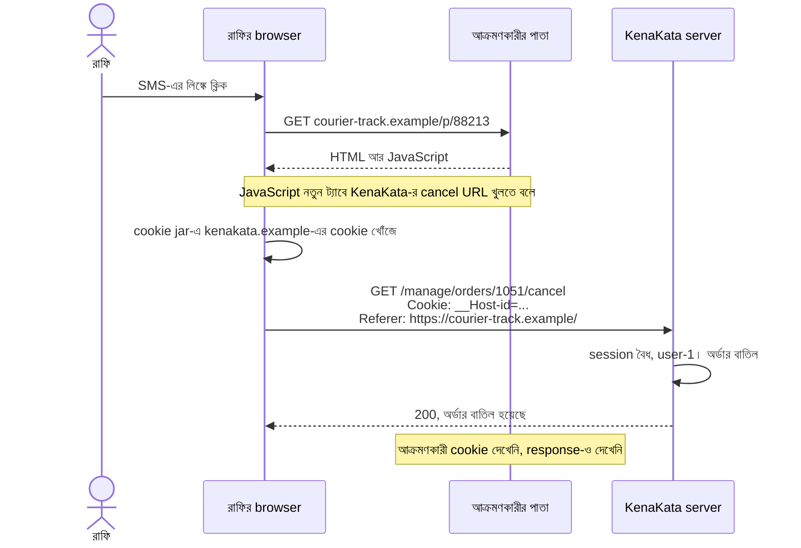
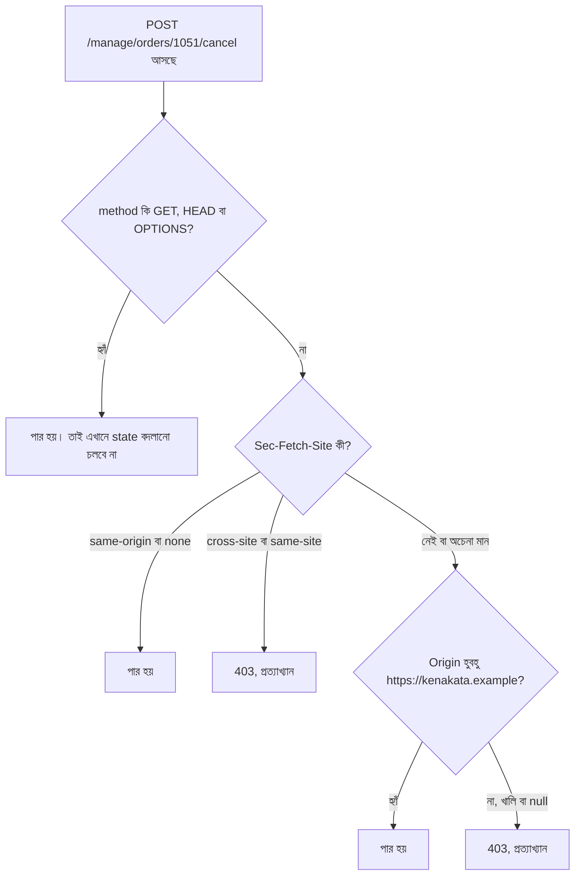
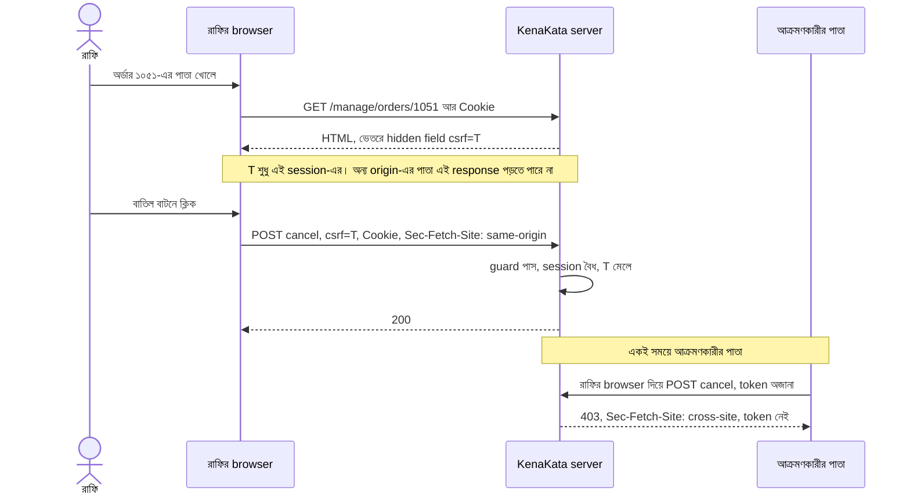
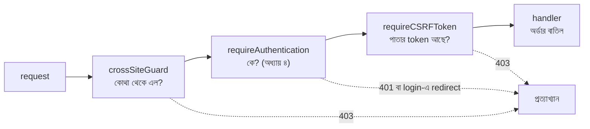

# CSRF

অধ্যায় ৫ একটা প্রশ্নে শেষ হয়েছিল, আর আরিফ প্রশ্ন ঝুলিয়ে রাখার মানুষ নয়।

*যে আক্রমণকারী আমাদের session ID কখনো দেখেনি, সে কি তবু শুভর browser দিয়ে শুভর নামে request পাঠাতে পারে?*

পরদিন সকালে সে staging-এ রাফির (`user-1`, Owner) নামে login করল। নিজের laptop-এ একটা test পাতা বানাল, যার ভেতরে লুকোনো একটা form, `action` সোজা staging-এর `POST /manage/orders/1042/refund`, আর একটা এক লাইনের JavaScript যা পাতা খুললেই form-টা submit করে দেয়। তারপর অন্য একটা ট্যাবে সেই test পাতা খুলল।

Server-এর log-এ request এল। কিন্তু cookie ছাড়া।

```text
POST /manage/orders/1042/refund   cookie নেই   401
```

আরিফ একটু অবাক হয়ে বসে রইল। তারপর হাসল। অধ্যায় ৪-এ সে `SameSite=Lax` লিখেছিল "যেহেতু সবাই লেখে" গোছের মনোভাবে। আজ ওই একটা শব্দ শুভকে, আর রাফিকে, বাঁচাল। Lax-এর নিয়মে অন্য site থেকে আসা `POST`-এ browser cookie পাঠায় না।

"তাহলে CSRF-এর ভয় কেটে গেল," আরিফ নিজেকে বলল। অধ্যায় ৪-এর সতর্কবাণীটা সে মনে করতে চাইল না।

কয়েকদিন পরের এক সকাল সাড়ে নয়টা। আরিফের ফোনে নীরার নাম।

"মিতু নামের এক ক্রেতা রাফিকে ফোন করে রেগে গেছে," নীরা বলল। "তার পাইকারি অর্ডারটা, ১০৫১, নাকি বাতিল হয়ে গেছে। রাফি বলছে সে বাতিল করেনি।"

আরিফ অর্ডারের তালিকা খুলল। ১০৫১-এর পাশে লেখা: *বাতিল*। কে করল? অধ্যায় ৫-এর পর সে জানে প্রথম প্রশ্নটা কী: **session চুরি হয়েছে?** সে log খুলল।

```text
11:42:09Z GET  /manage/orders/1051/cancel   sid=3fa9c2b1 user=user-1 ip=192.0.2.21
          (reverse proxy-র access log থেকে মিলিয়ে) referer=https://courier-track.example/
```

(IP নমুনা, ডকুমেন্টেশনের জন্য আলাদা করা range থেকে। সময় UTC, অধ্যায় ৫-এর মতোই। `sid` ID-র hash-এর প্রথম আট অক্ষর।)

প্রতিটা সংকেত আরিফ মিলিয়ে দেখল। IP রাফির দোকানের Wi-Fi-র একই `/24`। User-Agent রাফির browser-এর। অধ্যায় ৫-এ যে context signal বানিয়েছিল, `Suspicious()`, সেটা একটা শব্দও করেনি। রাফি সকাল থেকে কাজ করছিল, শেষ request তিন মিনিট আগের, তাই ৩০ মিনিটের idle ঘড়িও ঠিক ছিল, ৮ ঘণ্টার absolute ঘড়িও। Session সম্পূর্ণ বৈধ। কেউ cookie চুরি করেনি। রাফির password Argon2id-র পেছনে।

শুধু একটা জিনিস খাপ খাচ্ছে না। `referer`। `courier-track.example` KenaKata-র কোনো পাতা নয়।

আরিফ রাফিকে ফোন করল। "কাল বিকেলে কোনো লিঙ্কে ক্লিক করেছিলেন?"

"SMS এসেছিল, পার্সেল ট্র্যাকিংয়ের," রাফি বলল। "ক্লিক করতেই একটা নতুন ট্যাব ঝট করে খুলল, কী যেন লেখা এল, বন্ধ করে দিলাম। ভাবলাম আজেবাজে।"

আরিফ চুপ করে গেল। গত সপ্তাহের কাজটা তার মনে পড়ছিল। নীরা চেয়েছিল, নতুন অর্ডারের ইমেইলে একটা "বাতিল করুন" লিঙ্ক থাকুক, যাতে রাফি ফোন থেকে এক ক্লিকে বাতিল করতে পারে। আরিফ বানিয়েছিল:

```go
// গত সপ্তাহে আরিফের লেখা। কাজ করে, নীরা খুশি।
mux.Handle("GET /manage/orders/{id}/cancel",
	requireAuthentication(http.HandlerFunc(cancelOrder)))
```

এই কোডে কোনো ভুল নেই, অন্তত যে ভুল আমরা এতদিন খুঁজেছি। অধ্যায় ৪-এর `requireAuthentication` ঠিকঠাক কাজ করেছে। session বৈধ ছিল। `user-1` সত্যিই অর্ডার বাতিল করতে পারে, অর্থাৎ অধ্যায় ২-এর authorization-ও আপত্তি তোলেনি। অধ্যায় ৫-এর সব নতুন যন্ত্র (মেয়াদ, rotate, context signal) নিজের কাজ ঠিকঠাক করেছে।

আর যে প্রশ্নটা অধ্যায় ৪ থেকে ঝুলছিল, আর অধ্যায় ৫-এর শেষে আরও তীক্ষ্ণ হলো, সেটা এখন ঘরের ভেতরে বসে আছে। server-এর চোখে দুটো request হুবহু এক: একটা রাফি নিজে করেছে, আরেকটা রাফির browser-কে দিয়ে অন্য কেউ করিয়েছে। **তফাতটা server কীভাবে ধরবে?**

---

## ১. ঘটনাটা ছবিতে

আক্রমণকারী যদি cookie না জানে, তাহলে request-এ cookie গেল কীভাবে? ছবিতে দেখো কে কী করল, আর কে কী কখনো দেখল না।



ছবির তিনটা জিনিস মনে রাখার মতো।

**এক,** আক্রমণকারী cookie চুরি করেনি। দেখেওনি। `HttpOnly` থাকলেও এই ঘটনা ঘটত, কারণ cookie পড়ার দরকারই পড়েনি। request-এ cookie জুড়েছে **browser** নিজে।

**দুই,** request এসেছে রাফির browser থেকে, রাফির network থেকে, রাফির session নিয়ে। অধ্যায় ৫-এর context signal (network, User-Agent) এখানে অন্ধ, কারণ বদলানোর মতো কিছু বদলায়নি। "অন্য জায়গা থেকে এসেছে" ধরনের কোনো সংকেত নেই। শুধু `referer` একটা ক্ষীণ ছাপ রেখে গেছে।

**তিন,** আক্রমণকারী response-ও দেখেনি। এই হামলা অন্ধ। সে কেবল একটা কাজ করিয়ে নিয়েছে।

এই আক্রমণের নাম **CSRF** (Cross-Site Request Forgery)। OWASP-র ভাষ্য অনুযায়ী: ক্ষতিকর কোনো সাইট, ইমেইল বা প্রোগ্রাম authenticated user-এর browser দিয়ে বিশ্বস্ত সাইটে একটা অনাকাঙ্ক্ষিত কাজ করিয়ে নেয়, আর সাইট আসল আর জাল request আলাদা করতে পারে না।

অধ্যায় ১-এর wristband-এ ফিরি। session ID রাফির কবজিতে বাঁধা। আক্রমণকারী সেটা খোলেনি। সে রাফির **হাতকে** বলেছে, "ওই দরজায় টোকা দাও।" হাত টোকা দিয়েছে, আর কবজির wristband দেখিয়ে দিয়েছে। দরজার পাহারাদার (`requireAuthentication`) wristband দেখল, নম্বর মিলল, দরজা খুলে দিল। সে একটা প্রশ্নই করে: *এই wristband কার?* সে কখনো জিজ্ঞেস করে না: *এই টোকাটা কি রাফি নিজে দিতে চেয়েছিল?*

Authentication বলে *কে*। CSRF-এর পুরো গল্প *ইচ্ছা* নিয়ে।

---

## ২. Browser কেন পাঠাল?

অধ্যায় ৪-এর §৭-এ আমরা একটা flowchart এঁকেছিলাম: browser কখন cookie পাঠায়। ছবিটা আবার মনে করো। প্রশ্নগুলো ছিল: host মেলে? path মেলে? `Secure` আর সংযোগ মেলে? আর শেষে `SameSite`। একটা প্রশ্ন কোথাও ছিল না: **এই request কে শুরু করেছে, রাফি নিজে, না অন্য কোনো পাতা?** (`SameSite` একটা মোটা রেখা টানে, অন্য *site* থেকে এসেছে কি না। তার বেশি কিছু নয়।)

কারণ cookie jar বাঁধা থাকে **গন্তব্যের** সঙ্গে (`kenakata.example`), **উদ্যোক্তার** সঙ্গে নয়। অধ্যায় ৪-এ এই বৈশিষ্ট্যের নাম বলেছিলাম **ambient authority**: কে request শুরু করল, সেটা না দেখেই browser authority জুড়ে দেয়। OWASP একই কথা বলে: browser-এর প্রতিটা request-এ cookie আপনা-আপনি যায়, তাই সাইট যদি requester-এর পরিচয় আর ক্ষমতা শুধু cookie দিয়ে যাচাই করে, এই আক্রমণ চলে।

"কিন্তু same-origin policy?" প্রশ্নটা আসবেই। SOP আর CORS মূলত অন্য origin-এর **response পড়া** আটকায়। আক্রমণকারীর response পড়ার দরকারই নেই। আর MDN-এর বিবরণ অনুযায়ী `<form>` submit-এর মতো "simple request" cross-origin পাঠানো যায়, কারণ web-এর শুরু থেকে form তা পারত, আর compatibility-র কারণে সেটা ভাঙা হয়নি।

MDN CSRF সম্ভব হওয়ার তিনটা শর্ত দেয়। তিনটাই লাগে। একটা ভাঙলেই হামলা ব্যর্থ। এই তিন শর্তই এই অধ্যায়ের মানচিত্র:

| # | শর্ত | KenaKata-র আজকের অবস্থা | কোন প্রতিরক্ষা এটা ভাঙে |
| - | ---- | ----------------------- | ----------------------- |
| ১ | HTTP request দিয়ে server-এ state বদলায় | হ্যাঁ, অর্ডার বাতিল | নিরাপদ method-এ state বদলানো বন্ধ (§৪.১) |
| ২ | request কার, তা যাচাই হয় শুধু cookie দিয়ে | হ্যাঁ, `__Host-id` | request-এর উৎস যাচাই (§৪.২), আর cookie ছাড়া আরেকটা প্রমাণ (§৪.৩) |
| ৩ | request-এর parameter আক্রমণকারী অনুমান করতে পারে | হ্যাঁ, URL-ই `/manage/orders/1051/cancel` | অনুমান-অযোগ্য token (§৪.৩) |

`SameSite` শর্ত ২-কে আংশিক ভাঙে: কিছু ক্ষেত্রে cookie-ই পাঠাতে দেয় না।

---

## ৩. আরিফের প্রথম ফিক্স, আর তার ফাটল

আরিফের প্রথম চালটা সবচেয়ে স্বাভাবিক: GET বদলে POST।

নীরা আপত্তি করল। "ইমেইলের ভেতর তো POST বাটন বসানো যায় না।" আরিফের সমাধান: ইমেইলের লিঙ্ক GET-ই থাকুক, কিন্তু সেটা শুধু অর্ডারের পাতা খুলুক, যেখানে "বাতিল করুন" একটা POST বাটন। এক ক্লিকের বদলে দুই ক্লিক। নীরা গজগজ করল, তারপর রাজি হলো।

(এই "দুই ক্লিক" নিজে CSRF-এর প্রতিরক্ষা নয়। কাজ করছে দ্বিতীয় ধাপের POST-টা, যেটা নিচে ধাপে ধাপে সুরক্ষিত হবে। শুধু ধাপ বাড়ালে আক্রমণকারী ধাপগুলোও পাঠাতে পারে।)

অধ্যায়ের শুরুতে আমরা দেখেছি, `POST` form-এর হামলা `SameSite=Lax` আটকেছে, `POST` নিজে নয়।

তারপর ক্ষতি হওয়ার পর আরিফ অধ্যায় ৪-এর সতর্কবাণীটা সত্যিই পড়ল: `SameSite` CSRF-এর শক্ত সমাধান নয়, বড়জোর defense in depth। সে আবার আক্রমণকারীর চেয়ারে বসল। প্রশ্ন: **Lax-কে ফাঁকি দেওয়ার পথ কয়টা?**

| হামলার ধরন | `Lax` cookie যায়? | কেন |
| ---------- | ------------------ | --- |
| অন্য সাইটের auto-submit `POST` form | না | Lax: cross-site `POST`-এ cookie যায় না |
| অন্য সাইট থেকে top-level navigation, method `GET` | **হ্যাঁ** | Lax: top-level navigation আর safe method, দুটোই মিলেছে। **আজকের ঘটনা** |
| অন্য সাইটের ``, `<iframe>` (subresource, nested) | না | top-level navigation নয় |
| **সহোদর subdomain** থেকে যে কোনো request, `POST`-ও | **হ্যাঁ** | সেটা same-site। `SameSite`-এর চোখে "cross" নয় |
| `GET` পাঠানো হলো, কিন্তু framework-এর *method override* সেটাকে `POST` বানিয়ে নেয় | **হ্যাঁ** | top-level `GET` হিসেবে cookie যায়, framework ভাবে `POST` |
| `SameSite` না বোঝা বা না মানা client (পুরোনো বা embedded browser) | ধরে নাও হ্যাঁ | OWASP: এমন client-এ cookie যেন `SameSite` ছাড়াই আচরণ করে |

দ্বিতীয় সারির দিকে তাকাও। অধ্যায় ৪ §৭-এ আমরা `Lax` বেছেছিলাম যেন রাফির কর্মীরা WhatsApp-এর লিঙ্ক ধরে এসে login পাতায় আটকে না যায় (অধ্যায় ৫-এ নীরার "login-এর পর ঠিক ওই পাতায় ফিরুক" দাবিটাও এই লিঙ্কের গল্প)। ঠিক সেই ছাড়টাই আজ আক্রমণকারীর পথ। এটা `Lax`-এর দোষ নয়। এটা `Lax`-এর **চুক্তি**: browser বলছে, "তুমি যদি `GET`-এ state বদলাও, ঝুঁকিটা তোমার।"

চতুর্থ সারির `blog.kenakata.example` অধ্যায় ৪-এর মতোই কাল্পনিক, KenaKata-র আসল নকশা নয়। ধরো কাল কেউ সেখানে একটা পুরোনো CMS বসাল, আর তাতে একটা দুর্বলতা আছে। সেখান থেকে যাওয়া request মূল সাইটের কাছে same-site, তাই `Lax` কেন, `Strict` cookie-ও সঙ্গে যায়। এই জন্যই অধ্যায় ৪-এ `Domain` না দেওয়ার কথা বলেছিলাম: না দিলে cookie সহোদরদের সঙ্গে ভাগ হয় না, কিন্তু সহোদর যে *পাঠাতে* পারে, সেটা `Domain` না দিলেও বদলায় না। এই দুটো আলাদা প্রশ্ন।

### Referer দেখলে কেমন হয়?

আরিফের দ্বিতীয় চিন্তা: log-এ তো `referer`-ই ছিল। server সেটা দেখে অচেনা হলে ফিরিয়ে দিক। ধারণাটা আধা-ঠিক। সমস্যা তিনটা। `Referer` অনেক জায়গায় থাকে না (privacy, proxy, load balancer, OWASP-র তালিকা)। যাচাইয়ে সহজ ভুল হয়: `kenakata.example.evil.example` ধরনের নাম মিলে যায় যদি prefix দিয়ে মেলাও। আর `Origin: null` এলে কী করবে? OWASP স্পষ্ট বলে, header না থাকা বা `Origin: null` same-origin-এর প্রমাণ নয়।

তার চেয়ে ভালো সংকেত আছে। browser নিজে বসায়, আর পাতার JavaScript বদলাতে পারে না। সেটাই এখন দরকার।

---

## ৪. ভালো সমাধান: একটা দেয়াল নয়, কয়েকটা

আরিফ ঠিক করল, একটা প্রতিরক্ষার ওপর ভরসা নয়। প্রতিটা দেয়াল আলাদা ভাবে ব্যর্থ হয়, তাই স্তর চাই। OWASP-ও একই পথ দেখায়: framework-এর নিজস্ব CSRF সুরক্ষা থাকলে সেটা, নইলে token, তার সঙ্গে অন্তত একটা defense in depth।

### ৪.১ স্তর ০: নিরাপদ method-এ state বদলাবে না

`GET`, `HEAD`, `OPTIONS` হলো safe method। নিয়ম সোজা: এগুলোতে কিছু বদলানো চলবে না। কারণ `Lax`-এর চুক্তি তো আছেই, আর এর পরের স্তরগুলোও safe method-কে সরাসরি পার করে দেয়। Go-র standard library-র নিজের ডকুমেন্টেশনও সতর্ক করে: safe method-এর request দিয়ে state বদলালে এই সুরক্ষা কাজ করবে না। OWASP-র কথাও এক: state বদলাতে `GET` নয়।

অধ্যায় ৪-এর একটা ঋণ এখানে শোধ হয়। সেখানে বলেছিলাম, logout `POST`, `GET` নয়, কেন তা অধ্যায় ৬-এ। কারণ logout-ও state বদলায় (খাতা থেকে session মোছে)। `GET /logout` হলে যে কোনো সাইট রাফিকে চুপচাপ logout করিয়ে দিতে পারত। ক্ষতি ছোট, কিন্তু নীতি আজকের ঘটনার মতোই। আর ছোট ক্ষতি প্রায়ই বড় হামলার প্রথম ধাপ (§৫)।

একটা সতর্কতা: কিছু framework-এ *method override* থাকে (`?_method=POST` ধরনের)। MDN দেখায়, আক্রমণকারী `GET` পাঠিয়ে সেটাকে server-এর চোখে `POST` বানাতে পারে। ওই ফিচার কখনো চালু করলে `GET`-এ তা মানবে না।

ফলে ইমেইলের লিঙ্ক এখন অর্ডারের পাতা খোলে (শুধু দেখা), আর "বাতিল করুন" একটা `POST` বাটন। বাকি স্তরগুলো সেই `POST`-কে ঘিরে।

### ৪.২ স্তর ১: request কোথা থেকে এল? (Fetch Metadata আর Origin)

browser কিছু header নিজে বসায়, যেগুলো পাতার JavaScript বদলাতে পারে না। দুটো কাজে লাগবে:

| header | কী বলে | মান |
| ------ | ------ | --- |
| `Sec-Fetch-Site` | request-এর উৎস আর গন্তব্যের সম্পর্ক | `same-origin`, `same-site`, `cross-site`, `none` (user নিজে: bookmark, address bar) |
| `Origin` | উৎসের origin (scheme, host, port) | যেমন `https://courier-track.example` |

OWASP `Sec-Fetch-Site`-কে এই কাজের প্রধান সংকেত বলে, আর জানায় এটা সব বড় browser-এ ২০২৩-এর মার্চ থেকে আছে (প্রায় ৯৮% coverage)। তবে পুরোনো browser-এর জন্য `Origin`/`Referer`-ভিত্তিক fallback রাখা বাধ্যতামূলক বলেছে।

আরিফের সিদ্ধান্তগুলো ছবিতে। প্রশ্ন: একটা `POST` কোন কোন পরীক্ষা পেরোলে ঢুকতে পারে?



কোডে এটা এত ছোট:

```go
const trustedOrigin = "https://kenakata.example" // server-এর কনফিগে লেখা, request থেকে নেওয়া নয়

func isSafeMethod(m string) bool {
	return m == http.MethodGet || m == http.MethodHead || m == http.MethodOptions
}

func sameOriginRequest(r *http.Request) bool {
	switch r.Header.Get("Sec-Fetch-Site") {
	case "same-origin", "none":
		return true
	case "cross-site", "same-site": // same-site মানে সহোদর subdomain-ও। তাদের বিশ্বাস করছি না
		return false
	default:
		// header নেই (পুরোনো browser, proxy-র মুছে-ফেলা header, browser নয় এমন client) বা অচেনা মান
		return r.Header.Get("Origin") == trustedOrigin // "null" আর খালি, দুটোই প্রত্যাখ্যান
	}
}

func crossSiteGuard(next http.Handler) http.Handler {
	return http.HandlerFunc(func(w http.ResponseWriter, r *http.Request) {
		w.Header().Add("Vary", "Sec-Fetch-Site, Origin")
		if isSafeMethod(r.Method) || sameOriginRequest(r) {
			next.ServeHTTP(w, r)
			return
		}
		http.Error(w, "cross-site request rejected", http.StatusForbidden)
	})
}
```

প্রতিটা সিদ্ধান্তের পেছনে একটা trade-off:

**`same-site` প্রত্যাখ্যান।** MDN-এর Express উদাহরণ `same-site`-ও ঢুকতে দেয়। OWASP বলে, শুধু তখনই দাও যখন সহোদর subdomain-গুলোকে বিশ্বাস করো। দুই উৎসের সিদ্ধান্ত আলাদা, কারণ threat model আলাদা। আমাদের কাল্পনিক `blog.` আছে, তাই আমরা কঠোর।

**target origin কনফিগে।** request-এর `Host` বা proxy-র header থেকে না নিয়ে server-এ লিখে রাখা। OWASP একে সবচেয়ে নিরাপদ পথ বলে, কারণ proxy-র পেছনে `Host` বদলে যায়। দাম: প্রতিটা পরিবেশে (dev, staging, production) আলাদা মান।

**দুটো header-ই না থাকলে প্রত্যাখ্যান (fail-safe)।** OWASP দুই পথ দেয়: fail-safe (সংবেদনশীল endpoint-এ সুপারিশ) আর fail-open (compatibility-র জন্য)। KenaKata-র এখনকার সব client browser, তাই আমরা fail-safe। দাম: `curl` বা ভেতরের কোনো script থেকে সরাসরি POST করলে `Origin` নিজে বসাতে হবে।

**`Vary` header।** এটা response-এ বসে, সিদ্ধান্তের পরে। প্রতিরক্ষায় কিছু বদলায় না। কিন্তু response যদি এই header-ভেদে আলাদা হয়, cache যেন তা গুলিয়ে না ফেলে। OWASP এটা rollout-এর পরামর্শে রাখে।

**Go-র standard library।** Go 1.25 থেকে `net/http`-এ `CrossOriginProtection` আছে। ডকুমেন্টেশন অনুযায়ী সেটা `Sec-Fetch-Site`, অথবা সেটা না থাকলে `Origin` আর `Host`-এর hostname মিলিয়ে cross-origin ধরে, safe method সবসময় ছেড়ে দেয়, আর **দুটো header-ই না থাকা request-কে same-origin বা browser-নয় ধরে ঢুকতে দেয়**। মানে ডিফল্টে সেটা fail-open, আমাদের কোডের উল্টো। ব্যবহার সরল:

```go
cop := http.NewCrossOriginProtection()
// cop.AddTrustedOrigin("https://partner.example") // জেনেবুঝে ছাড়, তার আগে নয়
handler := cop.Handler(mux)
```

এই টুকরোটা আমি **চালাইনি**, কারণ আমার পরীক্ষার পরিবেশ Go 1.22.2 (অধ্যায় ৪-এর মতোই)। শুধু ডকুমেন্টেশন পড়েছি। আরেকটা কথা: pkg.go.dev-র ওই পাতার ওপরে `CrossOriginProtection`-এর একটা vulnerability (GO-2025-3955, bypass pattern নিয়ে) তালিকাভুক্ত দেখেছি। advisory পড়িনি। `AddInsecureBypassPattern` ব্যবহার করতে চাইলে আগে Go-র সর্বশেষ patch আর advisory দেখে নিয়ো।

**rollout।** OWASP-র পরামর্শ: আগে "শুধু log" মোডে চালাও, কী কী আটকাত দেখো, তারপর enforce। speculative navigation (prefetch/prerender) আর header-মুছে-দেওয়া proxy নিয়ে সতর্ক থাকো। আমাদের কোডে log-only মোড নেই। production-এ যাওয়ার আগে যোগ করা উচিত।

### ৪.৩ স্তর ২: CSRF token

header তো আছে, আবার token কেন? তিন কারণ। এক, header-ভিত্তিক সুরক্ষা browser আর মাঝের proxy-র আচরণের ওপর দাঁড়িয়ে। token দাঁড়িয়ে আমাদের নিজের application-এ। দুই, OWASP বলে, cookie-ভিত্তিক authentication-এর application-এ token এখনো জরুরি। তিন, সহোদর subdomain থেকে আসা request header-এর চোখে `same-site`, তাই ভুল করে ছাড় দিলে token-ই শেষ বেড়া।

নিয়মটা OWASP-র *synchronizer token pattern*। server একটা অনুমান-অযোগ্য মান বানিয়ে session-এর সঙ্গে রাখে, পাতায় বসায়, request-এর সঙ্গে ফেরত নেয়, আর মেলায়। আক্রমণকারী পাতাটা পড়তে পারে না (SOP), তাই মানটা জানে না। ছবিতে দুটো দৃশ্য: আসল ব্যবহার আর জাল চেষ্টা।



token-এর ধর্ম (OWASP): প্রতি session-এ আলাদা, গোপন, অনুমান-অযোগ্য (CSPRNG)। synchronizer pattern-এ token **cookie-তে নয়**। URL-এ নয়, log-এ নয়, কারণ `GET` URL browser history, log আর `Referer`-এ ফাঁস হয়। token-কে কোনো *মেয়াদ* দেওয়ার দরকার নেই, session-এর সঙ্গেই তার জীবন (অধ্যায় ৫-এর idle ৩০ মিনিট আর absolute ৮ ঘণ্টা), আর OWASP স্পষ্ট বলে, CSRF token কোনো access token নয়। per-request token বেশি নিরাপদ হলেও "Back" বাটনে ভাঙে, তাই আমরা per-session।

কোড। অধ্যায় ৫-এর `record`-এ (যেখানে এখন `Next`, `StartedAt`, `LastSeen`, `UA`, `Net` আছে) একটা ফিল্ড বাড়ে, আর session ID-র পাশে আরেকটা, **স্বাধীন** random মান বানানো হয়:

```go
type record struct {
	UserID    string
	Next      string
	CSRF      string // নতুন: এই session-এর CSRF token
	StartedAt time.Time
	LastSeen  time.Time
	UA        string
	Net       netip.Prefix
}

// put-এর ভেতরে, যেখানে session ID বানানো হয় তার ঠিক পাশে, একটা লাইন বাড়ে:
if r.CSRF, err = randomToken(); err != nil { // session ID থেকে স্বাধীন, আলাদা random মান
	return "", err
}

// CSRFToken: Lookup এখন পুরো record ফেরত দেয় (অধ্যায় ৫), তাই এটা এক লাইন।
func (s *Store) CSRFToken(token string) (string, bool) {
	rec, ok := s.Lookup(token)
	return rec.CSRF, ok
}
```

কেন স্বাধীন? token পাতার HTML-এ যায়, আর session ID `HttpOnly` cookie-তে। token যদি session ID-র হুবহু রূপ বা তা থেকে বানানো হতো, পাতায় বসানো মান থেকে session ID-র দিকে একটা সূত্র তৈরি হতো। আলাদা random মানে সেই সূত্র নেই। `put` ডাকে login-এর আগের anonymous session আর login-এর মুহূর্তের `Rotate` দুটোই, তাই প্রতিটা session-এর নিজের token থাকে, আর `Rotate` নতুন session বানালে নতুন token-ও আসে, আলাদা কিছু করতে হয় না। অধ্যায় ৫-এর "login-এর সময় ID বদলাও" এখানে বিনা খরচে মিলে যায়। login-এর আগের session-এর token কেন লাগে, সেটা §৫-এ।

middleware আর পাতা:

```go
// tokenMatches: request-এর token (header বা form) আর session-এর token তুলনা করে।
func tokenMatches(r *http.Request, want string) bool {
	got := r.Header.Get("X-CSRF-Token") // JavaScript-এর ডাকের জন্য (অধ্যায় ১০)
	if got == "" {
		got = r.PostFormValue("csrf") // form-এর hidden field
	}
	return want != "" && subtle.ConstantTimeCompare([]byte(got), []byte(want)) == 1
}

func requireCSRFToken(next http.Handler) http.Handler {
	return http.HandlerFunc(func(w http.ResponseWriter, r *http.Request) {
		if isSafeMethod(r.Method) {
			next.ServeHTTP(w, r)
			return
		}
		c, err := r.Cookie(cookieName)
		if err != nil {
			http.Error(w, "forbidden", http.StatusForbidden)
			return
		}
		want, ok := sessions.CSRFToken(c.Value)
		if !ok || !tokenMatches(r, want) {
			http.Error(w, "csrf token missing or invalid", http.StatusForbidden)
			return
		}
		next.ServeHTTP(w, r)
	})
}

var orderPage = template.Must(template.New("o").Parse(
	`<form method="post" action="/manage/orders/{{.ID}}/cancel">` +
		`<input type="hidden" name="csrf" value="{{.CSRF}}">` +
		`<button>অর্ডার বাতিল</button></form>`))
```

`html/template` মানটা নিজে escape করে। তুলনা `ConstantTimeCompare` দিয়ে, যেন সময় মাপে মিল-অমিল ধরা না যায়। আর `want != ""` শর্তটা শখের নয়: `ConstantTimeCompare` দুটো **খালি** মানকে সমান বলে। কোনো কারণে session-এর token খালি থাকলে, token-ছাড়া request-ও মিলে যেত।

stateless হলে (server-এ session নেই) OWASP-র বিকল্প *signed double-submit cookie*, যেখানে token session-এর সঙ্গে HMAC দিয়ে বাঁধা। সাধারণ (naive) double-submit OWASP-র হিসাবে **নিরুৎসাহিত**: সহোদর subdomain বা অন্য কোনো উপায়ে আক্রমণকারী cookie বসাতে পারলে মিলিয়ে দিতে পারে। আমাদের server-side session আছে, তাই synchronizer সবচেয়ে সরল।

### ৪.৪ স্তর ৩: cookie-র অভ্যাস (অধ্যায় ৪ থেকে যা আছে)

`SameSite=Lax` রাখো। `__Host-` রাখো। `Domain` দিয়ো না। OWASP এই শেষটা নিয়ে সরাসরি সতর্ক করে: `Domain` দিলে সব subdomain cookie ভাগ করে, আর dangling CNAME-ওয়ালা subdomain দখল হলে সেটা বিপদ।

MDN একটা সূক্ষ্ম কৌশল দেয়: পাতা দেখানোর জন্য একটা `Lax` cookie, আর state বদলানোর জন্য আরেকটা `Strict` cookie। আমরা নিইনি। guard আর token আগেই আছে, দুই cookie-র জটিলতা বাড়তি।

### ৪.৫ স্তর ৪: ভয়ংকর কাজে user-কে আবার জড়ানো

OWASP বলে, অতি সংবেদনশীল কাজে re-authentication বা one-time token ধরনের user-নির্ভর প্রতিরক্ষা ভাবো। আর **CAPTCHA নয়**: ওটা বট ঠেকানোর জন্য বানানো, আর মানুষের উপস্থিতির প্রমাণ অন্য session থেকে জোগাড় করা যায়। অর্ডার বাতিল সাধারণ কাজ, এখানে এটা অতিরিক্ত। কিন্তু টাকা বা ক্ষমতা বদলের কাজে লাগবে, অধ্যায় ২২।

### ৪.৬ সব মিলিয়ে



```go
func newApp() http.Handler {
	manage := http.NewServeMux()
	manage.HandleFunc("GET /manage/orders/{id}", showOrder)             // শুধু দেখা, ভেতরে POST বাটন
	manage.HandleFunc("POST /manage/orders/{id}/cancel", cancelOrder)   // state বদলায়, শুধু POST

	mux := http.NewServeMux()
	mux.HandleFunc("GET /login", loginPage)    // anonymous session (অধ্যায় ৫) আর পাতায় তার token (§৫)
	mux.HandleFunc("POST /login", loginHandler) // নিজেই token মেলায়, কারণ user তখনো authenticated নয়
	mux.Handle("POST /logout", requireAuthentication(requireCSRFToken(http.HandlerFunc(logoutHandler))))
	mux.Handle("/manage/", requireAuthentication(requireCSRFToken(manage)))
	return crossSiteGuard(mux) // সবচেয়ে বাইরে: /login আর /logout-ও এর ভেতরে
}
```

`crossSiteGuard` সবচেয়ে বাইরে। `/login` নিজের token নিজে মেলায় (পরের অংশ), কারণ ওখানে `requireCSRFToken` চলে না, চলার মতো authenticated session তখনো নেই।

আমি এই কোড (সঙ্গে অধ্যায় ৫-এর store-এর ছোট করা একটা রূপ) Go 1.22.2-তে compile করে তেরোটা test চালিয়েছি (§তথ্যসূত্রে বিস্তারিত)। তার মধ্যে দুটো এই অধ্যায়ের সবচেয়ে গুরুত্বপূর্ণ প্রমাণ। এক, guard থাকা সত্ত্বেও `GET`-এ অর্ডার বাতিল করলে বাতিল হয়ে যায়, কারণ guard safe method-এর প্রতি অন্ধ (এটা §৯-এ ফিরবে)। দুই, আক্রমণকারীর **নিজের বৈধ session-এর token** রাফির session-এ কাজ করে না, কারণ token session-নির্দিষ্ট।

---

## ৫. Login আর logout-ও লক্ষ্য

অনেকে ভাবে, login পাতায় CSRF অর্থহীন, কারণ user তখনো authenticated নয়। OWASP বলে, এই ধারণা সবসময় ঠিক নয়। *Login CSRF*-এ আক্রমণকারী victim-কে **নিজের account-এ** login করিয়ে দেয়। victim তখন অজান্তে আক্রমণকারীর account-এ তথ্য লিখে ফেলতে পারে। OWASP-র উদাহরণ: shopping সাইটে victim নিজের কার্ডের তথ্য ওই account-এ রাখল, আর আক্রমণকারী পরে সেটা ব্যবহার করল।

KenaKata-র এখনকার একটাই দোকান, তাই ঝুঁকিটা কল্পনার। কিন্তু যেদিন একাধিক দোকান আসবে (অধ্যায় ১৫), রাফি অজান্তে অন্য কারও account-এ ক্রেতার তালিকা তুলে দিলে সেটা সত্যিকারের তথ্য ফাঁস।

OWASP-র সুপারিশ: login-এর আগে একটা *pre-session* বানিয়ে তাতে token বসাও, আর login-এর পর সেটা **ধ্বংস করে নতুন session** দাও (নইলে fixation)। এখানে অধ্যায় ৫-এর কাজ আমাদের সোজা সুবিধা দেয়। সেখানে নীরার "login-এর পর ঠিক ওই পাতায় ফেরো" দাবির জন্য আরিফ একটা anonymous session বানিয়েছিল, আর login-এর মুহূর্তে `Rotate` পুরোনোটা মেরে নতুন দেয়। pre-session আমাদের আগেই আছে। সেই session-এর record-এ (§৪.৩) একটা token-ও আছে। login পাতা সেটা form-এ বসায়, login handler সেটা মেলায়:

```go
c, err := r.Cookie(cookieName)
var pre record
ok := false
if err == nil {
	pre, ok = sessions.Lookup(c.Value) // login-এর আগের anonymous session
}
if !ok || !tokenMatches(r, pre.CSRF) {
	http.Error(w, "login পাতাটা পুরোনো, আবার খুলুন", http.StatusForbidden)
	return
}
// ... password যাচাই (অধ্যায় ৩) ...
token, err := sessions.Rotate(c.Value, userID, r.UserAgent(), clientIP(r)) // পুরোনো ID মরে, নতুন ID আর নতুন token
```

এই কাজ এখন দুই স্তরে হয়: সবচেয়ে বাইরের `crossSiteGuard` (header দেখে) আর এই token। আমার test পাঁচটা অবস্থা দেখেছে:

| অবস্থা | ফল |
| ------ | --- |
| cross-site header, সঠিক token | `403`, কোনো `Set-Cookie` নেই (guard ফেরায়) |
| same-origin header, কিন্তু anonymous session-ই নেই | `403` |
| token নেই বা ভুল | `403` |
| আক্রমণকারীর **নিজের** anonymous token, victim-এর anonymous cookie-তে | `403` |
| সঠিক সবকিছু | `303`, নতুন ID, **আর নতুন token**। পুরোনো anonymous cookie আর token মৃত |

শেষ সারির শেষ অংশটা অধ্যায় ৫-এর fixation-এর সঙ্গে মিলে যায়। আক্রমণকারী `X` বসিয়ে রাখলে সে `X`-এর token-ও জানে (একই পাতা চেয়ে নিলেই পাওয়া যায়)। কিন্তু login-এর মুহূর্তে `Rotate` `X` মুছে দেয়, তাই ওই token আর কোনো কাজেই লাগে না।

এর দাম আছে। anonymous session ৩০ মিনিটে মরে (অধ্যায় ৫)। কেউ login পাতা খুলে ৪০ মিনিট পরে submit করলে এখন `403` পাবে, আর তার টাইপ করা email হারাবে। ভালো নকশায় সেই ক্ষেত্রে login পাতা নতুন token সহ আবার দেখানো হয়, email-টা ভরা অবস্থায়। আমাদের ছোট কোডে সেটা নেই। আর anonymous session নিজেই একটা পৃষ্ঠ, অধ্যায় ৫ §১৩-এ যা বলা হয়েছে: লক্ষ লক্ষ `GET /login` store ভরাতে পারে। token থাকলে সেই সমস্যা বাড়ে না, কিন্তু কমেও না।

**Logout?** সেটা এখন `POST`, আর guard আর token দুটোর নিচে। test দেখিয়েছে: `GET /logout` পায় `405`। cross-site `POST /logout` পায় `403`, আর রাফির session তখনো বেঁচে থাকে। শুধু same-origin আর সঠিক token হলেই session মোছে।

---

## ৬. `Authorization` header হলে কী বদলায়?

অধ্যায় ৪-এর §৫-এ একটা প্রশ্ন ঝুলিয়েছিলাম: credential `Authorization` header-এ পাঠালে CSRF-এর কী হয়?

**যা কমে।** browser `Authorization` header নিজে বসায় না (Bearer ধরনের ক্ষেত্রে), JavaScript বসায়। অন্য সাইটের পাতার কাছে ওই মান নেই, আর MDN-এর বিবরণ অনুযায়ী custom header থাকলে request "simple" থাকে না, তাই cross-origin পাঠাতে CORS-এর অনুমতি লাগে। ambient authority-ই নেই, তাই classic CSRF-এর ভিত্তিই নেই।

**যা আসে।** তিনটা নতুন প্রশ্ন।

এক, মানটা এখন JavaScript-এর নাগালে থাকতে হয়। কোথায় রাখবে? সেখানে XSS ঢুকলে কী হবে? অধ্যায় ৭ আর ১০।

দুই, CORS ভুল সাজালে দরজা আবার খোলে। MDN বলে, কোনো origin থেকে CSRF সম্ভব হবে যদি server সেই origin-কে `Access-Control-Allow-Origin` আর `Access-Control-Allow-Credentials` দুটোতেই অনুমতি দেয়।

তিন, "`Authorization` header মানেই ambient নয়" কথাটা সবসময় সত্যি না। অধ্যায় ১-এর HTTP Basic মনে আছে? RFC 7617 client-কে অনুমতি দেয়, একই protection space-এর পরের request-এ আগেই credential পাঠাতে। browser তার password dialog-এর মান কীভাবে জমায় আর কখন পাঠায়, সেটা আমি এই লেখার সময় প্রমাণসহ মেলাইনি, তাই নিজের browser-এ পরীক্ষা করে নিয়ো। যদি জমা মান আপনা-আপনি যায়, তাহলে Basic-ও ambient, আর "header মানে নিরাপদ" ধরে নেওয়া ভুল।

KenaKata-র এখনকার নকশায় header-ভিত্তিক credential নেই। token আসে মোবাইল app-এর সঙ্গে (অধ্যায় ৮)। তাই এই অংশ একটা আগাম নোট, সিদ্ধান্ত নয়।

---

## ৭. Threat model: CSRF-এ আক্রমণকারীর হাতে কী থাকে

CSRF-এ কোনো credential চুরি হয় না, তাই অধ্যায় ৪-এর প্রশ্নগুলো একটু মানিয়ে নিতে হয়।

| প্রশ্ন | উত্তর |
| ------ | ----- |
| কী control করে? | একটা পাতা, যেটা রাফি খোলে। সেই পাতার JavaScript দিয়ে রাফির browser-কে request পাঠানোর নির্দেশ। request-এর URL, method আর body (browser-এর নিয়মের সীমার মধ্যে)। সহোদর subdomain-ও হতে পারে |
| কী steal করে? | কিছুই না। cookie, response বা token পড়তে পারে না। এই আক্রমণ চুরি নয়, **ব্যবহার করানো**। ব্যতিক্রম: token যদি URL, log, `Referer` বা XSS দিয়ে ফাঁস হয় |
| কী observe করে? | response দেখে না (SOP)। অন্ধ হামলা। সফল হলো কি না তার নিজের জানার উপায় সীমিত |
| কী modify করে? | parameter যা খুশি। পারে না: `Origin`, `Sec-Fetch-*` বদলাতে। OWASP বলে `Origin`/`Referer` forbidden header, শুধু browser বসাতে পারে। cross-origin-এ custom header পাঠাতেও CORS-এর অনুমতি লাগে |
| কী replay করে? | একই পাতা যে কোনো logged-in victim-এর বিরুদ্ধে চলে। victim-নির্দিষ্ট গোপন কিছু লাগে না। token থাকলে লাগে, আর সেটা সে জানে না |
| credential leak হলে? | CSRF-এ credential leak হয় না। ক্ষতি = victim-এর ক্ষমতা। OWASP: আক্রমণকারী শুধু application-এর দেওয়া সামর্থ্য আর victim-এর অধিকারই কাজে লাগাতে পারে |
| কতক্ষণ access? | একটা request। কিন্তু victim-এর session যতক্ষণ বৈধ আর সে ওই পাতা খোলে, ততক্ষণ প্রতিবার আবার। অধ্যায় ৫-এর নিয়মে সেটা idle ৩০ মিনিট (কাজের মাঝে ঘড়ি নতুন হয়) আর absolute ৮ ঘণ্টা। রাফি ৩০ মিনিট চুপ থাকলে session মরে, হামলা ব্যর্থ। session hijack-এর মতো টানা দখল নয় |
| server কি ধরতে পারবে? | সাধারণ log-এ প্রায় না (শুরুর log দেখো)। অধ্যায় ৫-এর context signal (network, User-Agent) চুপ থাকে, কারণ request victim-এর নিজের browser থেকেই আসে। Fetch Metadata আর token থাকলে হ্যাঁ: cross-site `POST` আর token mismatch গোনা যায়। OWASP বলে এমন ঘটনা log করতে, কিন্তু token-এর মান log-এ নয় |
| server কি revoke করতে পারবে? | প্রযোজ্য নয়, কারণ কিছু চুরি হয়নি। বাতিল করার বদলে ক্ষতি **ফেরানো**: অর্ডার পুনরুদ্ধার, audit |
| ক্ষতি কীভাবে সীমিত হয়? | স্তর (§৪), ছোট ভূমিকা (অধ্যায় ২, ১৫), ফেরানো-যায় এমন কাজ (soft cancel), সংবেদনশীল কাজে আবার প্রমাণ (অধ্যায় ২২) |

---

## ৮. Trade-off: প্রতিটা দেয়ালের দাম

- **token:** প্রতিটা form-এ বসাতে হয়, server-কে session-এর সঙ্গে রাখতে হয়। per-request token বেশি নিরাপদ, কিন্তু "Back" ভাঙে।
- **Fetch Metadata:** header না থাকলে কী করবে, সেটা একটা নীতি-সিদ্ধান্ত (fail-safe বনাম fail-open)। proxy header মুছতে পারে। prefetch বা prerender-এর মতো speculative লোডিং-এ header নিয়ে অনিশ্চয়তা আছে (OWASP-র "Concerns")। webhook বা partner integration-কে আলাদা করে ছাড় দিতে হয়।
- **same-site প্রত্যাখ্যান:** সহোদর subdomain-কে বিশ্বাস না করলে নিরাপদ, কিন্তু পরে সত্যিকারের সহোদর সেবা এলে ছাড় দিতে হবে।
- **login-এর pre-session token:** পুরোনো login পাতা (৩০ মিনিটের বেশি) submit করলে `403`। user-এর টাইপ করা তথ্য যায়, আর ভালো নকশায় পাতা নতুন token সহ ফিরে আসা উচিত।
- **দুই ক্লিক:** নীরার এক ক্লিকের স্বপ্ন গেল। ইমেইলের লিঙ্ক এখন পাতা খোলে।
- **`Lax` বনাম `Strict`:** `Strict` শক্ত, কিন্তু লিঙ্ক ধরে আসা কর্মীরা login-এ ঠেকে। দুই cookie-র কৌশলে দুটোই মেলে, দামে জটিলতা।
- **নিজের কোড বনাম standard library:** নিজের কোড আমরা বুঝি, কিন্তু রক্ষণাবেক্ষণ আমাদের। standard library-র কোড অন্যদের পরীক্ষিত, কিন্তু তার ডিফল্ট আমাদের নীতির সঙ্গে নাও মিলতে পারে (§৪.২)।
- **log:** blocked request log করলে হামলার চেষ্টা দেখা যায়, কিন্তু log-এ token বা session ID লিখে ফেলা চলবে না (অধ্যায় ৪)।

---

## ৯. এই সমাধান কী সমাধান করে না

- **XSS।** OWASP-র সবচেয়ে বড় সতর্কতা: XSS সব CSRF প্রতিরক্ষা ভেঙে দিতে পারে। আক্রমণকারীর script আমাদের নিজের পাতায় চললে request আসবে `same-origin` থেকে, `Origin` ঠিক থাকবে, পাতা থেকে token-ও পড়া যাবে। প্রতিটা স্তর পাস করবে। অধ্যায় ৭।
- **`GET`-এ state বদল।** guard আর token দুটোই safe method ছেড়ে দেয়। কেউ আবার `GET /…/cancel` বানালে সব দেয়াল পাশ কাটানো হবে। আমার test এটা দেখিয়েছে।
- **client-side CSRF।** OWASP-র আলাদা একটা শ্রেণি: আমাদের নিজের JavaScript যদি URL-এর অংশ ধরে request বানায়, আক্রমণকারী সেই ইনপুট নিয়ন্ত্রণ করে নিজের পছন্দের request করিয়ে নিতে পারে। request তখন same-origin, token সহ, cookie সহ। `SameSite` আর token কিছুই ধরে না। এখন আমাদের JavaScript কম, কিন্তু SPA এলে (অধ্যায় ১০) এটা জীবন্ত হবে।
- **session চুরি (অধ্যায় ৫)।** আক্রমণকারীর হাতে cookie থাকলে সে পাতা চেয়ে নিয়ে token-ও পায়। এই স্তরগুলো **browser-কে অপব্যবহার** থেকে বাঁচায়, credential-ধারী আক্রমণকারী থেকে নয়। `curl`-এ `Sec-Fetch-Site` লিখে দেওয়া যায়।
- **অধ্যায় ৫-এর যন্ত্র।** মেয়াদ, rotate, revoke আর context signal, কোনোটাই CSRF ধরে না, কারণ কিছু চুরি বা বসানো হয়নি, request আসে victim-এর নিজের browser থেকে। শুধু idle timeout জানালা ছোট করে: রাফি ৩০ মিনিট চুপ থাকলে session মরে, তখন আসা জাল request ব্যর্থ। কিন্তু রাফি কাজের মাঝে থাকলে নয়।
- **authorization (অধ্যায় ২, ১৫)।** CSRF victim-এর ক্ষমতা ধার করে। অধ্যায় ৫-এর শুভ (`user-4`) Owner নয়, তাই তার browser দিয়ে পাঠানো refund `403` পেত। কিন্তু রাফি (`user-1`) Owner। ক্ষমতা যার যত বেশি, তাকে ধরে CSRF-এর ক্ষতিও তত বেশি। কারও ক্ষমতা কতটুকু, সেটা CSRF-এর প্রতিরক্ষা ঠিক করে না, ঠিক করে অধ্যায় ২ আর ১৫-এর নকশা।
- **clickjacking।** একটা আলাদা সমস্যা: আসল user আসল পাতায় আসল ক্লিক করে, কিন্তু পাতাটা অদৃশ্যভাবে অন্য ছবির নিচে। তখন request সত্যিই same-origin, token সহ। এর প্রতিরক্ষা আলাদা (OWASP-র Clickjacking Defense cheat sheet)। এখানে আলোচনা হয়নি।
- **প্রতারণা।** রাফিকে কেউ বুঝিয়ে নিজেই বাটন টেপাতে পারে। সেটা ঠিক এই ধরনের জাল-request নয়।

---

## ১০. সাধারণ ভুল ধারণা

**"`SameSite=Lax` দিয়েছি, তাই CSRF শেষ।"** `Lax` top-level `GET`-এ cookie পাঠায়, সহোদর subdomain ঠেকায় না, আর কিছু client-এ কাজই করে না। §৩-এর সারণি দেখো।

**"শুধু `POST` ব্যবহার করলেই চলবে।"** form-এর `POST` cross-origin পাঠানো যায়। অধ্যায়ের প্রথম পরীক্ষায় `POST` আটকেছে `SameSite`, `POST` নিজে নয়।

**"JSON API হলে CSRF হয় না।"** OWASP সতর্ক করে: JSON API `text/plain` মেনে নিলে সেটা simple request, আর CSRF-যোগ্য। ঠিক সুরক্ষা হলো simple content type প্রত্যাখ্যান বা custom header দাবি করা, আর তা-ও token যোগ করলে ভালো।

**"CORS বসিয়েছি, তাই নিরাপদ।"** CORS অন্য origin-কে response *পড়তে* দেয় কি না ঠিক করে। হামলা response ছাড়াই চলে। উল্টো, ভুল CORS (credentials সহ উদার `Allow-Origin`) দরজা খুলে দেয়।

**"`HttpOnly` cookie CSRF ঠেকায়।"** না। `HttpOnly` cookie পড়া আটকায়, পাঠানো নয়। অধ্যায় ৪-এ MDN-এর সূত্রে দেখেছি, script-এর শুরু করা request-এও তা যায়।

**"HTTPS থাকলে CSRF হয় না।"** হামলা victim-এর নিজের বৈধ HTTPS সংযোগেই চলে। TLS পথ রক্ষা করে, কে request চাইল তা নয়।

**"`Referer` দেখলেই হলো।"** §৩। পুরোপুরি ভরসার নয়।

**"একটা নিশ্চিতকরণ পাতা থাকলেই হলো।"** ধাপ বাড়ালে আক্রমণকারীও ধাপ পাঠায়। কাজ করে ধাপের ভেতরের token।

**"token-এর মেয়াদ বা timestamp দরকার।"** OWASP: এটা একটা প্রচলিত ভুল ধারণা। CSRF token access token নয়। session নতুন হলে token নতুন।

**"সাধারণ double-submit cookie যথেষ্ট।"** OWASP এটাকে নিরুৎসাহিত করে। cookie বসাতে পারা আক্রমণকারী (সহোদর subdomain, অনিরাপদ পথ) মিলিয়ে দিতে পারে।

**"session-এর মেয়াদ কম রাখলে CSRF হবে না।"** idle timeout জানালা ছোট করে, বন্ধ করে না। কাজের মাঝে থাকা user-এর session তখনো বৈধ।

**"CAPTCHA CSRF আটকায়।"** OWASP স্পষ্ট বলে না। CAPTCHA বট আটকাতে বানানো।

**"token আছে, তাই XSS-এও নিরাপদ।"** না। §৯।

**"login পাতায় CSRF লাগে না।"** §৫।

---

## ১১. এক নজরে: CSRF আর তার প্রতিরক্ষা

| প্রশ্ন | উত্তর |
| ------ | ----- |
| এটা কী? | victim-এর browser দিয়ে বিশ্বস্ত সাইটে জাল request করানো, যা সাইট আসল থেকে আলাদা করতে পারে না |
| কেন সম্ভব? | ambient authority: browser কে শুরু করল না দেখেই cookie জুড়ে দেয় |
| কী solve করে (token আর guard)? | অন্য origin বা site থেকে আসা জাল request, যেখানে আক্রমণকারী token জানে না |
| কী solve করে না? | XSS, `GET`-এ state বদল, client-side CSRF, credential-ধারী আক্রমণকারী, authorization, clickjacking (§৯) |
| কোথায় থাকে? | guard: server-এর middleware। token: session-এর রেকর্ডে আর পাতার HTML-এ। `Sec-Fetch-Site`, `Origin`: browser বসায় |
| কে ব্যবহার করে? | browser header বসায়, পাতা token ফেরত পাঠায়, server যাচাই করে |
| কীভাবে abuse হয়? | `GET`-এ state, XSS দিয়ে token পড়া, URL বা log-এ token ফাঁস, সহোদর subdomain, header-এর fail-open নীতি |
| চুরি হলে ক্ষতি? | token ফাঁস হলে ওই session-এ জাল request সম্ভব। credential ফাঁস নয় |
| মেয়াদ কত, কেন? | token-এর = session-এর: idle ৩০ মিনিট, absolute ৮ ঘণ্টা (অধ্যায় ৫)। login-এর আগের anonymous session-এর token ৩০ মিনিট। আলাদা মেয়াদ নেই |
| বাতিল করা যায়? | token session-এর সঙ্গেই মরে। login-এ `Rotate` নতুন session আর নতুন token দেয়, পুরোনোটা (anonymous সহ) মৃত। আলাদা revoke-এর দরকার নেই |
| বিকল্প? | signed double-submit (stateless), custom header (JS client), `Strict` cookie, framework-এর বিল্ট-ইন |
| কখন লাগে? | cookie-ভিত্তিক authentication, বিশেষ করে form আর state বদলানো কাজ |
| কখন লাগে না? | ambient নয় এমন credential (header-এ হাতে-বসানো), তবে §৬-এর তিন প্রশ্ন সামলাতে হয় |
| Production trade-off? | §৮ |

---

## আমরা কী শিখলাম? (What did we learn?)

- CSRF credential চুরি নয়। এটা browser-কে দিয়ে ইচ্ছার বাইরে কাজ করানো। authentication বলে *কে*, CSRF-এ প্রশ্ন *ইচ্ছা*।
- কারণ ambient authority: cookie বাঁধা থাকে গন্তব্যের সঙ্গে, উদ্যোক্তার সঙ্গে নয়।
- হামলা তিন শর্তে চলে (state বদলায়, শুধু cookie দিয়ে যাচাই, অনুমানযোগ্য parameter)। একটা ভাঙলেই হামলা ব্যর্থ। আমরা তিনটাই ভাঙলাম।
- `SameSite=Lax` একটা ভালো প্রথম দেয়াল, কিন্তু শেষ দেয়াল নয়: top-level `GET`, সহোদর subdomain, পুরোনো client।
- নিরাপদ method-এ state বদলানো হলে পরের সব স্তর অন্ধ। logout তাই `POST`।
- request-এর উৎস দেখো browser-এর নিজে-বসানো header দিয়ে (`Sec-Fetch-Site`, `Origin`), আর target origin কনফিগে লেখো।
- token session-এর রেকর্ডে, স্বাধীন random, cookie-তে নয়, URL-এ নয়। আক্রমণকারী পাতা পড়তে পারে না, তাই token জানে না।
- এই সব স্তর **browser-এর অপব্যবহার** ঠেকায়। credential-ধারী আক্রমণকারী বা আমাদের নিজের পাতায় চলা script ঠেকায় না।

## পাঁচ মিনিটের পরীক্ষা

নিজের project-এর **staging**-এ (production-এ নয়):

**এক।** সব `GET` route-এর তালিকা করো। কোনটা ডেটা বদলায়? (বাতিল, মোছা, নিশ্চিত করা, logout।)

**দুই।** একটা `POST` ডাকো cross-site header সহ। এটা তোমার *server-এর নিয়ম* পরীক্ষা করে, browser-এর আচরণ নয়:

```bash
curl -i -X POST https://staging.example/manage/orders/1051/cancel \
  -H 'Cookie: __Host-id=<তোমার session>' \
  -H 'Sec-Fetch-Site: cross-site'
```

`403` না এলে guard নেই।

**তিন।** `Sec-Fetch-Site` বাদ দিয়ে `Origin: https://evil.example` দাও। তারপর দুটোই বাদ দাও। দ্বিতীয়টায় কী হয়, সেটাই তোমার fail-safe বনাম fail-open নীতি।

**চার।** `Sec-Fetch-Site: same-origin` দাও, কিন্তু token ছাড়া। `403` আসা উচিত।

**পাঁচ।** login পাতার form-এ hidden token আছে কি না দেখো। token ছাড়া `POST /login` (বৈধ `Origin` সহ) কী পায়? login-এর পর পুরোনো anonymous cookie আর তার token দিয়ে কিছু করা যায় কি না, দেখো।

**ছয়।** একটা আসল browser-এ DevTools খুলে নিজের একটা `POST` দেখো: `Sec-Fetch-Site` আর `Origin` কী পাঠাচ্ছে? সব form-এ hidden token আছে কি না, page source-এ দেখো।

## একটা অস্বস্তিকর প্রশ্ন (One uncomfortable question)

আজ আমরা তিন স্তরের দেয়াল বানালাম। প্রতিটা দেয়ালের পেছনে একটা অদৃশ্য ধারণা আছে: **পাতায় যে script চলছে, সেটা আমাদের নিজের।**

ধরো কোনো এক input ঘরে কেউ একটা `<script>` লিখে দিল, আর আমাদের পাতা সেটাকে নিজের কোড বলে চালিয়ে দিল। তখন request আসবে `same-origin` থেকে। `Origin` ঠিক। পাতা থেকে token পড়াও যাবে। তাহলে কোন দেয়ালটা তখন দাঁড়িয়ে থাকবে?

আর `HttpOnly`-এর কী হবে? script cookie পড়তে পারবে না। কিন্তু request তো করতে পারবে, আর browser সেই cookie জুড়ে দেবে।

## পরের অধ্যায়

[অধ্যায় ৭: XSS এবং HttpOnly-এর সীমাবদ্ধতা](../07-xss-and-httponly/README.md)। একটা input ঘরে script ঢোকে। Stored, Reflected আর DOM XSS, `HttpOnly` কী ঠেকায় আর কী ঠেকায় না, আর CSP।

---

## তথ্যসূত্র

যা সত্যিই পড়া হয়েছে আর যা হয়নি, আলাদা করে লিখলাম।

**এই লেখার সময় পুরো পড়া:**

- [OWASP: Cross-Site Request Forgery Prevention Cheat Sheet](https://cheatsheetseries.owasp.org/cheatsheets/Cross-Site_Request_Forgery_Prevention_Cheat_Sheet.html): synchronizer token, signed আর naive double-submit, Fetch Metadata (§৪.২-এর নীতি আর rollout), custom header, client-side CSRF, `SameSite`-এর সীমা, `Origin`/`Referer` যাচাই, `__Host-`, user interaction-ভিত্তিক প্রতিরক্ষা (CAPTCHA নয়), login CSRF, Go 1.25-এর `CrossOriginProtection`-এর উল্লেখ।
- [MDN: Cross-site request forgery (CSRF)](https://developer.mozilla.org/en-US/docs/Web/Security/Attacks/CSRF): পাতাটা ২০২৬-এর ২৯ সেপ্টেম্বর সর্বশেষ বদলানো। CSRF-এর তিন শর্ত, simple request, `Lax`-এর সীমা, method override, CORS-এর সঙ্গে সম্পর্ক, `Strict`/`Lax` দুই cookie-র পরামর্শ।
- [Go: net/http (go1.25.0), `CrossOriginProtection`](https://pkg.go.dev/net/http@go1.25#CrossOriginProtection): type আর method-এর ডকুমেন্টেশন। ওই পাতার ওপরে GO-2025-3955 তালিকাভুক্ত দেখেছি, **advisory নিজে পড়িনি।**

**আংশিক পড়া:**

- RFC 7617 §২.২: "client MAY preemptively send" বাক্যটা একটা search result-এর উদ্ধৃতাংশে দেখেছি, পুরো RFC পড়িনি। browser-এর Basic credential জমানোর আসল আচরণ **যাচাই করিনি** (§৬)।

**এই repository থেকে পড়া:** অধ্যায় ৪ (পুরো, GitHub থেকে) আর অধ্যায় ৫ (পুরো। GitHub বারবার 503 দিয়েছিল, তাই লেখকের পাঠানো file থেকে)। অধ্যায় ১–৩ আর `product/domain-model.md`, `architecture.md` পড়া হয়নি।

**এই অধ্যায়ের জন্য আবার পড়া হয়নি (অধ্যায় ৪ আর ৫-এর পাঠের ওপর নির্ভর):**

- RFC 6265, draft-ietf-httpbis-rfc6265bis, MDN Set-Cookie: `SameSite`-এর সংজ্ঞা, same-site বনাম same-origin, `__Host-`, ambient authority শব্দটা। অধ্যায় ৪-এর তথ্যসূত্র দেখো।
- W3C Fetch Metadata spec আর Fetch Standard-এর `Origin`/forbidden header নিয়ম: শুধু OWASP-র সারাংশ থেকে। `Sec-` দিয়ে শুরু হওয়া header-ও JavaScript বদলাতে পারে না, এই দাবিটা মূল spec থেকে **Technical Review-এ মেলাতে হবে**।
- Barth, Jackson ও Mitchell-এর "Robust Defenses for Cross-Site Request Forgery" (login CSRF): OWASP-র সূত্রে উল্লেখ, নিজে পড়িনি।
- Clickjacking: শুধু আলাদা সমস্যা বলে চিহ্নিত, যাচাই করা হয়নি।

**Go কোড (Go 1.22.2):** §৪–§৫-এর কোড compile করে `go vet` আর `go test -race` চালানো হয়েছে, তেরোটা test। store-এর অংশ অধ্যায় ৫-এর দেখা API (`Policy`, `record`, `Lookup`, `Rotate`, `Authenticated`, মেয়াদ-নিয়ম) অনুযায়ী ছোট করে **পুনর্গঠিত**: `put` আর anonymous session শুরুর function-এর ভেতরের গড়ন আমি দেখিনি, নিজে লিখেছি। তাই আসল repo-র কোডে `put`-এ token-এর লাইনটা কোথায় বসবে, সেটা মিলিয়ে নিতে হবে। যা পরীক্ষিত: `GET` cancel guard-কে পাশ কাটায়; ঠিক করা app-এ `GET` cancel অর্ডার বদলায় না; `cross-site` আর `same-site` প্রত্যাখ্যান (সঠিক token থাকলেও); token ছাড়া, ভুল token, আর session ID-কে token বানালে প্রত্যাখ্যান; সঠিক token সহ সফল; header-এর token; আক্রমণকারীর নিজের session-এর token victim-এ ব্যর্থ; `Origin` fallback-এর আটটা অবস্থা; login-এর পাঁচ অবস্থা (cross-site, anonymous session নেই, token নেই বা ভুল, আক্রমণকারীর anonymous token, সঠিক) আর সঠিক login-এ নতুন ID ও নতুন token; login-এর পর পুরোনো anonymous cookie আর token মৃত; ৩১ মিনিট চুপ থাকার পর session মৃত, তাই জাল `POST` `401`; `GET /logout` `405`, cross-site `POST /logout` `403` আর session অক্ষত, বৈধ logout-এ session মৃত; `Set-Cookie`-তে শুধু session ID আর attribute ঠিক; `Vary` header। আরেকটা জিনিস test-এ ধরা পড়েছে: `ConstantTimeCompare` দুটো খালি মানকে সমান বলে, তাই `want != ""` লাগে। **যা চালানো হয়নি:** কোনো আসল browser (cookie আর header-এর আসল আচরণ), Go 1.25-এর `CrossOriginProtection`, একাধিক server, `X-Forwarded-For`।

## লেখার অবস্থা

- [x] Draft
- [ ] Technical Review
- [ ] Security Review
- [ ] Published
