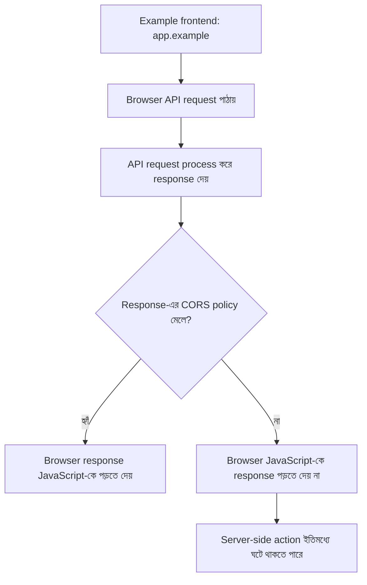
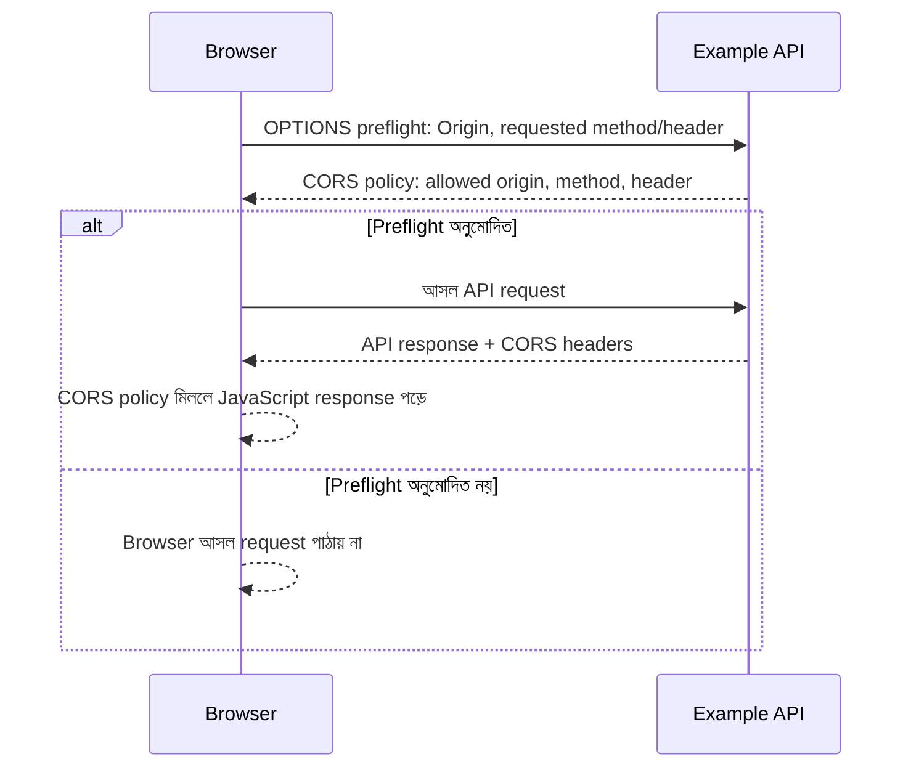
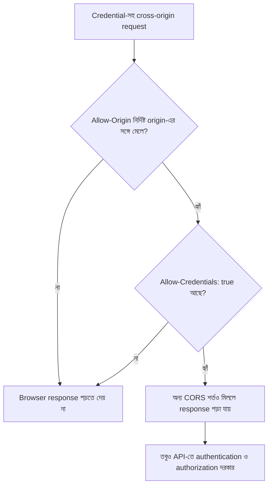

# CORS: Browser কোন Response পড়তে পারবে?

বৃহস্পতিবার সকাল। আরিফ browser security নিয়ে একটা ছোট test scenario দেখছে। একটি পাতা চলছে `https://app.example`, আর সেটি `https://api.example`-এ থাকা API-র response পড়তে চায়। Browser-এ response এসেছে, কিন্তু JavaScript সেটি পড়তে পারছে না। Console-এ CORS error।

নীরা জিজ্ঞেস করল, “API তো request-এর উত্তর দিয়েছে। তাহলে JavaScript data পাচ্ছে না কেন?”

এখানে প্রথমে একটা গুরুত্বপূর্ণ পার্থক্য মনে রাখতে হবে। **Browser request পাঠাতে পারা, server request গ্রহণ করা, আর JavaScript response পড়তে পারা এক জিনিস নয়।** CORS মূলত শেষের প্রশ্নটির উত্তর দিতে সাহায্য করে।

## এই অধ্যায়ে কী বুঝবে

- Origin-এর তিনটি অংশ এবং origin ও site-এর পার্থক্য।
- Preflight কী যাচাই করে এবং simple request কেন preflight ছাড়াই server-এ পৌঁছাতে পারে।
- CORS কেন authentication, authorization বা সম্পূর্ণ CSRF defense নয়।

## ১. Origin কী, আর কেন আলাদা?

একটি web origin গঠিত হয় তিনটি অংশ দিয়ে:

- Scheme, যেমন `https`
- Host, যেমন `app.example`
- Port, যেমন `443`

এই তিনটির কোনোটি আলাদা হলে origin আলাদা। তাই `https://app.example` এবং `https://api.example` আলাদা origin, যদিও দুটো একই site-এর অংশ হতে পারে। **Origin আর site একই ধারণা নয়।**

Browser-এর Same-Origin Policy (SOP) হলো মূল নিরাপত্তা নিয়ম: একটি origin-এর script সাধারণত অন্য origin-এর response ইচ্ছেমতো পড়তে পারে না। CORS হলো server-এর মাধ্যমে নির্দিষ্ট cross-origin response browser-কে পড়তে দেওয়ার একটি নিয়মভিত্তিক ব্যবস্থা।

CORS মানে server-এর API-তে কে ঢুকতে পারবে, সেই permission system নয়। Server request-টি গ্রহণ করবে কি না, সেটি authentication, authorization, validation এবং application policy-র ওপর নির্ভর করে।

## ২. CORS আসলে কী নিয়ন্ত্রণ করে?

ধরা যাক, একটি browser frontend API-তে order চায়। Browser request পাঠাতে পারে, কিন্তু API-র response JavaScript-কে দেখানোর আগে browser CORS policy যাচাই করে।

শেষের লাইনটি খুব গুরুত্বপূর্ণ। CORS check ব্যর্থ হলে browser JavaScript-কে response পড়তে না-ও দিতে পারে, কিন্তু তার মানে এই নয় যে request server-এ পৌঁছায়নি বা server কোনো কাজ করেনি। বিশেষ করে “simple request”-এর ক্ষেত্রে browser preflight ছাড়াই request পাঠাতে পারে।

তাই CORS error-কে server-এর operation বাতিল হওয়ার নিশ্চয়তা হিসেবে ধরা যাবে না।

## ৩. Simple request আর preflight

সব cross-origin request-এর আগে browser আলাদা অনুমতি-জিজ্ঞাসা পাঠায় না।

কিছু request browser “simple request” হিসেবে পাঠাতে পারে। সাধারণ HTML form-এর পুরোনো আচরণ ও web compatibility-র কারণে এই ধরনের request-এর আগে preflight বাধ্যতামূলক নয়। Server request process করতে পারে, কিন্তু CORS response header না মিললে browser response JavaScript-কে পড়তে দেয় না।

অন্য কিছু request-এর জন্য browser আগে একটি **preflight request** পাঠায়। সাধারণত এটি `OPTIONS` request, যাতে browser জানায় কোন origin থেকে request আসছে এবং পরের request-এ কোন method বা header ব্যবহার করতে চায়।

Preflight পাস করা **user authenticated বা authorized হওয়ার প্রমাণ নয়**। এটি browser-কে জানায়, নির্দিষ্ট cross-origin request পাঠানোর অনুমতি আছে কি না। API-কে আসল request-এও authentication ও authorization যাচাই করতে হবে।

## ৪. Server কোন তথ্য দিয়ে অনুমতি জানায়?

CORS-এ কয়েকটি response header বিশেষভাবে গুরুত্বপূর্ণ:

| Header | কাজ |
| --- | --- |
| `Access-Control-Allow-Origin` | কোন origin response পড়তে পারবে, তা জানায় |
| `Access-Control-Allow-Methods` | Preflight-এর ক্ষেত্রে কোন method অনুমোদিত, তা জানায় |
| `Access-Control-Allow-Headers` | Preflight-এর ক্ষেত্রে কোন request header অনুমোদিত, তা জানায় |
| `Access-Control-Allow-Credentials` | Credential-সহ cross-origin response পড়ার অনুমতি জানায় |
| `Vary: Origin` | Response origin অনুযায়ী বদলালে cache-কে সেই পার্থক্য বিবেচনা করতে বলে |

এগুলো browser-এর CORS decision-এ অংশ নেয়। এগুলো API-র business permission বা role check-এর বিকল্প নয়।

কোনো API যদি শুধু নির্দিষ্ট frontend-কে response পড়তে দিতে চায়, তবে scheme, host এবং port-সহ নির্দিষ্ট origin allowlist-এ মিলিয়ে দেখতে হবে। যেকোনো `Origin` header-কে যাচাই ছাড়া response-এ ফেরত দেওয়া বিপজ্জনক হতে পারে। Origin-এ path থাকে না, আর `https://app.example` ও `http://app.example` এক origin নয়।

## ৫. Credential-সহ CORS

Browser request-এ cookie বা অন্য browser-managed credential পাঠানো হবে কি না, সেটি request-এর credential mode এবং cookie policy-সহ একাধিক নিয়মের ওপর নির্ভর করে। Cross-origin fetch-এর default আচরণকে “সব cookie যাবে” ধরে নেওয়া যাবে না।

Credential-সহ cross-origin response JavaScript-কে পড়তে দিতে হলে server-কে নির্দিষ্ট origin অনুমোদন করতে হয় এবং `Access-Control-Allow-Credentials: true` দিতে হয়। **Credential-সহ request-এর জন্য `Access-Control-Allow-Origin: *` ব্যবহার করা যায় না।** Wildcard origin আর credentialed response একসঙ্গে মেলে না।

Credentialed CORS বেশি সতর্কতার দাবি রাখে। যদি trusted origin-এর কোনো frontend-এ XSS থাকে, বা allowlist অতিরিক্ত উদার হয়, তবে browser সেই origin-এর script-কে user-এর credential-সহ API response পড়তে দিতে পারে। তাই শুধু “আমাদের frontend-এর origin” বললেই হবে না, সেই origin-এর code ও deployment-ও trust boundary-র অংশ।

`Origin: null`-কে নির্বিচারে অনুমোদন করো না। Allowlist-এ origin match করতে হলে নির্দিষ্ট, প্রত্যাশিত origin-ই ব্যবহার করো।

## ৬. CORS কি CSRF আটকায়?

না, CORS-কে একমাত্র CSRF defense হিসেবে ধরা যাবে না।

অধ্যায় ৬-এ আমরা দেখেছি, CSRF-এ আক্রমণকারী victim-এর browser দিয়ে request করাতে চায়। তার response পড়ার প্রয়োজন নাও হতে পারে। Browser কিছু cross-origin simple request পাঠাতে পারে, যদিও আক্রমণকারীর JavaScript response পড়তে না পারে। ফলে “CORS error দেখিয়েছে, তাই state change হয়নি” সিদ্ধান্তটি নিরাপদ নয়।

CSRF defense-এর জন্য state-changing request-এ উপযুক্ত server-side যাচাই, যেমন CSRF token এবং Origin/Fetch Metadata policy, প্রয়োজন অনুযায়ী ব্যবহার করতে হবে। Cookie-র `SameSite` attribute সহায়ক হতে পারে, কিন্তু একে একমাত্র প্রতিরক্ষা হিসেবে ধরে নেওয়া উচিত।

আবার CORS ঠিক থাকলেও authentication ও authorization আলাদা করে দরকার। CORS বলে browser-এর JavaScript response পড়তে পারবে কি না; এটি বলে না user ওই order দেখতে বা refund করতে পারবে কি না।

## ৭. CORS কী পারে না?

| ভুল ধারণা | সঠিক বোঝাপড়া |
| --- | --- |
| CORS API-কে attacker-এর request থেকে রক্ষা করে | এটি মূলত browser-এ response sharing নিয়ন্ত্রণ করে; request server-এ পৌঁছাতে পারে |
| CORS হলো authentication | Origin user identity প্রমাণ করে না |
| CORS হলো authorization | Server-কে resource ও action-এর permission যাচাই করতেই হবে |
| CORS error মানে request execute হয়নি | Simple request server-এ process হয়ে থাকতে পারে |
| Non-browser client-ও CORS মানতে বাধ্য | CORS browser-enforced policy; curl বা অন্য client নিজে তা enforce নাও করতে পারে |
| Wildcard origin সবসময় harmless | Public, credential-free response-এ wildcard উপযুক্ত হতে পারে; sensitive credentialed response-এ নয় |

Browser-এর বাইরে থাকা client-এর request-এ `Origin` header নকল করা সম্ভব। তাই server-side authorization-কে “শুধু অনুমোদিত Origin থেকে request আসে” ধারণার ওপর দাঁড় করানো যাবে না।

## ৮. Design decision

আরিফের প্রথম প্রতিক্রিয়া ছিল সব origin অনুমোদন করে দেওয়া, যাতে frontend-এর CORS error চলে যায়। নীরা থামাল। Development-এর সুবিধার জন্য production-এ অনির্দিষ্ট origin trust করা ঠিক নয়।

এই illustrative scenario-র design decision:

1. যে frontend origin সত্যিই API ব্যবহার করবে, কেবল সেটি allowlist-এ থাকবে।
2. Credential দরকার না হলে credentialed CORS চালু করা হবে না।
3. Credentialed response-এ wildcard origin ব্যবহার করা হবে না।
4. Origin-কে exact scheme, host ও port অনুযায়ী মিলিয়ে দেখা হবে।
5. API-তে authentication, function-level authorization এবং resource-level authorization CORS থেকে আলাদা থাকবে।
6. State-changing request-এর CSRF defense আলাদাভাবে বজায় থাকবে।
7. Dynamic origin অনুযায়ী response বদলালে cache behavior-এ `Vary: Origin` প্রাসঙ্গিক কি না যাচাই করা হবে।

এগুলো এই illustrative scenario-র design guideline, সব application-এর জন্য একটাই universal configuration নয়। কোন origin trusted, credential দরকার কি না, আর কোন response sensitive, তা application-এর threat model দিয়ে নির্ধারণ করতে হবে।

## আমরা কী শিখলাম?

- Origin হলো scheme, host ও port-এর সমন্বয়; site-এর সঙ্গে এটি এক নয়।
- CORS browser-কে বলে cross-origin response JavaScript-কে পড়তে দেওয়া যাবে কি না।
- Simple request preflight ছাড়াই server-এ পৌঁছাতে পারে; CORS failure মানেই server-side action বাতিল নয়।
- Credentialed CORS-এ নির্দিষ্ট origin দরকার; wildcard origin-এর সঙ্গে credentials অনুমোদন করা যায় না।
- CORS authentication, authorization বা পূর্ণ CSRF defense নয়।

## নিজের বোঝাপড়া যাচাই করো

1. Browser CORS error দেখালেও server কেন order cancel করে ফেলতে পারে?
2. Preflight সফল হলে কেন API-তে user-এর permission আবার যাচাই করতে হবে?
3. `Access-Control-Allow-Origin: *` এবং credentialed response একসঙ্গে কেন গ্রহণযোগ্য নয়?
4. কোনো non-browser client CORS policy মানছে কি না, সেটি কি API authorization-এর ভিত্তি হতে পারে?

উত্তর মিলিয়ে দেখো

1. Simple request server-এ পৌঁছে state বদলাতে পারে, যদিও browser পরে JavaScript-কে response পড়তে না দেয়। তাই CORS error মানেই operation rollback নয়।

2. Preflight browser-এর cross-origin request policy যাচাই করে; user কে, তার permission কী, বা resource কার, তা যাচাই করে না। আসল request-এ server-side authorization দরকার।

3. Credentialed response নির্দিষ্ট trusted origin-এর সঙ্গে যুক্ত হতে হয়। Wildcard origin দিয়ে কোন origin credential-সহ অনুমোদিত, তা নির্দিষ্ট করা যায় না।

4. না। CORS browser-enforced response-sharing policy; non-browser client সেটি মানতে বাধ্য নয়। API-র authorization সব client-এর জন্য server-এ enforce করতে হবে।

## পরের অধ্যায়

CORS browser-এর cross-origin response sharing নিয়ে। এবার আমরা দেখব, একই browser-এ চলা attacker-controlled JavaScript কীভাবে KenaKata-র origin-এর ভেতরে ঢুকে যেতে পারে, আর `HttpOnly` কেন XSS-এর সম্পূর্ণ সমাধান নয়। পরের অধ্যায়: [XSS এবং HttpOnly-এর সীমাবদ্ধতা](../08-xss-and-httponly/README.md).

## তথ্যসূত্র

- [MDN: Cross-Origin Resource Sharing (CORS)](https://developer.mozilla.org/en-US/docs/Web/HTTP/Guides/CORS)
- [WHATWG Fetch Standard: CORS protocol](https://fetch.spec.whatwg.org/#http-cors-protocol)
- [MDN: Same-Origin Policy](https://developer.mozilla.org/en-US/docs/Web/Security/Same-origin_policy)
- [MDN: Origin header](https://developer.mozilla.org/en-US/docs/Web/HTTP/Headers/Origin)
- [OWASP: Cross-Site Request Forgery Prevention Cheat Sheet](https://cheatsheetseries.owasp.org/cheatsheets/Cross-Site_Request_Forgery_Prevention_Cheat_Sheet.html)

