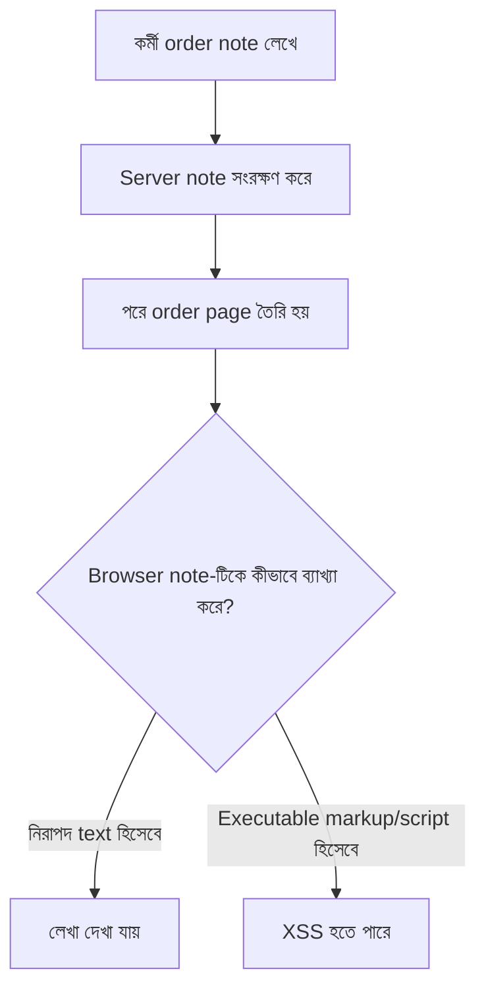
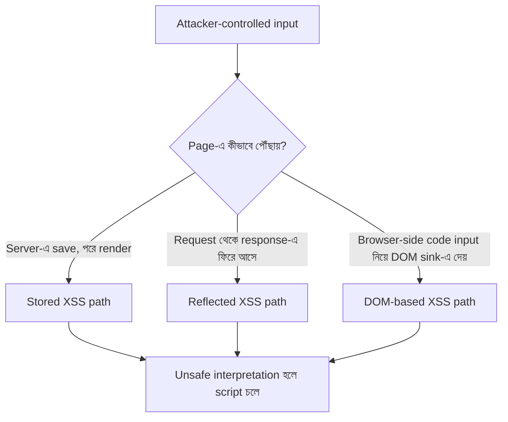
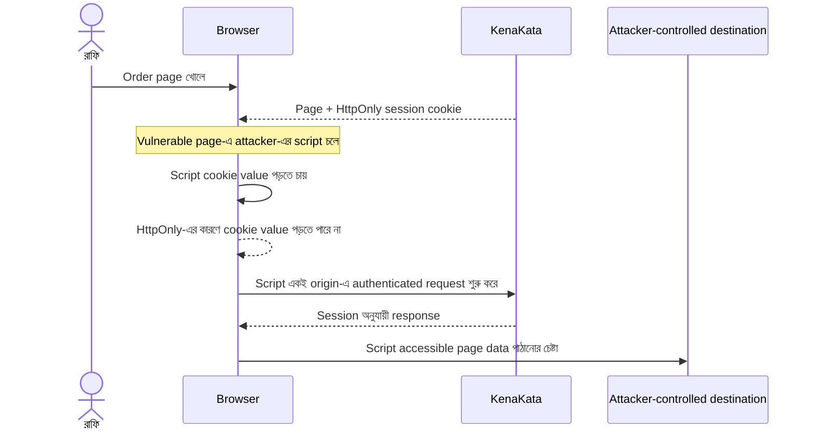
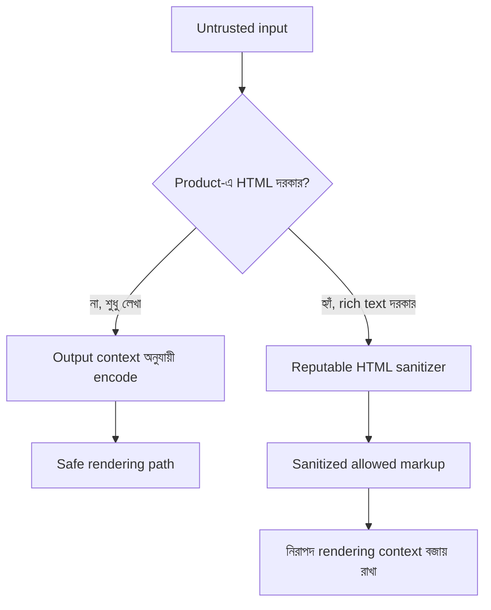

# XSS এবং HttpOnly-এর সীমাবদ্ধতা

একটা input field-এ customer-এর লেখা এসেছিল। আরিফ সেটাকে database-এ রেখেছিল, পরে order page-এ দেখিয়েছিল। সব ঠিকঠাক চলছিল, যতক্ষণ না একদিন page-টা আর শুধু লেখা দেখাল না। Browser-কে একটা কাজও করিয়ে ফেলল।

> এই অধ্যায়ের মূল প্রশ্ন: **যদি আক্রমণকারীর JavaScript KenaKata-র page-এর ভেতরে চলতে পারে, তাহলে HttpOnly cookie থাকা সত্ত্বেও সে কী করতে পারে?**

KenaKata এখনো একটা server-rendered web application। Login-এর পর browser-এ session cookie থাকে। নতুন SPA, mobile app বা token architecture এই অধ্যায়ে আসছে না।

## ১. একটা order note, আর অদ্ভুত আচরণ

রাফির দোকানে কর্মীরা order-এর পাশে note লেখে। যেমন, “বিকেলের আগে পাঠাবেন”। আরিফ note-টা save করে, order page-এ দেখায়। একদিন একজন কর্মী note-এ এমন কিছু paste করল, যেটা plain text নয়, browser-এর কাছে HTML ও script হিসেবে ব্যাখ্যা হওয়ার মতো content।

আরিফের প্রথম প্রতিক্রিয়া: “Input তো database-এ আছে। Database-এর ডেটা আবার বিপজ্জনক হবে কেন?”

নীরা জিজ্ঞেস করল, “Database কি ঠিক করে browser ওই লেখাকে text হিসেবে দেখবে, নাকি code হিসেবে চালাবে?”

সেটাই মূল ভুল। **ডেটা কোথা থেকে এসেছে, তার চেয়ে browser-এ পৌঁছে সেটি কীভাবে ব্যাখ্যা হচ্ছে, সেটা XSS-এর জন্য বেশি গুরুত্বপূর্ণ।** Database-এ রাখা user input পরে কোনো page-এ নিরাপদভাবে দেখানো না হলে সেটি stored XSS-এর পথ হতে পারে। একই ঝুঁকি search query, customer name, imported data, এমনকি আগে থেকেই database-এ থাকা content-এও থাকতে পারে।

এই diagram-এ database-কে নিরাপত্তার সীমানা ধরা হয়নি। Save করা আর নিরাপদে render করা দুটি আলাদা কাজ।

## ২. XSS আসলে কী?

Cross-site scripting (XSS) হলো এমন দুর্বলতা, যেখানে website attacker-এর নিয়ন্ত্রিত content-কে নিজের page-এর মধ্যে executable code হিসেবে চালাতে দেয়। নামের “cross-site” অংশটা বিভ্রান্ত করতে পারে: আক্রমণকারীর script চলার সময় browser সেটিকে KenaKata-র origin-এর code হিসেবে বিবেচনা করতে পারে।

Browser-এর same-origin policy সাধারণত এক origin-এর script-কে অন্য origin-এর private data পড়া থেকে আটকায়। কিন্তু যদি KenaKata-র page-এই attacker-এর script চালু হয়, তখন সেটি সেই origin-এর trusted page context-এর ভেতরে কাজ করছে। Browser-এর সীমানা attacker-কে আলাদা করে রাখছে না, কারণ script-টি KenaKata-র page-এর মধ্যেই চলছে।

সফল XSS-এ script কী করতে পারে, তা page ও application-এর ক্ষমতার ওপর নির্ভর করে। যেমন:

- বর্তমান page-এর content পড়তে বা বদলাতে পারে।
- page-এ থাকা order/customer তথ্য পড়তে পারে, যদি সেই তথ্য script-এর কাছে accessible হয়।
- user-এর browser দিয়ে KenaKata-তে authenticated request পাঠাতে পারে।
- page-এ থাকা CSRF token পড়তে পারে, যদি সেটি JavaScript-এর কাছে accessible হয়।
- user-কে ভুল তথ্য দেখাতে পারে বা তার করা কাজের ফল বদলে দিতে পারে।
- পড়া যায় এমন data attacker-এর নিয়ন্ত্রিত endpoint-এ পাঠানোর চেষ্টা করতে পারে, যদি browser policy ও network conditions তা অনুমতি দেয়।

এর মানে এই নয় যে XSS সব browser data পড়তে পারে, অন্য সব website-এর data পড়তে পারে, বা সব security control অকার্যকর হয়ে যায়। Same-origin policy অন্য origin-এর সীমানা এখনো রক্ষা করে। কিন্তু vulnerable origin-এর ভেতরে চলা script-কে সেই origin-এর নিজস্ব code-এর মতো ক্ষমতা দেওয়া হতে পারে।

## ৩. Stored, Reflected, আর DOM-based XSS

এই নামগুলো আলাদা attack family-এর নাম মনে হলেও এগুলো মূলত input page-এ কীভাবে পৌঁছায় বা execution কোথায় ঘটে, সেই দিকগুলো বোঝায়। এক incident-এ server-side ও DOM-related আচরণ একসঙ্গেও থাকতে পারে।

### Stored XSS: লেখা জমে থাকে, আক্রমণ পরে চলে

Attacker-controlled content server বা database-এ save হয়। পরে কোনো user সেই content-সহ page খুললে দুর্বল rendering-এর কারণে script চালু হয়।

KenaKata-র উদাহরণ: order note save হয়েছে। পরে রাফি order page খুললে note render হয়। Note-টি safe text হিসেবে encode না করা হলে, একবার জমা হওয়া content বারবার অন্য কর্মীদের browser-এ পৌঁছাতে পারে।

### Reflected XSS: request-এর content response-এ ফিরে আসে

Attacker এমন URL বা request তৈরি করে, যার input server response-এ নিরাপদভাবে encode না করে ফিরিয়ে দেয়। উদাহরণস্বরূপ, search page-এ query text দেখানো হয়। Attacker crafted search link পাঠায়; ভুক্তভোগী link খুললে query response-এর অংশ হয়ে page-এ আসে।

এখানে input দীর্ঘদিন database-এ থাকতে হবে এমন নয়। সাধারণত victim-কে crafted link বা request-এ যেতে প্রলুব্ধ করতে হয়।

### DOM-based XSS: browser-side code ভুলভাবে data-কে code বানায়

কখনো server response নিজে safe থাকে, কিন্তু page-এর JavaScript URL fragment, query parameter বা অন্য attacker-controlled data নিয়ে এমন DOM API-তে দেয়, যেটি string-কে HTML বা code হিসেবে ব্যাখ্যা করে। দুর্বলতা browser-side data flow-তে।

Server-rendered website-এও JavaScript থাকতে পারে, তাই DOM-based XSS বুঝতে SPA থাকা জরুরি নয়।

**মনে রাখার সহজ উপায়:** Stored মানে input পরে আবার render হয়; reflected মানে request-এর input response-এ ফিরে আসে; DOM-based মানে browser-side code attacker-controlled data-কে unsafe DOM/code sink-এ দেয়। এগুলোকে শুধু payload-এর চেহারা দেখে শ্রেণিবদ্ধ করো না।

## ৪. HttpOnly কী রক্ষা করে?

Chapter 4-এ session cookie-র কথা এসেছিল। KenaKata-র session cookie-তে HttpOnly flag থাকলে page-এর JavaScript সাধারণ cookie API, যেমন `document.cookie`, দিয়ে সেই cookie-র value পড়তে পারে না।

এটা গুরুত্বপূর্ণ। XSS-এর একটি পরিচিত লক্ষ্য হলো session cookie চুরি করে পরে অন্য browser বা device থেকে session replay করা। HttpOnly সেই নির্দিষ্ট পথটিকে কঠিন করে, কারণ script-কে session cookie-র value সরাসরি পড়তে দেয় না।

কিন্তু এখানে একটি গুরুত্বপূর্ণ পার্থক্য আছে:

**Cookie পড়তে না পারা আর cookie ব্যবহার করে request করাতে না পারা এক জিনিস নয়।**

Browser KenaKata-তে request পাঠানোর সময় cookie-র scope ও policy অনুযায়ী session cookie নিজেই যুক্ত করতে পারে। একই origin-এর page-এ চলা ক্ষতিকর script-ও user-এর browser দিয়ে request শুরু করতে পারে। Script cookie-র raw value না জানলেও request authenticated হতে পারে।

Diagram-এর শেষ ধাপটি সব সময় সফল হবে এমন দাবি নয়। CSP, browser behavior, network policy, data-র accessibility এবং attacker-এর endpoint-এর ওপর তা নির্ভর করতে পারে। মূল শিক্ষা হলো, HttpOnly cookie value পড়া আটকায়, কিন্তু vulnerable page-এর script execution নিজে বন্ধ করে না।

## ৫. HttpOnly থাকলেও কী কী ক্ষতি সম্ভব?

ধরা যাক, রাফি KenaKata-তে login করা। Session cookie HttpOnly, Secure এবং SameSite-সহ সঠিকভাবে configured। তবুও order note-এর দুর্বল rendering-এর কারণে তার browser-এ script চলছে।

আক্রমণকারীর কাছে সরাসরি session ID নেই। কিন্তু script page-এর content পড়তে পারে, user-এর browser দিয়ে request পাঠাতে পারে, এবং page-এ থাকা CSRF token accessible হলে সেটিও পড়তে পারে। ফলে session cookie-এর value বের না করেও রাফির ক্ষমতার কিছু অংশ অপব্যবহার হতে পারে।

| কাজ | HttpOnly কি একা আটকায়? | কেন |
| --- | --- | --- |
| JavaScript দিয়ে session cookie value পড়া | হ্যাঁ, cookie-তে HttpOnly থাকলে | Cookie value JavaScript API-তে প্রকাশ করা হয় না |
| Page-এর text ও accessible DOM data পড়া | না | HttpOnly page content আড়াল করে না |
| Browser দিয়ে KenaKata-তে authenticated request শুরু করা | না | Browser request-এর সঙ্গে cookie নিজে যোগ করতে পারে |
| Accessible CSRF token পড়া | না | Token page/DOM-এ থাকলে script সেটি পড়তে পারে |
| অন্য origin-এর private response নির্বিচারে পড়া | না, কিন্তু এটি HttpOnly-এর কৃতিত্ব নয় | Same-origin policy সাধারণত অন্য origin-এর data আলাদা রাখে |
| XSS-এর মূল injection vulnerability দূর করা | না | HttpOnly cookie attribute, HTML/JavaScript injection prevention নয় |

### তাহলে কি session cookie-র নিরাপত্তা অর্থহীন?

একদমই নয়। HttpOnly এখনো session cookie-র value সরাসরি চুরি হওয়ার একটি গুরুত্বপূর্ণ পথ বন্ধ করে। XSS-এর কারণে cookie চুরি ও session replay কঠিন করা বাস্তব সুরক্ষা। কিন্তু XSS থাকলে attacker একই browser context-এ user-এর নামে কাজ করতে পারে, তাই cookie flag-কে XSS prevention-এর বিকল্প বলা যাবে না।

এখানে Chapter 5-এর session hijacking-এর সঙ্গে পার্থক্যটা মনে রাখো:

- **Session hijacking:** আক্রমণকারী session credential দখল করে নিজের request-এ ব্যবহার করার চেষ্টা করে।
- **XSS:** আক্রমণকারীর script victim-এর browser-এর trusted origin context-এ চলে, এবং সেই browser-এর ক্ষমতা ব্যবহার করতে পারে।

একটি ঘটনা অন্যটিতে পরিণত হতে পারে, কিন্তু দুটো একই threat নয়।

## ৬. প্রথম প্রতিরক্ষা: input-কে code হতে দিও না

আরিফের ভুল ছিল, সে ভাবছিল “Input validate করেছি” বা “Database-এ save করেছি” বললেই content নিরাপদ। XSS প্রতিরক্ষায় মূল প্রশ্ন হলো: **এই data-কে browser-এ কোন context-এ বসানো হচ্ছে?**

### Text দেখাতে হলে output encoding

Order note যদি plain text হয়, browser-কে সেটি text হিসেবে দেখাতে হবে, markup হিসেবে ব্যাখ্যা করতে দেওয়া যাবে না। সাধারণ HTML text context-এ output encoding special character-কে এমন রূপে প্রকাশ করে, যাতে browser সেগুলোকে নতুন HTML syntax হিসেবে না ধরে।

এখানে encoding-এর context গুরুত্বপূর্ণ। HTML text, HTML attribute, JavaScript, CSS এবং URL এক parser দিয়ে ব্যাখ্যা হয় না। এক context-এর জন্য উপযুক্ত encoding অন্য context-এ নিরাপত্তা নিশ্চিত করে না।

- Framework বা template engine-এর automatic escaping ব্যবহার করো, এবং ঠিক কোন context-এ তা কাজ করে বুঝে নাও।
- Dynamic value-কে script block, event-handler attribute বা অন্য dangerous context-এ বসানো এড়াও।
- User input-কে “খারাপ string” খুঁজে blacklist করে নিরাপদ বানানোর ওপর নির্ভর কোরো না।
- Input validation business rule ও data shape ঠিক করতে কাজে লাগে, কিন্তু output context-এর নিরাপদ encoding-এর বিকল্প নয়।

### যদি user-কে HTML লিখতে দিতেই হয়?

কখনো product-এ formatted description বা rich text দরকার হতে পারে। তখন সব HTML-কে text হিসেবে encode করলে formatting-ও দেখা যাবে না। সে ক্ষেত্রে reputable HTML sanitizer দিয়ে অনুমোদিত HTML subset-এ সীমাবদ্ধ করতে হয়। Sanitizer-এর কাজ এবং output encoding-এর কাজ এক নয়।

Sanitized HTML পরে আবার unsafeভাবে modify করলে বা অন্য context-এ বসালে সুরক্ষা নষ্ট হতে পারে। Sanitizer/library update-ও গুরুত্বপূর্ণ, কারণ browser behavior ও bypass technique বদলায়।

Diagram-টি সাধারণ দিকনির্দেশ। নির্দিষ্ট context ও framework-এর behavior না জেনে একে implementation recipe মনে কোরো না।

## ৭. DOM-based XSS: data আর code-এর মাঝখানের ফাঁদ

Browser-side code যখন untrusted string-কে HTML হিসেবে parse করে বা code হিসেবে execute করে, তখন DOM-based XSS ঘটতে পারে। `innerHTML`, `outerHTML`, `insertAdjacentHTML()` বা `document.write()`-এর মতো API-তে untrusted content দেওয়া বিপজ্জনক হতে পারে। `eval()`-এর মতো code-interpreting API-ও ঝুঁকিপূর্ণ।

কোনো API-র নাম মুখস্থ করাই লক্ষ্য নয়। মনে রাখার নিয়মটি হলো:

- **Text দরকার হলে text হিসেবে বসাও**, HTML হিসেবে parse করো না।
- HTML দরকার হলে trusted sanitizer-এর মাধ্যমে allow করা markup ব্যবহার করো।
- Untrusted input-কে JavaScript code হিসেবে চালিও না।
- Browser-side code URL fragment বা query parameter থেকে data নিলে, সেই data কোথায় যায় তা trace করো।

DOM-based XSS-এর input server-এ save হওয়ার দরকার নেই। URL fragment server-এ পাঠানোও হয় না, কিন্তু page JavaScript সেটি পড়ে unsafe DOM sink-এ বসালে vulnerability হতে পারে।

## ৮. CSP: browser-কে আরেকটি নিয়ম দেওয়া

Content Security Policy (CSP) হলো response-এর সঙ্গে পাঠানো policy, যার মাধ্যমে browser-কে জানানো হয় কোন script ও resource কীভাবে load বা execute করতে পারবে। এটি XSS-এর বিরুদ্ধে **অতিরিক্ত প্রতিরক্ষা স্তর**, মূল vulnerability fix করার বিকল্প নয়।

একটি শক্ত CSP সাধারণত script-এর জন্য nonce-based বা hash-based policy ব্যবহার করে। Nonce হলে server প্রতিটি response-এর জন্য unpredictable value তৈরি করে, এবং অনুমোদিত script element-এ সেই value থাকে। Hash-based policy নির্দিষ্ট script content-কে অনুমোদন করতে পারে। Browser policy-র সঙ্গে না মিললে injected script execute করতে অস্বীকার করতে পারে।

শুধু “নিজের domain-এর script allow” করা allowlist CSP সব সময় যথেষ্ট নয়। অনুমোদিত origin-এ attacker-controlled script বা unsafe endpoint থাকলে policy-র লাভ কমে যেতে পারে। CSP-এর কাজ সঠিকভাবে বুঝতে policy কতটা restrictive, inline script কীভাবে সামলানো হচ্ছে এবং application-এর legitimate script behavior কী, তা দেখতে হয়।

### CSP কী করে, কী করে না?

| প্রশ্ন | উত্তর |
| --- | --- |
| Injected script execute হওয়া কঠিন করতে পারে? | হ্যাঁ, সঠিকভাবে configured strict CSP হলে |
| Output encoding ও sanitization-এর দরকার শেষ করে? | না |
| সব XSS একইভাবে আটকাবে? | না; policy, browser support ও attack path-এর ওপর নির্ভর করে |
| ভুল CSP policy application ভেঙে দিতে পারে? | হ্যাঁ; legitimate script block হতে পারে |
| Report-Only mode আক্রমণ block করে? | না; violation পর্যবেক্ষণের জন্য, enforcement নয় |
| CSP-কে একমাত্র XSS defense ধরা উচিত? | না |

CSP চালুর আগে `Content-Security-Policy-Report-Only` দিয়ে violation পর্যবেক্ষণ করা উপকারী হতে পারে। তবে report-only policy শুধু রিপোর্ট করে, script execution block করে না। বাস্তবে enforcement চালুর আগে legitimate behavior, reporting data এবং browser compatibility পর্যালোচনা দরকার।

এই অধ্যায়ে KenaKata-র জন্য কোনো নির্দিষ্ট CSP header তৈরি করা হচ্ছে না। Nonce, hash, `strict-dynamic`, `unsafe-inline` বা `unsafe-eval`-এর পূর্ণ configuration guide-ও এটি নয়। লক্ষ্য হলো CSP কেন সাহায্য করে এবং কেন একে একমাত্র প্রতিরক্ষা ভাবা ভুল, তা বোঝা।

## ৯. তিনটি প্রতিরক্ষা, তিনটি আলাদা কাজ

এখন প্রতিরক্ষাগুলো পাশাপাশি রাখি।

| প্রতিরক্ষা | মূল কাজ | কী সমাধান করে না |
| --- | --- | --- |
| Output encoding | Untrusted data-কে নির্দিষ্ট output context-এ text হিসেবে দেখানো | ভুল context-এ বসানো বা পরে unsafe sink-এ পাঠানোর সব ঝুঁকি নয় |
| HTML sanitization | User-authored HTML থেকে বিপজ্জনক markup/feature সরিয়ে allow করা content রাখা | সব data flow নিরাপদ করা নয়; পরে unsafe modification করলে ঝুঁকি ফিরতে পারে |
| HttpOnly cookie | JavaScript API থেকে session cookie value আড়াল করা | XSS বন্ধ করা, page data আড়াল করা বা authenticated request বন্ধ করা নয় |
| CSP | Browser-এ script/resource execution সীমিত করা | Injection vulnerability দূর করা বা প্রতিটি attack path নিশ্চিতভাবে আটকানো নয় |

প্রতিরক্ষাগুলো একে অন্যের বিকল্প নয়। Safe rendering হলো প্রথম কাজ। HttpOnly session credential-এর exposure কমায়। CSP সঠিকভাবে configured হলে অতিরিক্ত barrier তৈরি করে।

## ১০. Threat model: attacker কী জানে, কী পারে?

এই অধ্যায়ের threat model:

- Attacker KenaKata-তে user-controlled content জমা দিতে পারে, অথবা victim-কে crafted URL খুলতে প্রলুব্ধ করতে পারে।
- দুর্বল rendering-এর কারণে attacker-controlled script KenaKata-র page context-এ চলতে পারে।
- Victim ইতিমধ্যে KenaKata-তে login করা থাকতে পারে।
- Session cookie-তে HttpOnly আছে; তাই attacker-এর script cookie value সরাসরি পড়তে পারে না।
- Script-এর ক্ষমতা page-এ accessible data, browser policy, CSP, network restriction এবং application-এর behavior দ্বারা সীমিত হতে পারে।

এই অধ্যায় ধরে নিচ্ছে না যে attacker browser-এর সব cookie পড়তে পারে, সব origin-এর data পড়তে পারে, operating system দখল করেছে, বা server-এর database সরাসরি পড়তে পারে। এগুলো আলাদা threat model।

## ১১. সাধারণ ভুল ধারণা

**“HttpOnly দিলেই XSS আটকায়।”**  
না। এটি JavaScript থেকে cookie value আড়াল করে। Injection বা script execution আটকায় না।

**“Session ID চুরি না হলে attacker কিছু করতে পারবে না।”**  
ভুল। XSS চলার সময় victim-এর browser দিয়ে request ও accessible data-র অপব্যবহার হতে পারে।

**“Input validate করেছি, তাই XSS হবে না।”**  
Input validation business rule যাচাই করে। নিরাপদ output encoding বা HTML sanitization-এর বিকল্প নয়।

**“সব input-এর জন্য একই escaping যথেষ্ট।”**  
না। HTML text, attribute, URL, JavaScript ও CSS context আলাদা।

**“CSP আছে, তাই vulnerable code ঠিক করার দরকার নেই।”**  
না। CSP defense-in-depth। Policy ভুল বা অতিরিক্ত permissive হলে protection কমে যায়।

**“Stored XSS শুধু public comment-এ হয়।”**  
না। Staff-only order note, product description, imported content বা অন্য user-controlled field-ও vulnerable page-এ render হলে ঝুঁকি হতে পারে।

**“DOM-based XSS হতে হলে SPA লাগবে।”**  
না। Server-rendered page-এ JavaScript URL বা অন্য input নিয়ে unsafe DOM sink-এ দিলে সেটিও সম্ভব।

## ১২. নিজের বোঝাপড়া যাচাই

প্রতিটি ঘটনার জন্য ঠিক করো: এটি কোন XSS path-এর উদাহরণ, HttpOnly কী আটকাবে, এবং কোন প্রতিরক্ষা প্রথমে ঠিক করা দরকার?

1. Order note save করা আছে। রাফি পরে order page খুলে, আর note-এর content browser-এ script হিসেবে চলে।
2. Search term URL থেকে আসে এবং server সেটিকে search result page-এ unsafeভাবে ফিরিয়ে দেয়।
3. Page-এর JavaScript URL fragment পড়ে সেটিকে HTML হিসেবে page-এ বসায়।
4. Session cookie HttpOnly, কিন্তু XSS script order cancel করার authenticated request পাঠায়।
5. CSP report-only mode-এ injected script-এর violation report দেখা যায়, কিন্তু script এখনও execute হয়।

### উত্তর নিয়ে ভাবার ইঙ্গিত

1. Stored XSS; text হিসেবে নিরাপদ render করাই মূল প্রতিরক্ষা।
2. Reflected XSS; response-এ query নিরাপদভাবে encode করতে হবে।
3. DOM-based XSS; unsafe data flow ও DOM sink ঠিক করতে হবে।
4. HttpOnly cookie value পড়া ঠেকায়, কিন্তু request অপব্যবহার আটকায় না।
5. Report-Only policy enforcement নয়। Report পাওয়া মানে browser execution block করেছে এমন নয়।

## ১৩. পাঁচ মিনিটের নিরাপত্তা পর্যালোচনা

নিজের project-এর staging বা test environment-এ review করো। এই অধ্যায়ে কোনো live site পরীক্ষা করা হয়নি; নিচের তালিকাটি ভবিষ্যৎ manual review-এর জন্য।

- User-controlled content কোথায় save হয় এবং কোথায় render হয়, তালিকা করো।
- Plain text field-গুলো template-এ text হিসেবে render হচ্ছে কি না যাচাই করো।
- Rich HTML দরকার এমন field থাকলে sanitizer, allowed markup এবং পরে content modify হয় কি না পর্যালোচনা করো।
- URL/query/fragment থেকে data নিয়ে browser-side code কোন DOM API-তে দেয়, তা trace করো।
- Session cookie-তে HttpOnly আছে কি না যাচাই করো, কিন্তু সেটিকে XSS prevention-এর প্রমাণ হিসেবে ব্যবহার কোরো না।
- CSP থাকলে enforced নাকি Report-Only, script policy কতটা restrictive, এবং legitimate script block হচ্ছে কি না পর্যালোচনা করো।
- Test case-এ শুধু cookie চুরি নয়, accessible page data ও user-এর browser দিয়ে action অপব্যবহারের সম্ভাবনাও ধরো।

এগুলো review checklist, এখানে চালানো test-এর ফল নয়। Browser matrix, application implementation, automated test বা production configuration এই অধ্যায় লেখার সময় পরীক্ষা করা হয়নি।

## আমরা কী শিখলাম?

- XSS হলো attacker-controlled content-কে website-এর trusted page context-এ executable হতে দেওয়া।
- Stored, Reflected ও DOM-based নামগুলো input/page flow-এর ভিন্ন দিক বোঝায়।
- HttpOnly session cookie value JavaScript থেকে আড়াল করে, কিন্তু script execution বা authenticated request বন্ধ করে না।
- Output encoding context অনুযায়ী করতে হয়। Rich HTML দরকার হলে sanitizer-এর ভূমিকা আলাদা।
- CSP অতিরিক্ত প্রতিরক্ষা স্তর, মূল vulnerability fix-এর বিকল্প নয়।
- Session cookie চুরি না করেও XSS user-এর browser-এর ক্ষমতা অপব্যবহার করতে পারে।

## একটা অস্বস্তিকর প্রশ্ন

CSRF অধ্যায়ে আমরা জিজ্ঞেস করেছিলাম, “পাতায় যে script চলছে, সেটা কি আমাদের নিজের?” এবার উত্তরটা পরিষ্কার: browser একই origin-এর script-কে trusted page context-এ চালায়। যদি সেই বিশ্বাসটাই ভুল content-কে দেওয়া হয়, তাহলে cookie-র flag একা কতটা বাঁচাতে পারবে?

পরের অধ্যায়ে আমরা আরেকটি প্রশ্নে যাব: **যখন browser cookie session ছাড়া অন্য client-ও KenaKata-র resource চাইতে শুরু করবে, তখন পরিচয় কীভাবে request-এর সঙ্গে যাবে?**

## তথ্যসূত্র

- [OWASP: Cross Site Scripting Prevention Cheat Sheet](https://cheatsheetseries.owasp.org/cheatsheets/Cross_Site_Scripting_Prevention_Cheat_Sheet.html): output encoding, context-specific encoding, HTML sanitization, safe sinks, CSP ও সাধারণ anti-pattern।
- [OWASP: DOM based XSS Prevention Cheat Sheet](https://cheatsheetseries.owasp.org/cheatsheets/DOM_based_XSS_Prevention_Cheat_Sheet.html): browser-side source/sink ও DOM-based XSS প্রতিরক্ষা।
- [OWASP: Content Security Policy Cheat Sheet](https://cheatsheetseries.owasp.org/cheatsheets/Content_Security_Policy_Cheat_Sheet.html): strict CSP, nonce/hash policy, Report-Only এবং CSP-এর সীমা।
- [MDN: Cross-site scripting (XSS)](https://developer.mozilla.org/en-US/docs/Web/Security/Attacks/XSS): XSS-এর threat model, output encoding, sanitization, DOM sink ও CSP।
- [MDN: HTTP cookies](https://developer.mozilla.org/en-US/docs/Web/HTTP/Guides/Cookies): HttpOnly, Secure ও SameSite cookie attribute-এর ভূমিকা।
- [MDN: Content Security Policy](https://developer.mozilla.org/en-US/docs/Web/HTTP/Guides/CSP): CSP delivery, nonce/hash, strict CSP এবং policy deployment।

## লেখার অবস্থা

- [x] Draft
- [ ] Technical Review
- [ ] Security Review
- [ ] Published
