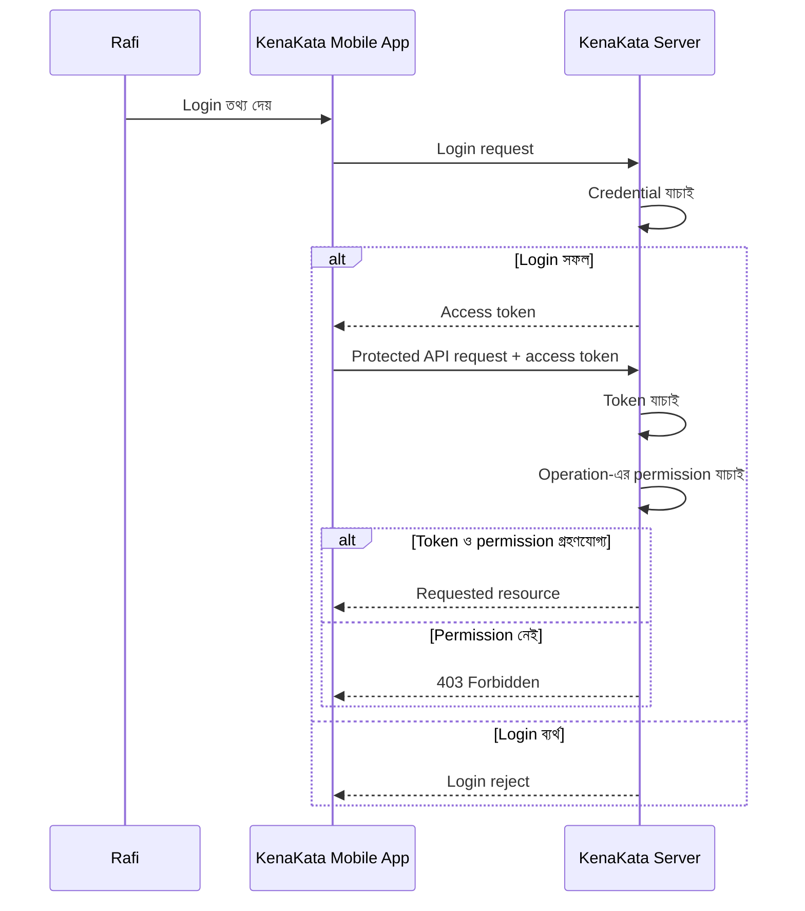
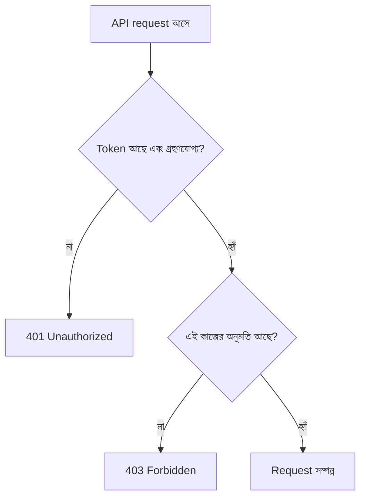

# Token কেন দরকার?

রাফি এখন দোকানে বসে শুধু laptop থেকে KenaKata চালাতে চায় না। বাজারে থাকলেও ফোন থেকে order দেখতে হবে, নতুন order এলে বুঝতে হবে, দরকার হলে product-এর তথ্যও বদলাতে হবে।

আরিফের website-এ login করা আছে। Browser একটা session cookie পাঠায়, আর server সেই cookie দিয়ে session খুঁজে পায়। কিন্তু নতুন mobile app-টি browser-এর ওই page নয়। ফোনের app-কে KenaKata API-তে request পাঠাতে হবে, এবং server-কে প্রতিবার বুঝতে হবে request-টি কোন credential নিয়ে এসেছে।

**প্রশ্নটা তাই “cookie খারাপ, token ভালো” নয়। প্রশ্ন হলো: আলাদা client থেকে API-তে credential কীভাবে পাঠাব?**

## ১. Password প্রতিটি request-এ পাঠাতে হবে?

না। Password হলো login-এর সময় user-এর পরিচয় যাচাই করার credential। সেটি প্রতিটি product বা order request-এ পাঠানোর দরকার নেই।

ধরো, রাফি তার order list দেখতে চায়। যদি প্রতিবার email আর password পাঠাতে হয়, তাহলে password বারবার নেটওয়ার্কে যাবে এবং প্রতিটি API request-কে password যাচাইয়ের কাজ করতে হবে। এর বদলে login সফল হওয়ার পর server client-কে একটি access token দিতে পারে। এরপর client protected API request-এ সেই token পাঠায়।

Token মানে কোনো জাদুর চাবি নয়। এটি আরেকটি sensitive credential, যেটি server নির্দিষ্ট সীমার মধ্যে গ্রহণ করবে কি না, তা যাচাই করতে হয়।

## ২. Cookie session আর access token কি একই জিনিস?

দুটোই পরের request-এ credential বহন করার উপায় হতে পারে। কিন্তু এদের model এক নয়।

| প্রশ্ন | Browser cookie session | Access-token model |
|---|---|---|
| Client কী বহন করে? | Session-এর পরিচয় বোঝানো cookie | API request-এর সঙ্গে access token |
| Server কী করে? | Cookie থেকে session খুঁজে পায়, session যাচাই করে | Token যাচাই করে এবং তার অনুমোদনের সীমা বোঝে |
| Credential কীভাবে request-এ যায়? | Browser উপযুক্ত request-এ cookie নিজে পাঠায় | Client সাধারণত request-এর `Authorization` header-এ token যোগ করে |
| কোথায় বেশি স্বাভাবিক? | Server-rendered website-এর browser session | Mobile app বা API client-এর protected-resource request |
| নিরাপত্তার প্রশ্ন | Session ID চুরি, fixation, CSRF, cookie scope | Token চুরি, disclosure, replay, token-এর সীমা ভুলভাবে প্রয়োগ |

এই টেবিলটি ধারণাগত পার্থক্য দেখায়, সব implementation-এর সার্বজনীন নিয়ম নয়। Mobile app-এ cookie ব্যবহার করা একেবারেই অসম্ভব, এমন নয়। KenaKata-র product সিদ্ধান্ত হলো: পুরোনো website cookie session রাখবে, আর নতুন mobile app API-তে access token ব্যবহার করবে।

আর একটা গুরুত্বপূর্ণ কথা: **token ব্যবহার করলেই security স্বয়ংক্রিয়ভাবে বেড়ে যায় না।** Token-ও চুরি হতে পারে। কোন client, কোন credential model, কী threat, আর credential কীভাবে সংরক্ষণ ও যাচাই হবে, তার ওপর নিরাপত্তা নির্ভর করে।

## ৩. Mobile app-এর request-এ token কোথায় যায়?

ধারণাগত flow-টা দেখি। এখানে login endpoint KenaKata-র নিজের first-party mobile login-এর অংশ। এটি OAuth authorization-code flow নয়। OAuth, PKCE ও OIDC পরে আসবে।



এই diagram-এ দুটি আলাদা সিদ্ধান্ত আছে:

1. **Token validation:** Request-এ দেওয়া token গ্রহণযোগ্য কি না।
2. **Authorization:** এই user বা grant-কে এই নির্দিষ্ট resource-এ এই কাজ করার অনুমতি আছে কি না।

প্রথমটি পাস করলেই দ্বিতীয়টি স্বয়ংক্রিয়ভাবে পাস করে না।

## ৪. HTTP request দেখতে কেমন?

ধরা যাক, রাফি তার order list দেখতে চায়। নিচেরটি শুধু illustrative HTTP request, কোনো runnable implementation নয়।

```http
GET /api/orders HTTP/1.1
Host: api.kenakata.example
Authorization: Bearer <access-token>
```

এখানে `Bearer` বলছে, request-এ যে token দেওয়া হয়েছে, তার possession-ই এই model-এ credential হিসেবে ব্যবহৃত হচ্ছে। Server-কে token যাচাই করতে হবে। Token যার হাতে চলে যায়, সে token-এর অনুমোদিত সীমার মধ্যে সেটি ব্যবহার করার চেষ্টা করতে পারে।

Bearer token ব্যবহারের জন্য `Authorization` header একটি প্রচলিত পদ্ধতি। Token URL বা query string-এ রাখা উচিত নয়: URL browser history, server log, monitoring tool বা অন্য জায়গায় রেকর্ড হয়ে যেতে পারে। Token transport করার সময় HTTPS ব্যবহার করতে হবে। [RFC 6750](https://www.rfc-editor.org/rfc/rfc6750) bearer token-এর request format ও security considerations ব্যাখ্যা করে।

## ৫. Token থাকলেই কি সব order দেখা যাবে?

না। Access token-কে “সব দরজা খোলার চাবি” ভাবলে ভুল হবে।

ধরা যাক, রাফির token গ্রহণযোগ্য। তবু server-কে জানতে হবে সে কোন order দেখতে পারবে, কোন action করতে পারবে, এবং request করা resource তার অনুমোদনের মধ্যে পড়ে কি না। KenaKata-তে login করা মানেই সব কাজের অনুমতি নয়। পরের অধ্যায়ে organization ও role আসার আগে থেকেই authentication আর authorization-এর পার্থক্যটি গুরুত্বপূর্ণ।



এটি শিক্ষামূলক flow। বাস্তব API-তে response code ও error details-এর সুনির্দিষ্ট আচরণ তার protocol contract অনুযায়ী নির্ধারিত হবে।

## ৬. তাহলে token কী সমস্যা সমাধান করে?

এই product-এর জন্য access token একটি credential model দেয়, যাতে mobile app প্রতিটি API request-এ password না পাঠিয়েও protected resource চাইতে পারে। Server-ও এক ধরনের credential যাচাই করে request-এর access decision নিতে পারে।

কিন্তু token নিজে থেকে এসব সমস্যার সমাধান করে না:

- **চুরি হওয়া token:** অন্য কেউ token পেলে সেটি ব্যবহার করার চেষ্টা করতে পারে।
- **Token ফাঁস হওয়া:** URL, log, crash report, analytics বা অনিরাপদ storage-এ token চলে গেলে ঝুঁকি তৈরি হয়।
- **ভুল authorization:** Token গ্রহণযোগ্য হলেও server ভুল permission দিলে user অন্যের resource দেখতে বা বদলাতে পারে।
- **Token-এর format:** Token JWT কি না, তার ভিতরের data কী, বা কীভাবে signature যাচাই হবে, তা এই অধ্যায়ের বিষয় নয়।
- **দীর্ঘমেয়াদি login:** Access token-এর মেয়াদ শেষ হলে কী হবে, আর নতুন token কীভাবে পাওয়া যাবে, তা পরের অধ্যায়গুলোতে আসবে।

অর্থাৎ token password বারবার পাঠানোর প্রয়োজন কমাতে পারে, কিন্তু credential protection ও authorization-এর দায়িত্ব মুছে দেয় না।

## ৭. Security invariant

এই অধ্যায়ের সবচেয়ে জরুরি নিয়মটি মনে রাখো:

> **Token গ্রহণ করা আর operation অনুমোদন করা দুটি আলাদা সিদ্ধান্ত।**

আর তিনটি ব্যবহারিক কথা:

- Access token-কে sensitive credential হিসেবে ধরো।
- Bearer token পাঠালে HTTPS ব্যবহার করো; token URL-এ রেখো না।
- Token valid হলেও server-কে requested resource ও operation-এর permission যাচাই করতে হবে।

## ৮. নিজের বোঝাপড়া যাচাই করো

1. Mobile app-এর প্রতিটি API request-এ রাফির password পাঠানো কেন ভালো design নয়?
2. Cookie session ও access token-এর পার্থক্য বোঝাতে “cookie পুরোনো, token নতুন” বলা কেন যথেষ্ট নয়?
3. Request-এ valid token থাকলেও server কখন operation reject করতে পারে?
4. Access token যদি URL-এর query string-এ থাকে, কোথায় কোথায় সেটি ফাঁস হতে পারে?
5. Token চুরি হলে attacker-এর ক্ষমতা কেন token-এর অনুমোদিত সীমা এবং server-side authorization-এর ওপরও নির্ভর করে?

## পরের অধ্যায়

[অধ্যায় ৯: JWT কী, আর এটি কী নিশ্চিত করে?](../09-jwt/README.md)

Access token-এর কথা বলেছি, কিন্তু token-এর format নিয়ে এখনো কিছু বলিনি। পরের অধ্যায়ে দেখব JWT কীভাবে গঠিত হয়, আর JWT দেখলেই কোন নিরাপত্তা-ধারণা করা ভুল।

## তথ্যসূত্র

- [RFC 6750: The OAuth 2.0 Authorization Framework: Bearer Token Usage](https://www.rfc-editor.org/rfc/rfc6750): Bearer token, `Authorization` header, token disclosure ও replay risk। এই RFC OAuth bearer-token usage নিয়ে; এখানে শুধু bearer-token request model-এর ধারণা নেওয়া হয়েছে, KenaKata-র first-party login-কে OAuth flow বলা হয়নি।
- [RFC 6749: The OAuth 2.0 Authorization Framework](https://www.rfc-editor.org/rfc/rfc6749): OAuth context-এ access token-এর সংজ্ঞা। OAuth protocol flow-এর বিস্তারিত অধ্যায় ১৬–২১-এ আসবে।

## লেখার অবস্থা

- [x] Draft
- [ ] Technical Review
- [ ] Security Review
- [ ] Published
