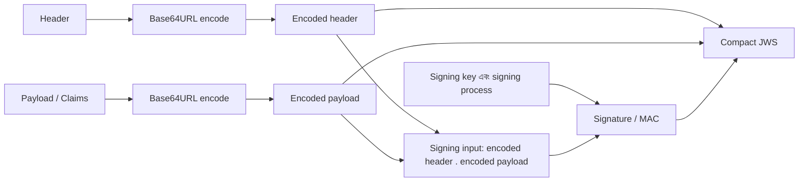
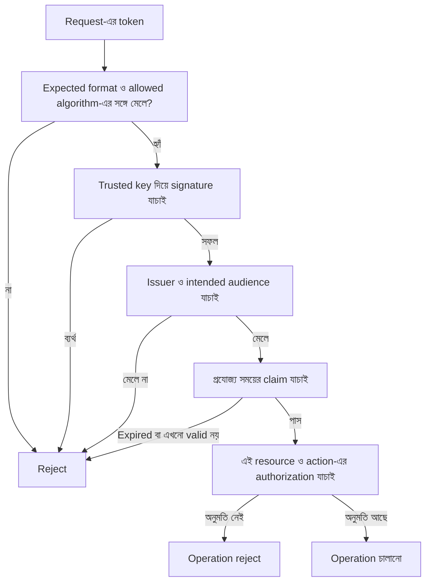

# JWT আসলে কী?

রাফির mobile app এখন KenaKata API-তে access token পাঠায়। আরিফ token যাচাই করার ব্যবস্থা করছে। নীরা একটা সহজ প্রশ্ন করল:

> “Token-টা যদি দেখতে পড়ার মতো লেখা হয়, তাহলে এটা কি নিরাপদ? আর token-এর ভেতরে `role: owner` লেখা থাকলে server কি ধরে নেবে যে user Owner?”

এখানেই JWT নিয়ে সবচেয়ে বিপজ্জনক ভুল ধারণাগুলো শুরু হয়। JWT হলো token লেখার একটি format, নিজে থেকে নিরাপত্তার নিশ্চয়তা নয়।

## ১. Token আর JWT কি একই জিনিস?

না। **Access token হলো token কী কাজে ব্যবহৃত হচ্ছে তার ধারণা; JWT হলো token-এর একটি format।** Access token JWT হতে পারে, আবার এমন opaque value-ও হতে পারে যার অর্থ client নিজে পড়ে বুঝতে পারে না। সব JWT-ও access token নয়। পরে OAuth/OIDC এলে একই format অন্য কাজেও দেখা যাবে।

JWT-এর পূর্ণরূপ JSON Web Token। এটি কিছু claim-কে compact, URL-safe representation-এ বহন করার format। Claim হলো কোনো বিষয় সম্পর্কে একটি statement, যেমন issuer কে, token কার জন্য, বা token কখন expire হবে। Claim লেখা আছে বলেই statement সত্য হয়ে যায় না। Server-কে নির্ধারণ করতে হবে token গ্রহণযোগ্য কি না।

## ২. পরিচিত তিনটি অংশ

সবচেয়ে পরিচিত JWT দেখতে এমন:

```text
xxxxx.yyyyy.zzzzz
```

এখানে তিনটি অংশ dot দিয়ে আলাদা করা। এটি সাধারণত **JWS Compact Serialization**-এর গঠন:



- **Header:** token-এর metadata, যেমন এটি কোন ধরনের object এবং কোন signing algorithm ব্যবহার করা হয়েছে বলে দাবি করছে।
- **Payload:** claims, অর্থাৎ token-এর ভেতরে রাখা statements।
- **Signature / MAC:** নির্দিষ্ট key ও algorithm দিয়ে encoded header ও payload-কে যুক্ত করা signing input-এর ওপর তৈরি integrity protection। JWS-এ algorithm অনুযায়ী এটি digital signature অথবা MAC হতে পারে।

Header ও payload সাধারণত Base64URL encoding করা থাকে। **Encoding encryption নয়।** যে কেউ token-এর এই অংশ decode করে পড়তে পারে। তাই password, secret, বা এমন ব্যক্তিগত তথ্য payload-এ রাখা যাবে না, যা token দেখে ফেলা কেউ জানতে পারুক তা চাই না।

Signature/MAC-ও payload-কে গোপন করে না। এটি সঠিকভাবে যাচাই করা হলে বোঝাতে সাহায্য করে যে protected content বদলানো হয়নি এবং ব্যবহৃত key ও algorithm গ্রহণযোগ্য। Key-টি সত্যিই trusted কি না, সেটি application-এর trust policy-র বিষয়। Signature যাচাই না করে শুধু payload decode করে বিশ্বাস করা নিরাপদ নয়।

> তিন অংশের উদাহরণটি signed JWS-এর পরিচিত রূপ। JWT সবসময় তিন অংশের হবে, এমন নয়। Encrypted JWT-এর জন্য JWE Compact Serialization-এ পাঁচটি অংশ থাকে। Signed আর encrypted আলাদা বৈশিষ্ট্য।

## ৩. ভেতরের লেখা কি সত্যি?

ধরা যাক, token-এর decoded payload-এ এমন কিছু দেখা গেল:

```json
{
  "sub": "user-42",
  "role": "Owner",
  "aud": "kenakata-api",
  "exp": 1893456000
}
```

এটি কেবল শিক্ষামূলক উদাহরণ। এখানে `sub` subject বোঝাতে পারে, `aud` intended audience এবং `exp` expiration time বোঝাতে পারে। কিন্তু নামগুলো দেখে একাই ধরে নেওয়া যাবে না যে token সঠিক, মেয়াদ আছে, বা user সত্যিই Owner।

আক্রমণকারী যদি payload-এর `role` বদলে দেয়, signed token-এর signature আর পরিবর্তিত content-এর সঙ্গে মিলবে না। কিন্তু server যদি signature যাচাই না করে শুধু decoded payload বিশ্বাস করে, তাহলে সেই সুরক্ষা কোনো কাজে আসবে না।

আর signature ঠিক থাকলেও সব সমস্যা শেষ নয়। Token-টি সঠিক issuer থেকে এসেছে কি না, এই API-র জন্যই কি না, মেয়াদ আছে কি না, এবং এই resource-এ চাওয়া action অনুমোদিত কি না, সেগুলোও context অনুযায়ী যাচাই করতে হয়।

## ৪. Server-এর যাচাই: শুধু signature যথেষ্ট নয়

KenaKata-র API-তে token এলে server-এর সিদ্ধান্ত এক ধাপে হয় না। ধারণাগতভাবে:



এটি একটি conceptual checklist, প্রতিটি JWT ব্যবহারের জন্য একটাই universal validation recipe নয়। কোন claim দরকার, তা token-এর উদ্দেশ্য ও সংশ্লিষ্ট profile-এর ওপর নির্ভর করে। তবে নিরাপদ নকশায় অন্তত এই ভুলগুলো এড়াতে হবে:

- **Token-এর নিজের algorithm নির্দেশনাকে অন্ধভাবে বিশ্বাস কোরো না।** Server-এর policy আগে থেকেই ঠিক করবে কোন algorithm গ্রহণযোগ্য। Token-এর header একা সেই policy নির্ধারণ করবে না।
- **যে key-এর ওপর আস্থা রাখার কথা, সেটিই ব্যবহার করো।** Token-এর untrusted header থেকে ইচ্ছেমতো key বা key location বেছে নিলে attacker-এর নিয়ন্ত্রণে validation চলে যেতে পারে।
- **Issuer ও audience যাচাই করো।** অন্য service বা অন্য উদ্দেশ্যের জন্য তৈরি token-কে এই API-র token হিসেবে গ্রহণ করা যাবে না।
- **সময়-সংক্রান্ত claim প্রযোজ্য হলে যাচাই করো।** যেমন `exp` মেয়াদ শেষ হওয়ার সময়, আর `nbf` তার আগে token ব্যবহার না করার নির্দেশ দিতে পারে।
- **Signature পাস মানেই authorization পাস নয়।** Token-এ role বা permission থাকলেও KenaKata-র নির্দিষ্ট resource ও action-এর policy আলাদাভাবে প্রয়োগ করতে হবে।

JWT-এর নিরাপদ ব্যবহার নিয়ে RFC 7519 format-এর মূল সংজ্ঞা দেয়; RFC 8725 নিরাপদ implementation-এর জন্য অতিরিক্ত Best Current Practice নির্দেশনা দেয়। Format জানা মানেই নিরাপদ validation জানা নয়।

## ৫. JWT কী নিশ্চিত করে, আর কী করে না?

| বিষয় | JWT নিজে থেকে নিশ্চিত করে? |
|---|---|
| Claims-এর compact representation | হ্যাঁ, এটি format-এর উদ্দেশ্য |
| Payload গোপন থাকা | না, সাধারণ signed JWS payload পড়া যায় |
| Content বদলানো হয়েছে কি না বোঝার উপায় | JWS-এর signature/MAC সঠিকভাবে যাচাই করলে integrity protection পাওয়া যায় |
| Token trusted issuer-এর কাছ থেকে এসেছে | কেবল সঠিক trust/key এবং issuer validation করলে |
| Token এই API-র জন্য | না, audience ও প্রাসঙ্গিক policy যাচাই করতে হয় |
| Token এখনো valid | না, expiry ও অন্যান্য প্রযোজ্য condition যাচাই করতে হয় |
| User-এর সব resource-এ access | না, authorization আলাদা সিদ্ধান্ত |

## 🧠 Decision Game: কোন token বিশ্বাস করবে?

আরিফের সামনে দুটি token এসেছে। দুটির payload decode করে একই লেখা দেখা যায়: `"role": "Owner"`। Token A-এর signature ও server-এর নির্ধারিত validation checks সফল। Token B-এর signature যাচাই করা হয়নি, শুধু payload decode করা হয়েছে।

**কোন token-এর claim-কে API-র decision-এ ব্যবহার করা যেতে পারে?**

<details>
<summary>উত্তর ও reasoning দেখো</summary>

Token A-ও কেবল তখনই গ্রহণযোগ্য, যখন প্রযোজ্য validation checks সফল হয়েছে, যেমন trusted key, allowed algorithm, issuer, intended audience এবং সময়-সংক্রান্ত শর্ত। এরপরও requested resource ও action-এর authorization আলাদা করে যাচাই করতে হবে।

Token B-কে বিশ্বাস করা যাবে না। Payload decode করলে শুধু লেখা দেখা যায়, token সত্যি বা অক্ষত কি না তা প্রমাণ হয় না। আর Token A-তে `role: Owner` লেখা থাকলেও সেটি সব resource-এ access-এর blanket permission নয়।

**Edge case:** Signature সফল হলেও token ভুল API-র জন্য তৈরি হলে KenaKata সেটি গ্রহণ করবে না। তাই signature একাই যথেষ্ট নয়।

</details>

## ৬. KenaKata-র সিদ্ধান্ত

আরিফের জন্য মূল শিক্ষা: JWT-কে decode করা সহজ হতে পারে, কিন্তু বিশ্বাস করার সিদ্ধান্ত আলাদা। Server যেন client-এর দেখানো claim-কে নিজে যাচাই না করে সত্য ধরে না নেয়। আর JWT ব্যবহার করতেই হবে, এমনও নয়। Opaque access token-ও কিছু architecture-এ উপযুক্ত হতে পারে।

এই অধ্যায়ে আমরা JWT-এর গঠন ও নিরাপত্তার সীমা বুঝলাম। Signing algorithm-এর গভীর বিবরণ, OAuth access-token profile, browser-এ token রাখার কৌশল এবং expiry/replay-এর পূর্ণ timeline পরের অধ্যায়গুলোতে তাদের নিজস্ব threat model-সহ আসবে।

## নিজেকে যাচাই করো

১. তিন অংশের JWT-এর payload decode করতে পারলে কি প্রমাণ হয় যে token বিশ্বাসযোগ্য? কেন?  
২. Signature যাচাই সফল হলেও কেন `aud` বা intended audience যাচাই দরকার হতে পারে?  
৩. JWT আর access token একই ধারণা নয় কেন?  
৪. Signed JWT-এর payload কি গোপন? গোপনীয়তা দরকার হলে কোন আলাদা বৈশিষ্ট্য প্রয়োজন হতে পারে?  
৫. Token-এ `role: Owner` লেখা থাকলে কেন API-র authorization decision বাদ দেওয়া যাবে না?

## আরও পড়ার জন্য

- [RFC 7519 — JSON Web Token](https://www.rfc-editor.org/rfc/rfc7519.html): JWT format, claims ও serialization-এর মূল সংজ্ঞা।
- [RFC 7515 — JSON Web Signature (JWS)](https://www.rfc-editor.org/rfc/rfc7515.html): JWS integrity protection ও compact serialization।
- [RFC 8725 — JSON Web Token Best Current Practices](https://www.rfc-editor.org/rfc/rfc8725.html): JWT ব্যবহারের security guidance।

---

## লেখার অবস্থা

- [x] Draft
- [x] Technical Review (source-based conceptual review; no implementation/browser tests)
- [x] Security Review (source-based threat-model review; not a production audit)
- [ ] Published

Review record: [Chapter 10 Technical ও Security Review](../../../notes/technical-review-chapter-10.md).
