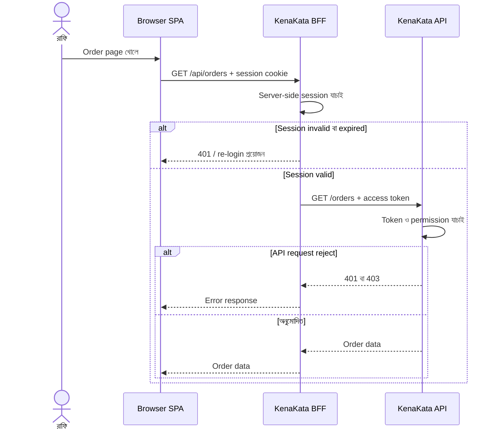
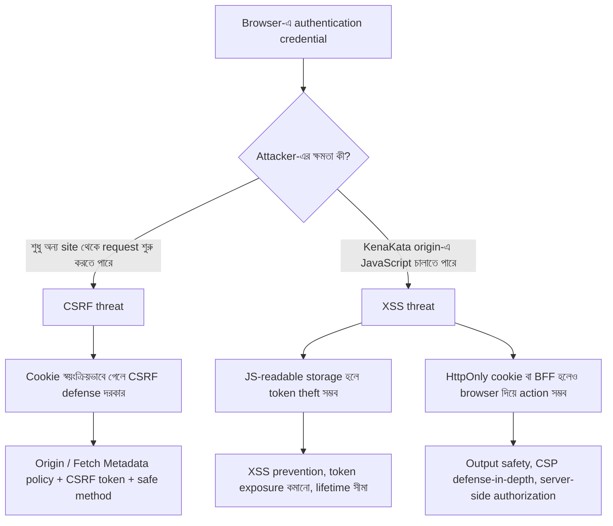

# SPA-তে Token কোথায় রাখব?

রাফির দোকানের server-rendered website আগের মতোই cookie session ব্যবহার করছে। এখন নীরা নতুন একটা **Single-Page Application (SPA)** চায়, যাতে order তালিকা দ্রুত বদলাবে, filter হবে, আর page বারবার reload করতে হবে না।

আরিফের mobile app-এ access token আছে। সে ভাবে, “Browser-ও তো API call করবে। Token-টা browser-এ রেখে দিলেই হয়!” কিন্তু কোথায় রাখবে? `localStorage`? `sessionStorage`? JavaScript-এর memory-তে? নাকি browser-কে একটা **HttpOnly cookie** পাঠাতে দেবে?

এটা শুধু storage API বেছে নেওয়ার প্রশ্ন নয়। **যে জায়গায় credential রাখি, সেটি কোন attacker-এর কাছে কতটা exposed হবে, সেটাই আসল প্রশ্ন।**

> এই অধ্যায়ে KenaKata-র SPA একটি first-party browser client; OAuth flow এখানে এখনো চালু হয়নি। RFC 10017 মূলত OAuth-ভিত্তিক browser client নিয়ে। এর §6.1-এর BFF pattern-কে এখানে architecture-এর তুলনামূলক উদাহরণ হিসেবে ব্যবহার করছি, আর §7.1-এ single-domain, non-OAuth application নিয়ে আলাদা আলোচনা আছে। তাই RFC-তে বর্ণিত OAuth BFF flow-কে KenaKata-র বর্তমান login-এর implementation বা compliance দাবি হিসেবে পড়বে না।

## ১. আগে threat model ঠিক করি

Storage তুলনা করার আগে আরিফ তিনটি প্রশ্ন লিখল:

1. Attacker কি শুধু অন্য website থেকে request পাঠাতে পারে, নাকি KenaKata-র page-এর ভেতরে JavaScript চালাতেও পারে?
2. Attacker কি browser-এর বাইরে token কপি করে নিয়ে যেতে চায়, নাকি user-এর browser দিয়েই কাজ করাতে চায়?
3. Browser বন্ধ বা page reload হলে login টিকে থাকা কি product-এর প্রয়োজন, নাকি user আবার session শুরু করতে পারবে?

এগুলো আলাদা threat। Chapter 6-এ CSRF দেখেছি: browser নিজে cookie যোগ করে এমন request পাঠাতে পারে, যা user ইচ্ছা করে শুরু করেনি। Chapter 8-এ XSS দেখেছি: attacker-এর JavaScript KenaKata-র origin-এর ভেতরে চলতে পারে। Storage decision এই দুই ঝুঁকির ভারসাম্য বদলায়, কিন্তু কোনোটাকেই জাদুর মতো মুছে দেয় না।

## ২. পাঁচটি option, পাঁচ রকম trade-off

### Option A: localStorage

localStorage browser-এ data রাখে, page reload ও browser restart-এর পরও সাধারণত তা থেকে যায়। একই origin-এর page এবং tab-গুলো একই storage দেখতে পারে।

**সুবিধা**
- Reload বা browser restart-এর পরেও value পাওয়া যায়।
- JavaScript সহজে value পড়ে API request-এ token যোগ করতে পারে।
- Browser নিজে থেকে এই value-কে matching request-এ cookie হিসেবে জুড়ে দেয় না। তাই শুধু localStorage-এ থাকা token classic ambient-cookie CSRF-এর মতো স্বয়ংক্রিয়ভাবে পাঠানো হয় না।

**ঝুঁকি**
- একই origin-এ চলা malicious JavaScript token পড়তে পারে। XSS হলে attacker token কপি করে নিজের device থেকে ব্যবহার করার চেষ্টা করতে পারে।
- Token দীর্ঘ সময় browser storage-এ থেকে যেতে পারে।
- Storage-এর data-কে trusted ধরে নেওয়া যাবে না; malicious script তা বদলাতেও পারে।

**মূল শিক্ষা:** Persistence সুবিধাজনক, কিন্তু long-lived credential-এর exposure window-ও বড় করতে পারে। OWASP-এর বর্তমান guidance authentication token, JWT, refresh token বা session ID localStorage-এ না রাখার পরামর্শ দেয়। এটা কোনো browser standard-এর universal law নয়, বরং XSS threat বিবেচনায় শক্তিশালী practical guidance।

### Option B: sessionStorage

sessionStorage-ও JavaScript থেকে পড়া যায়। পার্থক্য হলো, এটি origin এবং browser tab-এর page session অনুযায়ী আলাদা থাকে; tab বন্ধ হলে সাধারণত সেই tab-এর data মুছে যায়।

**সুবিধা**
- localStorage-এর তুলনায় persistence ও অন্য tab-এ exposure কম।
- Browser নিজে থেকে value-টিকে request-এর সঙ্গে cookie হিসেবে যোগ করে না।

**ঝুঁকি**
- XSS হলে একই tab-এর malicious JavaScript token পড়তে পারে।
- Tab খোলা থাকা অবস্থায় token চুরি হলে attacker-এর কাছে token চলে যেতে পারে।
- Tab বন্ধ হলে storage মুছে যাওয়া server-side token বা session বাতিল হওয়ার সমান নয়। আগে কপি করা token তখনও valid থাকতে পারে।

**মূল শিক্ষা:** sessionStorage-এর lifetime ছোট হতে পারে, কিন্তু এটি XSS boundary নয়। “Tab বন্ধ হলে মুছে যায়” মানে “চুরি করা যায় না” নয়।

### Option C: In-memory storage

Token শুধু SPA-র JavaScript memory-তে রাখা হয়, persistent browser storage-এ নয়।

**সুবিধা**
- Page reload বা browser context শেষ হলে memory-র value সাধারণত হারিয়ে যায়।
- localStorage বা sessionStorage-এর মতো স্থায়ীভাবে পড়ে থাকা token নেই।

**ঝুঁকি**
- Page reload হলে token হারাতে পারে, তাই login state আবার establish করার design দরকার।
- XSS চলাকালীন attacker memory থেকে token পেতে পারে, অথবা token না পড়েও user-এর browser দিয়ে authenticated API call করাতে পারে।
- Token memory-তে আছে বলেই অন্য JavaScript থেকে সম্পূর্ণ isolated, এমন নয়। আলাদা Worker বা Service Worker pattern আলাদা architecture এবং তার নিজস্ব trade-off আছে।

**মূল শিক্ষা:** In-memory storage persistent token theft-এর সুযোগ কমাতে পারে, কিন্তু active XSS-কে থামায় না। “Memory-তে রেখেছি, তাই নিরাপদ” অতিরিক্ত বড় দাবি।

### Option D: HttpOnly cookie

এখানে browser একটি cookie-তে session identifier বা অন্য credential রাখে। HttpOnly থাকলে page-এর JavaScript cookie value পড়তে পারে না। Secure cookie-কে HTTPS request-এ সীমাবদ্ধ করে। SameSite কিছু cross-site request-এ cookie পাঠানো সীমিত করতে সাহায্য করে।

একটি illustrative header:

```http
Set-Cookie: __Host-kenakata-session=<opaque-session-id>; Path=/; Secure; HttpOnly; SameSite=Lax
```

এটি শুধু উদাহরণ, production-ready configuration নয়। এখানে Max-Age বা Expires নেই, তাই এটি session cookie-এর উদাহরণ; browser restart-এর পরেও login থাকবে, এমন নিশ্চয়তা দেয় না। Browser session restore-এর আচরণ browser অনুযায়ী আলাদা হতে পারে। __Host- prefix ব্যবহারে Secure, Path=/ এবং Domain attribute না থাকার মতো শর্ত মানতে হয়। SameSite=Lax CSRF-এর পূর্ণ প্রতিরক্ষা নয়; Chapter 6-এর request-origin validation ও CSRF token policy-ও প্রাসঙ্গিক।

**সুবিধা**
- JavaScript সরাসরি HttpOnly cookie value পড়তে পারে না। ফলে XSS দিয়ে cookie value কপি করে নেওয়ার একটি পথ বন্ধ হয়।
- Browser matching request-এ cookie পাঠায়; SPA-কে JavaScript দিয়ে cookie value পড়তে হয় না।
- Opaque session ID server-side session-এর সঙ্গে যুক্ত করা যায়।

**ঝুঁকি**
- Cookie browser স্বয়ংক্রিয়ভাবে request-এ যোগ করতে পারে, তাই CSRF threat model গুরুত্বপূর্ণ।
- XSS থাকলে attacker cookie value না পড়েও page-এর ক্ষমতা ব্যবহার করে authenticated request করাতে পারে।
- HttpOnly cookie-র session value গোপন রাখে; page-এর DOM, accessible data, বা user-এর browser দিয়ে action নেওয়া বন্ধ করে না।

**মূল শিক্ষা:** HttpOnly হলো cookie value JavaScript থেকে আড়াল রাখার control, XSS-এর সম্পূর্ণ সমাধান নয়। Cookie-based authentication-এ CSRF প্রতিরক্ষা design-এর অংশ হতে হবে।

### Option E: Backend for Frontend (BFF)

BFF মানে SPA-র জন্য একটি backend component। Browser BFF-এর সঙ্গে session cookie দিয়ে কথা বলে। Access token ও refresh token BFF-এর server-side environment-এ থাকে, browser-এর JavaScript-এর হাতে সরাসরি দেওয়া হয় না। BFF প্রয়োজনীয় API call-এ token যোগ করে request forward করে।



**সুবিধা**
- Access ও refresh token browser storage-এ রাখতে হয় না।
- Browser-এ থাকা XSS সরাসরি token value চুরি করতে পারে না, কারণ token BFF-এ থাকে।
- Token lifecycle ও API access server-side-এ কেন্দ্রীভূত করা যায়।

**ঝুঁকি ও খরচ**
- Backend component, server-side session storage, deployment ও monitoring দরকার।
- API request BFF দিয়ে যাওয়ায় extra network hop ও operational complexity আসে।
- XSS এখনও user-এর browser দিয়ে BFF-এ authenticated request পাঠাতে পারে। BFF token exfiltration কমায়, কিন্তু compromised page-এর সব ক্ষতিকর action আটকানোর নিশ্চয়তা দেয় না।
- Cookie-ভিত্তিক BFF session-এর জন্য CSRF প্রতিরক্ষা দরকার। Chapter 6-এর KenaKata policy প্রাসঙ্গিক থাকবে।

**মূল শিক্ষা:** BFF browser থেকে token সরিয়ে server-side-এ রাখে, কিন্তু XSS ও CSRF-এর সব প্রভাব সরিয়ে দেয় না।

## ৩. এক নজরে তুলনা

| পদ্ধতি | Reload-এর পর থাকে? | একই origin-এর JavaScript token পড়তে পারে? | Browser নিজে credential request-এ যোগ করে? | প্রধান trade-off |
|---|---|---|---|---|
| localStorage | সাধারণত হ্যাঁ | হ্যাঁ | না, token নিজে থেকে নয় | সুবিধাজনক persistence, XSS-এ token theft-এর ঝুঁকি |
| sessionStorage | একই tab session-এ সাধারণত হ্যাঁ | হ্যাঁ | না, token নিজে থেকে নয় | কম persistence, কিন্তু XSS থেকে সুরক্ষা নয় |
| In-memory | সাধারণত না | চলমান app context-এ token access সম্ভব হতে পারে | না, token নিজে থেকে নয় | কম persistent exposure, reload-এর পর পুনরুদ্ধারের design দরকার |
| HttpOnly cookie | Cookie lifetime/configuration অনুযায়ী | Cookie value সরাসরি পড়তে পারে না | হ্যাঁ, matching request-এ | XSS token theft-এর একটি পথ কমায়, CSRF প্রতিরক্ষা দরকার |
| BFF + session cookie | Server-side session ও cookie lifetime অনুযায়ী | API access token browser-এ নেই (এই BFF variant-এ) | Session cookie হ্যাঁ | Token browser থেকে সরানো যায়, কিন্তু backend complexity ও CSRF রয়ে যায় |

এখানে “JavaScript token পড়তে পারে?” প্রশ্নটি কেবল token value চুরি নিয়ে। XSS-এর সময় attacker যদি token পড়তে না-ও পারে, সে page-এর অনুমোদিত ক্ষমতা ব্যবহার করে action চালানোর চেষ্টা করতে পারে। তাই শুধু table দেখে XSS impact শূন্য ধরে নিও না।

## ৪. CSRF আর XSS: আলাদা ঝুঁকি, আলাদা প্রশ্ন

একটা সহজ mental model:



এই diagram-এ প্রতিরক্ষাগুলো একে অন্যের বিকল্প নয়।

- localStorage-এর token JavaScript দিয়ে Authorization header-এ যোগ করলে browser সাধারণত সেই token নিজে থেকে cross-site request-এ যোগ করে না। এতে classic cookie-based CSRF-এর একটি বৈশিষ্ট্য কমে, কিন্তু XSS-এ token চুরির ঝুঁকি বাড়ে।
- Cookie-ভিত্তিক session-এ browser credential নিজে যোগ করে, তাই CSRF threat model আলাদা করে সামলাতে হয়।
- BFF token browser থেকে আড়াল রাখলেও SPA-র compromised JavaScript BFF-এর endpoint call করতে পারে। State-changing request-এ CSRF defense, server-side authorization এবং XSS prevention সবই প্রয়োজন।
- CORS configuration নিজে application authorization নয়, এবং একে একমাত্র CSRF defense ধরে নেওয়া যাবে না।

## ৫. তাহলে KenaKata কোনটা বেছে নেবে?

আরিফের সামনে দুটি বাস্তব পথ:

1. **SPA সরাসরি API-তে access token পাঠাবে।** Token browser-এর JavaScript পরিচালনা করবে। Persistent storage এড়িয়ে in-memory access token বিবেচনা করা যায়, তবে reload, token renewal ও login continuity-এর design লাগবে। localStorage বা sessionStorage-এ credential রেখে XSS-কে হালকা করে দেখা যাবে না।
2. **SPA একটি BFF-এর সঙ্গে কথা বলবে।** Browser-এ session cookie থাকবে, আর BFF server-side-এ token সামলাবে। এতে token exfiltration-এর ঝুঁকি কমে, কিন্তু backend complexity ও cookie-based CSRF defense-এর প্রয়োজন বাড়ে।

এই অধ্যায়েই refresh-token rotation, reuse detection, expiry বা revocation-এর পূর্ণ lifecycle ঠিক করছি না। সেগুলো অধ্যায় ১১–১৪-এ আসবে। একইভাবে OAuth authorization flow-ও এখন চালু করছি না; Season 2-এ সেটি আলাদা করে শেখানো হবে। Persistent cookie ও server-side session-এর lifetime এখানে শুধু login-persistence trade-off বোঝানোর জন্য এসেছে, পূর্ণ session-lifecycle design হিসেবে নয়.

### 🧠 Decision Game: নীরার requirement বদলালে সিদ্ধান্ত বদলাবে?

নীরা বলল, “আমি চাই browser বন্ধ করে কাল খুললেও login যেন থেকে যায়।” আরিফ প্রস্তাব দিল localStorage-এ refresh token রেখে দেওয়া। অন্যদিকে, team একটি ছোট server-side BFF চালাতে পারবে, তবে এতে operational কাজ বাড়বে।

**কোন সিদ্ধান্তটি সবচেয়ে ভালোভাবে ঝুঁকি ও product requirement দুটোই বিবেচনা করে?**

<details>
<summary>উত্তর ও reasoning দেখো</summary>

প্রথমে শুধু persistence requirement পূরণ করতে localStorage-এ refresh token রাখা উচিত বলে ধরে নেওয়া যাবে না। Refresh token দীর্ঘমেয়াদি ও শক্তিশালী credential হতে পারে; একই origin-এর malicious JavaScript সেটি পড়তে পারলে ক্ষতি বড় হতে পারে।

যদি team BFF-এর বাড়তি operational complexity সামলাতে পারে, server-side token storage ও cookie-based session একটি শক্তিশালী option। তবে browser বন্ধের পর login টিকিয়ে রাখতে হলে cookie-তে উপযুক্ত Max-Age/Expires এবং server-side session-এর উপযুক্ত lifetime লাগতে পারে; দুটির মেয়াদ সামঞ্জস্যপূর্ণ হতে হবে। দীর্ঘ lifetime চুরি হওয়া বা ভুলভাবে ব্যবহার হওয়া session-এর ঝুঁকিও বাড়ায়। Logout-এ শুধু browser-side state মুছে না দিয়ে server-side session-ও invalidate করতে হবে। BFF থাকলেও CSRF defense এবং XSS prevention দরকার।

যদি browser-কে সরাসরি token client হিসেবেই রাখতে হয়, তাহলে persistent storage-এর exposure, token lifetime, renewal design, XSS defenses ও user experience একসঙ্গে বিচার করতে হবে। In-memory storage persistent token theft কমাতে পারে, কিন্তু reload-এর পর login কীভাবে চলবে, সেটাও সমাধান করতে হবে।

**Edge case:** XSS চলমান থাকলে BFF-এর session cookie value না পড়েও attacker user-এর browser দিয়ে authenticated action নিতে পারে। তাই “BFF মানেই XSS শেষ” সঠিক উত্তর নয়।

</details>

## ৬. Security invariant

KenaKata-র জন্য এই অধ্যায়ের সিদ্ধান্তের তিনটি নিয়ম:

1. Browser storage-এ রাখা credential-কে XSS-এর কাছে inaccessible ধরে নেওয়া যাবে না, যদি সেটি page-এর JavaScript-এর নাগালে থাকে।
2. HttpOnly cookie token/session value সরাসরি JavaScript থেকে আড়াল করে; কিন্তু XSS-এর মাধ্যমে authenticated action নেওয়া বা cookie-based CSRF স্বয়ংক্রিয়ভাবে আটকায় না।
3. Token কোথায় আছে তার বাইরে server প্রতিটি protected request-এ token/session validity এবং requested resource/action-এর authorization যাচাই করবে।

## ৭. এই অধ্যায় কী solve করে না?

- **Token lifetime ও expiry:** token কতক্ষণ valid থাকবে এবং মেয়াদ শেষ হলে কী হবে, অধ্যায় ১১।
- **Refresh token lifecycle:** browser বা mobile client নতুন access token কীভাবে পাবে, rotation ও reuse detection কীভাবে কাজ করবে, অধ্যায় ১২–১৩।
- **Logout ও revocation:** browser-এর local value মুছে ফেলা আর server-side credential বাতিল করা এক নয়; বিস্তারিত অধ্যায় ১৪।
- **OAuth flow:** SPA OAuth client হলে authorization code, PKCE ও সংশ্লিষ্ট threat model Season 2-এ আসবে।
- **XSS-এর সম্পূর্ণ প্রতিরোধ:** Chapter 8-এর output handling, CSP-এর সীমা এবং server-side authorization এখানে প্রতিস্থাপিত হচ্ছে না।

## নিজেকে যাচাই করো

1. sessionStorage-এ token রাখলে XSS-এর সময় কী ঝুঁকি থেকে যায়?
2. HttpOnly cookie value JavaScript পড়তে না পারলেও attacker কীভাবে user-এর browser দিয়ে কাজ করাতে পারে?
3. SPA যদি token নিজে Authorization header-এ যোগ করে, আর cookie যদি browser নিজে পাঠায়, CSRF threat model-এ পার্থক্য কী?
4. BFF token browser থেকে সরিয়ে রাখে। এর পরেও কোন দুইটি security concern আলাদা করে সামলাতে হবে?
5. Browser বন্ধ হলে token মুছে যাওয়া আর server-side token revoke হওয়া কেন একই ঘটনা নয়?

## তথ্যসূত্র

- [RFC 10017: OAuth 2.0 for Browser-Based Applications](https://www.rfc-editor.org/rfc/rfc10017.html): আগস্ট ২০২৬-এ প্রকাশিত Internet Best Current Practice। Browser-based OAuth architecture, BFF, in-memory ও persistent token storage-এর threat analysis। KenaKata-র এই অধ্যায়ে OAuth flow চালু করা হচ্ছে না; এখানে browser storage ও BFF ধারণার জন্য reference হিসেবে ব্যবহার করা হয়েছে।
- [OWASP HTML5 Security Cheat Sheet](https://cheatsheetseries.owasp.org/cheatsheets/HTML5_Security_Cheat_Sheet.html): localStorage ও browser storage-এ sensitive data রাখার ঝুঁকি।
- [OWASP Session Management Cheat Sheet](https://cheatsheetseries.owasp.org/cheatsheets/Session_Management_Cheat_Sheet.html): browser storage, cookie এবং session credential-এর নিরাপত্তা।
- [OWASP CSRF Prevention Cheat Sheet](https://cheatsheetseries.owasp.org/cheatsheets/Cross-Site_Request_Forgery_Prevention_Cheat_Sheet.html): cookie-ভিত্তিক credential ও CSRF defense।
- [MDN: Secure cookie configuration](https://developer.mozilla.org/en-US/docs/Web/Security/Practical_implementation_guides/Cookies): Secure, HttpOnly, SameSite ও cookie prefix-এর আচরণ।
- [MDN: Web Storage API](https://developer.mozilla.org/en-US/docs/Web/API/Web_Storage_API): localStorage ও sessionStorage-এর lifetime ও scope।

---

## লেখার অবস্থা

- [x] Draft
- [x] Technical Review (source-based conceptual review; no implementation/browser tests)
- [x] Security Review (source-based threat-model review; not a production audit)
- [ ] Published

Review record: [Chapter 11 Technical ও Security Review](../../../notes/technical-review-chapter-10.md).
