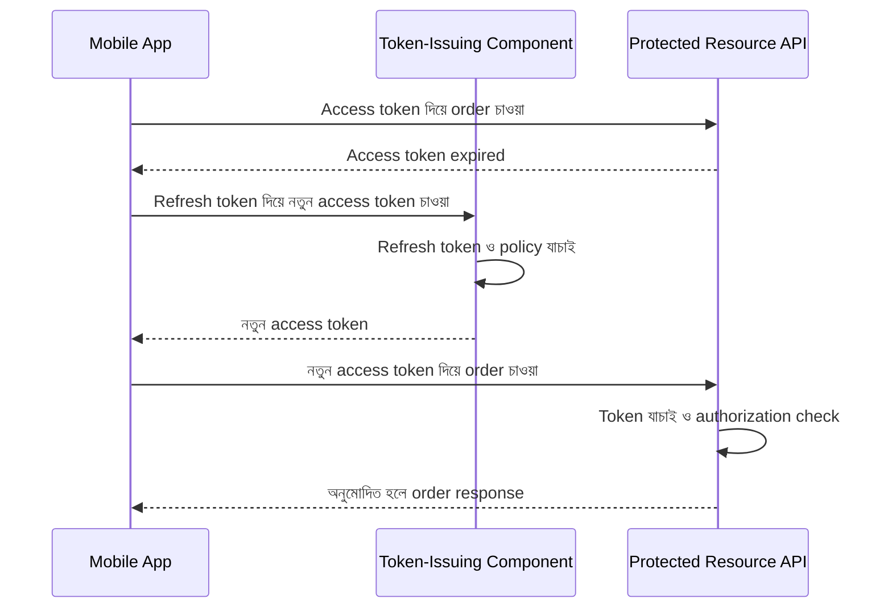
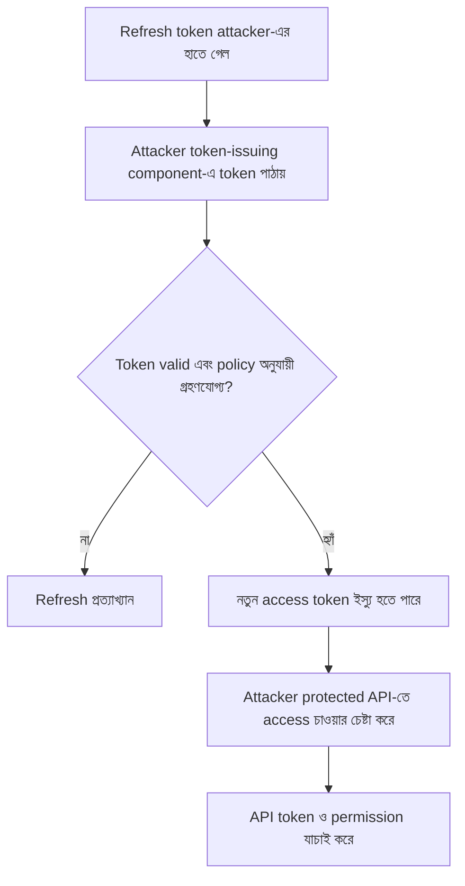
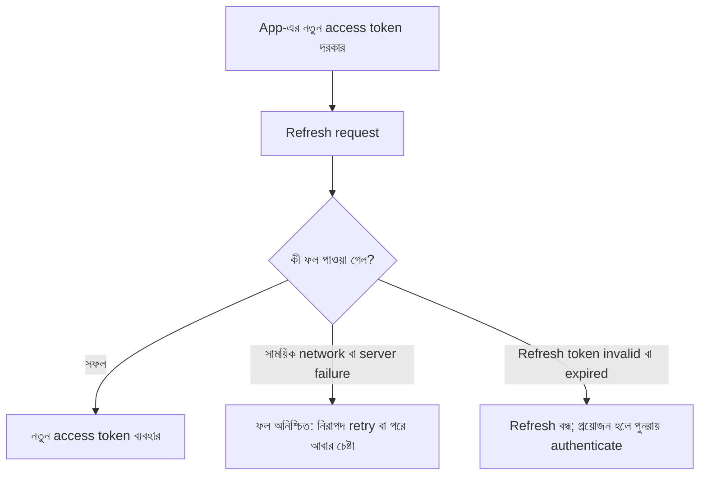

# Refresh Token কেন?

রাফি বাজারে আছে। KenaKata-র mobile app খুলে সকালের order দেখতে গেল। App জানাল, access token-এর মেয়াদ শেষ। আবার password দিয়ে login করতে হবে।

রাফি বিরক্ত। সে আরিফকে বলে, “Token-এর মেয়াদ একটু বাড়িয়ে দাও। বারবার login করতে ভালো লাগে না।”

আরিফ প্রস্তাবটা ভেবে দেখছিল। নীরা প্রশ্ন করল, “মেয়াদ বাড়ালে ব্যবহারকারীর সুবিধা হবে। কিন্তু token চুরি হয়ে গেলে আক্রমণকারীও কি বেশি সময় পাবে না?”

এটাই আসল trade-off। ছোট lifetime চুরি হওয়া access token-এর ব্যবহার-সুযোগ কমাতে পারে, কিন্তু user-কে ঘন ঘন আবার authenticate করতে বলা অসুবিধাজনক। Refresh token এই দুই চাহিদার মধ্যে ভারসাম্য আনার একটি উপায়।

এই অধ্যায়ে KenaKata-র **first-party mobile app** নিয়ে কথা বলব। এখানে OAuth Authorization Code Flow শেখানো হচ্ছে না। OAuth standard-এর কিছু ধারণা তুলনা করার জন্য reference হিসেবে আসবে, KenaKata-র বর্তমান flow-কে OAuth flow বলার জন্য নয়।

## এই অধ্যায়ে কী বুঝবে

- Access token ও refresh token কেন আলাদা কাজ করে।
- Refresh token-কে protected resource API-তে না পাঠানোর কারণ।
- Device storage, TLS, expiry, revocation ও refresh failure-এর user experience কীভাবে একসঙ্গে ভাবতে হয়।

## ১. Access token আর refresh token-এর কাজ এক নয়

Access token হলো protected resource-এ access চাওয়ার credential। KenaKata-র mobile app order API-তে order দেখতে চাইলে access token উপস্থাপন করে। API token গ্রহণযোগ্য কি না যাচাই করে, তারপর আলাদাভাবে দেখে user ওই order দেখার অনুমতি রাখে কি না।

Refresh token-এর কাজ আলাদা। এটি token-issuing component-এর কাছে নতুন access token চাওয়ার credential। Protected resource API-তে access token-এর বদলে refresh token পাঠানো যাবে না।

| বিষয় | Access token | Refresh token |
| --- | --- | --- |
| প্রধান কাজ | Protected resource-এ access চাওয়া | নতুন access token চাওয়া |
| কে গ্রহণ করে | সংশ্লিষ্ট resource API | নির্ধারিত token-issuing component |
| ব্যবহার | সাধারণত API request-এর সঙ্গে | প্রয়োজন হলে token refresh করার সময় |
| মেয়াদ | সাধারণত তুলনামূলক ছোট রাখা হয় | প্রায়ই বেশি দীর্ঘমেয়াদি, তবে policy-নির্ভর |
| চুরি হলে | মেয়াদ ও সীমার মধ্যে API access-এর চেষ্টা হতে পারে | নতুন access token পাওয়ার চেষ্টা হতে পারে, তাই ঝুঁকি বেশি হতে পারে |

এই মেয়াদের তুলনা সাধারণ নকশাগত প্রবণতা, universal rule নয়। প্রতিটি system-এ refresh token থাকতেই হবে, এমনও নয়। Token-issuing component চাইলে refresh token না-ও দিতে পারে; তখন মেয়াদ শেষ হলে নতুন access পাওয়ার জন্য user-কে আবার authenticate করতে হতে পারে।

**মূল পার্থক্য:** Access token দিয়ে resource-এ access চাওয়া হয়। Refresh token দিয়ে নতুন access token চাওয়া হয়। দুটি credential একই কাজের জন্য নয়।

## ২. Refresh token কেন দরকার?

আরিফের সামনে দুটি পথ ছিল।

- **Access token-এর মেয়াদ অনেক বাড়ানো:** user-কে কম ঘন ঘন নতুন token নিতে হবে। কিন্তু token চুরি হলে, অন্য কোনো control বাধা না দিলে, সেটি বেশি সময় ব্যবহারযোগ্য থাকতে পারে।
- **Access token-এর মেয়াদ তুলনামূলক ছোট রাখা এবং refresh token ব্যবহার করা:** access token হারিয়ে গেলে তার ব্যবহার-সময় সীমিত হতে পারে। Refresh token-এর মাধ্যমে user-কে প্রতিবার password দিতে না বলেও নতুন access token পাওয়া যেতে পারে।

Refresh token নিজে ঝুঁকি মুছে দেয় না। বরং এটি একটি নতুন, সংবেদনশীল credential যোগ করে। Attacker যদি refresh token কপি করে এবং server সেটি গ্রহণ করে, তাহলে attacker নতুন access token পেতে পারে। সে কারণে refresh token-কে শুধু “আরেকটা token” হিসেবে দেখা ঠিক নয়।

OAuth-এর ক্ষেত্রে RFC 9700 refresh token-কে আকর্ষণীয় target হিসেবে চিহ্নিত করে, কারণ চুরি হওয়া refresh token নতুন access token ইস্যু করাতে ব্যবহার হতে পারে। এই OAuth-specific নির্দেশনাকে KenaKata-র first-party flow-এর normative rule হিসেবে ধরছি না, তবে threat model-টি এখানেও প্রাসঙ্গিক। [RFC 9700, §4.14](https://www.rfc-editor.org/rfc/rfc9700.html#section-4.14)

## ৩. Refresh lifecycle: স্বাভাবিক পথ

Mermaid sequence diagram-এ mobile app, token-issuing component এবং protected resource API-র দায়িত্ব আলাদা করে দেখা যাক।

এটি একটি ধারণাগত flow। বাস্তবে token response-এর format, refresh policy, client authentication এবং error handling system অনুযায়ী বদলাতে পারে। Diagram-টি OAuth protocol-এর পূর্ণ flow নয়।

খেয়াল করো, refresh token protected resource API-তে যায়নি। API access token যাচাই করে, আর token-issuing component refresh token যাচাই করে। নতুন access token পাওয়া মানেই সব resource-এ সব কাজ করার অনুমতি পাওয়া নয়। Resource API-কে token validation এবং প্রাসঙ্গিক authorization check করতে হবে।

আরেকটি সূক্ষ্ম বিষয়: access token expire হয়েছে বলে app নতুন access token চাইতে পারে। কিন্তু শুধু একটি network request ব্যর্থ হয়েছে বলে token expire হয়েছে, এমন সিদ্ধান্ত নেওয়া যায় না। Network timeout, server error এবং token invalid হওয়ার response আলাদা ঘটনা।

## ৪. Refresh token চুরি হলে কী হতে পারে?

ধরা যাক, রাফির mobile device compromise হয়েছে, অথবা refresh token এমন জায়গায় চলে গেছে যেখানে attacker সেটি পড়তে পারে। Attacker token-issuing component-এ token উপস্থাপন করল। Server যদি token-টিকে এখনও valid ও ব্যবহারযোগ্য বলে গ্রহণ করে, তাহলে attacker নতুন access token পেতে পারে।

এখানে “নতুন access token ইস্যু হতে পারে” কথাটি গুরুত্বপূর্ণ। Refresh token হাতে পেলেই attacker সব কাজ করতে পারবে, এমন নিশ্চয়তা নেই। Token-এর validity, server-side policy, token-এর scope বা অনুমোদিত resource, এবং resource API-র authorization check ফলকে প্রভাবিত করে। কিন্তু refresh token চুরি হলে ঝুঁকি কেবল তার নিজের মেয়াদ পর্যন্ত সীমিত নাও থাকতে পারে; নতুন access token পাওয়ার সুযোগ তৈরি হতে পারে।

এ কারণেই refresh token-কে access token-এর চেয়েও বেশি সংবেদনশীল ধরে পরিকল্পনা করা যুক্তিযুক্ত। তবে “refresh token সবসময় বেশি দীর্ঘমেয়াদি” বা “refresh token সবসময় বেশি ক্ষমতাসম্পন্ন” বলা ঠিক হবে না। নির্দিষ্ট system-এর policy দেখে সিদ্ধান্ত নিতে হবে।

## ৫. Refresh token কীভাবে রক্ষা করব?

কোনো একক control সব ঝুঁকি দূর করে না। প্রতিটি control কোন জায়গায় সাহায্য করে, আর কী সীমা থাকে, তা আলাদা করে বুঝতে হবে।

### Device-এ storage

Mobile app-এ token সাধারণ, অনিরাপদ storage-এ রেখে দেওয়া উচিত নয়। Platform-এর উপযুক্ত secure-storage সুবিধা ব্যবহার করা দরকার। iOS-এর Keychain sensitive ছোট data সংরক্ষণের ব্যবস্থা দেয়; Android Keystore cryptographic key-কে extract করা কঠিন করতে পারে। এগুলো একই জিনিস নয়, আর Keystore নিজে কোনো arbitrary refresh token-কে জাদুর মতো নিরাপদ করে দেয় না। App-এর storage design ও platform API সঠিকভাবে ব্যবহার করা জরুরি।

- [Apple Keychain Services](https://developer.apple.com/documentation/security/keychain-services)
- [Android Keystore system](https://developer.android.com/privacy-and-security/keystore)
- [OWASP MASVS: Secure Storage](https://mas.owasp.org/MASVS/controls/MASVS-STORAGE-1/)

Secure storage-এরও সীমা আছে। Device compromise হলে বা attacker app-এর চলমান process নিয়ন্ত্রণ করলে credential ব্যবহার করার সুযোগ তৈরি হতে পারে। Token log, crash report, analytics event বা অন্য অনুপযুক্ত জায়গায় চলে গেলেও storage control সেটি ফিরিয়ে আনতে পারে না।

### Transmission এবং TLS

Mobile app ও token-issuing component-এর মধ্যে refresh token পাঠানোর সময় TLS-protected connection ব্যবহার করতে হবে। TLS network-এ data গোপন রাখতে ও transit-এ tampering-এর ঝুঁকি কমাতে সাহায্য করে। কিন্তু TLS token-কে device-এর storage-এ নিরাপদে রাখে না, compromised app থেকে আড়াল করে না, কিংবা server-এ পৌঁছানোর পর সব component-কে স্বয়ংক্রিয়ভাবে নিরাপদ করে না।

### Lifetime, idle timeout ও absolute lifetime

Refresh token-এর lifetime নির্ধারণে “সবার জন্য ৩০ দিন” বা “সবসময় ৯০ দিন” এমন একক নিয়ম নেই। Policy-তে অন্তত দুটি আলাদা প্রশ্ন করা যায়:

- **Idle timeout:** নির্দিষ্ট সময় refresh token ব্যবহার না হলে সেটি আর গ্রহণ করা হবে কি না?
- **Absolute lifetime:** মাঝেমধ্যে ব্যবহার হলেও, প্রথম issue হওয়ার পর সর্বোচ্চ কত সময় পর্যন্ত token বা সংশ্লিষ্ট grant চলতে পারবে?

এই দুই নীতি একসঙ্গে থাকতে পারে। Refresh token নিয়মিত ব্যবহার করা হচ্ছে বলে সেটি অনির্দিষ্টকাল valid রাখা বাধ্যতামূলক নয়। আবার খুব ছোট lifetime দিলে user-কে বারবার authenticate করতে হতে পারে। Lifetime নির্ধারণে account-এর sensitivity, device-এর ঝুঁকি, recovery experience এবং server-এর revocation capability বিবেচনা করতে হবে।

### Revocation

Server-side policy অনুযায়ী refresh token বাতিল বা revoke করা যেতে পারে। উদাহরণস্বরূপ, কোনো credential compromise ধরা পড়লে বা সংশ্লিষ্ট authorization আর গ্রহণযোগ্য না হলে সেটি বন্ধ করার প্রয়োজন হতে পারে। কিন্তু refresh token revoke করলেই আগে issue করা প্রতিটি access token সব architecture-এ সঙ্গে সঙ্গে invalid হবে, এমন নিশ্চয়তা নেই। Access token-এর lifecycle ও revocation আলাদা করে নকশা করতে হয়। এর পূর্ণ আলোচনা অধ্যায় ১৫-তে হবে।

### Refresh token না দিলে?

Refresh token দেওয়া সবসময় বাধ্যতামূলক নয়। কোনো application-এ security policy অনুযায়ী user-কে পুনরায় authenticate করানো গ্রহণযোগ্য হতে পারে। অন্য application-এ দীর্ঘ সময় login বজায় রাখার প্রয়োজন বেশি হতে পারে। সিদ্ধান্তটি convenience বনাম credential exposure-এর trade-off, এবং product-এর threat model দিয়ে ব্যাখ্যা করতে হবে।

## ৬. Refresh ব্যর্থ হলে app কী করবে?

সব ব্যর্থতাকে একই error হিসেবে দেখালে ভুল আচরণ হতে পারে।

- **Network timeout বা সাময়িক server error:** refresh-এর ফল জানা নাও যেতে পারে। শুধু এই ব্যর্থতা থেকে refresh token invalid বা access token expired বলে নিশ্চিত হওয়া যায় না। App সীমিত ও নিরাপদ retry policy অনুসরণ করতে পারে, তবে অনবরত retry করা ঠিক নয়।
- **Access token expired বা invalid বলে নিশ্চিত হওয়া:** ওই access token দিয়ে protected resource access চালিয়ে যাওয়া যাবে না। নতুন access token পাওয়া না গেলে user-কে বোঝাতে হবে যে পুনরায় login প্রয়োজন হতে পারে।
- **Refresh token expired, revoked বা invalid বলে নিশ্চিত হওয়া:** policy অনুযায়ী refresh বন্ধ করতে হবে এবং user-কে পুনরায় authenticate করতে বলতে হতে পারে।

এখানে refresh request ব্যর্থ হলেই আগে থাকা access token অবশ্যই invalid, এমন নয়। যদি access token এখনও valid থাকে, policy অনুযায়ী সেটি ব্যবহারযোগ্য হতে পারে। আর যদি সেটি expired বা invalid বলে নিশ্চিত হয়, সেটি দিয়ে API access চালানো যাবে না।

Diagram-টি failure handling-এর উচ্চস্তরের মডেল। Refresh token rotation, concurrent refresh request, reuse detection এবং ambiguous timeout-এর পূর্ণ recovery policy এখানে আলোচনা করা হচ্ছে না। সেগুলো পরের অধ্যায় ১৪-এর বিষয়।

## ৭. KenaKata-র সিদ্ধান্ত

আরিফ বুঝল, শুধু access token-এর মেয়াদ বাড়ালে user experience সহজ হতে পারে, কিন্তু token চুরি হলে ঝুঁকির সময়ও বাড়তে পারে। Refresh token একটি বিকল্প পথ দেয়: access token তুলনামূলক ছোট lifetime-এ রাখা যায়, আর user-কে প্রতিবার password দিতে না বলেও নতুন access token পাওয়ার সুযোগ থাকে।

কিন্তু এই সুবিধার বিনিময়ে refresh token-এর জন্য আলাদা সুরক্ষা দরকার। Device-এ সঠিক storage, TLS-এ transmission, যুক্তিযুক্ত lifetime, server-side validation এবং প্রয়োজনে revocation একসঙ্গে বিবেচনা করতে হবে। কোনো একটিকে সম্পূর্ণ সমাধান বলা যাবে না।

**Security invariant**

- Refresh token শুধু নির্ধারিত trusted token-issuing component-এ পাঠানো হবে।
- Protected resource API-তে access চাওয়ার সময় access token ব্যবহার হবে।
- Refresh token পাওয়া মানেই access token issue হবে, এমন নয়; server-কে token ও প্রযোজ্য policy যাচাই করতে হবে।
- Refresh failure আর access token invalid হওয়া একই ঘটনা নয়।
- Refresh token revoke হলেও আগে issue করা access token-এর অবস্থা architecture অনুযায়ী আলাদা করে বিবেচনা করতে হবে।

## নিজেকে যাচাই করো

1. Access token-এর মেয়াদ বাড়ালে user experience-এ কী সুবিধা এবং token চুরি হলে কী ঝুঁকি তৈরি হতে পারে?
2. Refresh token-কে protected resource API-তে পাঠানো উচিত নয় কেন?
3. TLS ব্যবহার করলেও device-এর storage-এ refresh token রক্ষা করার আলাদা ব্যবস্থা কেন দরকার?
4. Network timeout হলে refresh token invalid বলে সঙ্গে সঙ্গে সিদ্ধান্ত নেওয়া ঠিক হবে কি?
5. Refresh token revoke করলে আগে issue করা access token সব system-এ সঙ্গে সঙ্গে invalid হবে কি?

উত্তর মিলিয়ে দেখো

1. Access token-এর lifetime বাড়ালে বারবার refresh বা re-authentication কমতে পারে, কিন্তু token চুরি হলে তার অপব্যবহারের সময়ও বাড়তে পারে।

2. Access token protected resource API-তে ব্যবহার হয়; refresh token token-issuing component-এর কাছে নতুন access token চাওয়ার জন্য। তাই refresh token সাধারণ resource API-তে পাঠানো উচিত।

3. TLS transit-এ সুরক্ষা দেয়; device-এ token সংরক্ষণের সময়, backup, malware, logs বা compromised device থেকে তা নিজে রক্ষা করে না।

4. না। Timeout মানে client response পায়নি, কিন্তু server operation সম্পন্ন করে থাকতে পারে। Retry policy ও token state না বুঝে পুরোনো token invalid বলে ধরে নিলে race তৈরি হতে পারে।

5. না। Access token কীভাবে validate ও revoke হয়, সেটির policy আলাদা; refresh token revoke হলেই সব issued access token স্বয়ংক্রিয়ভাবে বন্ধ হয় না.

## আরও পড়ো

- [RFC 6749, §1.5 এবং §6: Refresh Token](https://www.rfc-editor.org/rfc/rfc6749.html#section-1.5)
- [RFC 9700, §4.14: Refresh Token Protection](https://www.rfc-editor.org/rfc/rfc9700.html#section-4.14)  
  এটি OAuth 2.0-এর Best Current Practice। KenaKata-র first-party flow-কে OAuth flow হিসেবে উপস্থাপন করার ভিত্তি নয়।
- [OWASP Mobile Application Security Verification Standard: Secure Storage](https://mas.owasp.org/MASVS/controls/MASVS-STORAGE-1/)
- [Apple Keychain Services](https://developer.apple.com/documentation/security/keychain-services)
- [Android Keystore system](https://developer.android.com/privacy-and-security/keystore)

## ধারাবাহিকতা

আগে: [অধ্যায় ১২: Token Expiration এবং Replay Window](../12-token-expiration-replay/README.md)

পরে: [অধ্যায় ১৪: Refresh Token Rotation এবং Reuse Detection](../14-refresh-token-rotation/README.md)

[Product timeline](../../../product/timeline.md) অনুযায়ী KenaKata-র mobile app-এ refresh token আগে থেকেই আছে। এই অধ্যায় সেই first-party lifecycle-এর ধারণা শেখায়, OAuth flow নয়।

