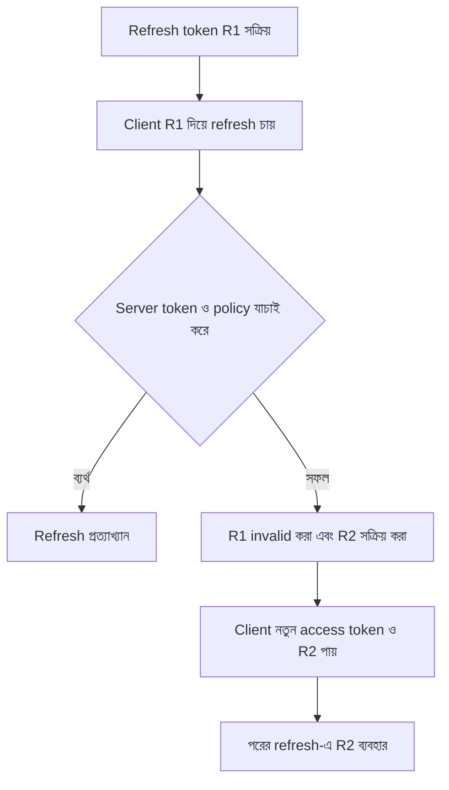
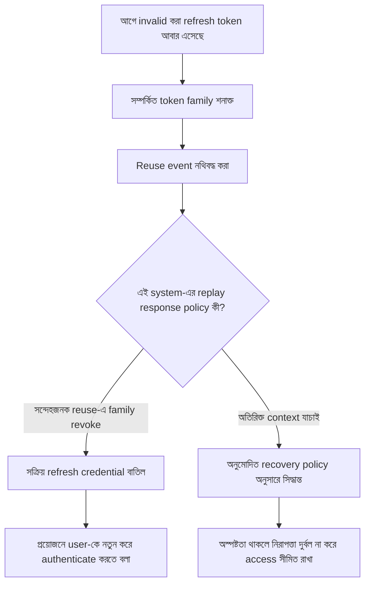

# Refresh Token Rotation এবং Reuse Detection

আরিফ KenaKata-র mobile app-এ refresh token ব্যবহার করে নতুন access token পাওয়ার ব্যবস্থা করেছে। এবার সে আরেকটি নিরাপত্তা-ব্যবস্থা যোগ করতে চায়: refresh token একবার ব্যবহার হলে পুরোনো token আর ব্যবহারযোগ্য থাকবে না, তার বদলে নতুন refresh token দেওয়া হবে।

কয়েক দিন পর monitoring-এ দেখা গেল, আগের একটি refresh token আবার এসেছে। নীরা প্রশ্ন করল, “এটা কি token চুরি হওয়ার প্রমাণ? নাকি network timeout-এর পর app পুরোনো request আবার পাঠিয়েছে?”

এই প্রশ্নের উত্তরই এই অধ্যায়ের কেন্দ্র। **Rotation** পুরোনো refresh token-এর জায়গায় নতুন token দেয়। **Reuse detection** এমন পুরোনো token আবার ব্যবহার করার ঘটনা শনাক্ত করে। কিন্তু detection signal একা বলে দিতে পারে না request-টি attacker পাঠিয়েছে, নাকি বৈধ client।

এই অধ্যায় KenaKata-র first-party mobile flow নিয়ে। OAuth-এর security standard তুলনা হিসেবে ব্যবহার করব, কিন্তু KenaKata-র flow-কে OAuth flow হিসেবে উপস্থাপন করব না।

## ১. Rotation কী বদলায়?

অধ্যায় ১২-তে দেখেছি, refresh token নতুন access token পাওয়ার credential। দীর্ঘমেয়াদি credential চুরি হলে attacker সেটি ব্যবহার করে নতুন access token চাইতে পারে। Rotation-এর ধারণা হলো, refresh সফল হলে আগের refresh token invalid করে নতুন refresh token ইস্যু করা।

ধারণাগত lifecycle:



Diagram-এ R1 ও R2 হলো বোঝানোর জন্য দেওয়া নাম, বাস্তব token value নয়।

Rotation-এর উদ্দেশ্য পুরোনো token-কে চিরকাল ব্যবহারযোগ্য রাখা নয়। Server-কে token-এর lifecycle মনে রাখতে হবে, যাতে R1 ইতিমধ্যে ব্যবহার হয়ে গেছে কি না বোঝা যায়। Token-গুলোকে একটি **token family** বা সংশ্লিষ্ট grant-এর সঙ্গে যুক্ত করে রাখা যেতে পারে। Token family হলো একই ধারাবাহিক refresh lifecycle-এর অংশ হওয়া token-গুলোর সম্পর্ক।

একটি গুরুত্বপূর্ণ নকশাগত বিষয় হলো state transition-এর consistency। একই R1 দিয়ে প্রায় একই সময়ে দুটি refresh request এলে server যেন দুটিকেই স্বাধীনভাবে সফল ধরে আলাদা active successor তৈরি না করে ফেলে। পুরোনো token invalid করা, নতুন token তৈরি করা এবং family-র state update পরস্পরের সঙ্গে সামঞ্জস্যপূর্ণ হতে হবে। এটি server-side design concern, কোনো নির্দিষ্ট database বা framework-এর tutorial নয়।

## ২. Reuse detection কী জানায়?

Rotation-এর পর R1 আর সাধারণভাবে refresh করার জন্য গ্রহণযোগ্য নয়। যদি R1 আবার আসে, server জানতে পারে পুরোনো token পুনরায় উপস্থাপন করা হয়েছে। একে reuse signal বলা যায়।

কিন্তু signal আর নিশ্চিত attribution এক নয়। অন্তত দুটি সম্ভাবনা আছে:

- **Credential compromise:** attacker R1 কপি করেছে এবং বৈধ client-এর আগেই বা পরে সেটি ব্যবহার করছে।
- **Client-side race বা retry:** বৈধ app-এর একাধিক process একই token দিয়ে request করেছে, অথবা server token rotate করেছে কিন্তু response client পায়নি, তাই client পুরোনো R1 আবার পাঠিয়েছে।

Server শুধু invalidated R1 দেখে সাধারণত বলতে পারে না কে request পাঠিয়েছে। OAuth 2.0 Security Best Current Practice, RFC 9700-এর §4.14-এ এই সীমাটি স্পষ্ট: compromised refresh token attacker এবং legitimate client উভয়ের মাধ্যমে ব্যবহার হলে কোন পক্ষ invalidated token পাঠিয়েছে তা authorization server নির্ধারণ করতে পারে না। OAuth public client-এর ক্ষেত্রে ওই guidance অনুযায়ী rotation ব্যবহার করা হলে পুরোনো token-এর reuse replay signal দেয় এবং সক্রিয় refresh token revoke করার ফল হতে পারে। [RFC 9700, §4.14](https://www.rfc-editor.org/rfc/rfc9700.html#section-4.14)

KenaKata-র first-party flow-এর জন্য এটি গুরুত্বপূর্ণ threat-model শিক্ষা, কিন্তু OAuth-এর normative requirement-গুলোকে এখানে স্বয়ংক্রিয়ভাবে বাধ্যতামূলক product rule হিসেবে ধরে নেওয়া হচ্ছে না।

## ৩. Reuse দেখা গেলে কী সিদ্ধান্ত নেওয়া যায়?

এই flow-তে reuse signal পাওয়ার পর server-কে policy অনুযায়ী প্রতিক্রিয়া জানাতে হবে। একটি সম্ভাব্য সিদ্ধান্ত-প্রবাহ:



এটি policy বোঝানোর diagram, সব system-এর জন্য নির্ধারিত algorithm নয়। উচ্চ ঝুঁকির ক্ষেত্রে family-র সক্রিয় refresh token revoke করা replay-এর সুযোগ বন্ধ করতে পারে। কিন্তু এর খরচও আছে: বৈধ user-কে আবার login করতে হতে পারে। অপরদিকে, প্রতিটি reuse-কে harmless retry ধরে গ্রহণ করলে attacker-এর replay-ও বৈধ হয়ে যেতে পারে।

**Security trade-off:** Detection-এ false positive হলে বৈধ user-এর session শেষ হতে পারে। Detection-কে উপেক্ষা করলে চুরি হওয়া credential ব্যবহারযোগ্য থাকতে পারে। তাই নীতিতে নিরাপত্তা, user impact এবং recovery-র সীমা স্পষ্ট হওয়া দরকার।

## ৪. Network timeout: সবচেয়ে বিভ্রান্তিকর ঘটনা

ধরা যাক, mobile app R1 দিয়ে refresh request পাঠাল। Server request গ্রহণ করল, R1 invalid করে R2 তৈরি করল, এবং নতুন access token-সহ response পাঠাল। কিন্তু network connection মাঝপথে ভেঙে যাওয়ায় app response পেল না।

এখন server-এর কাছে R2 active, কিন্তু app-এর কাছে এখনও R1-ই আছে। App যদি না জেনে R1 আবার পাঠায়, server সেটিকে reuse হিসেবে দেখতে পারে। এটি credential theft-এর মতোই দেখাতে পারে, যদিও মূল ঘটনা network timeout।

```mermaid
sequenceDiagram
    participant M as Mobile App
    participant T as Token-Issuing Component
    participant S as Token-Family State

    M->>T: R1 দিয়ে refresh request
    T->>S: R1 যাচাই; R1 invalid, R2 active
    S-->>T: State update সফল
    T--xM: R2 ও access token-এর response হারিয়ে যায়
    M->>T: Timeout-এর পর R1 দিয়ে আবার request
    T->>S: R1 ইতিমধ্যে invalid
    S-->>T: R1 পুরোনো token
    T-->>M: Policy অনুযায়ী reject বা recovery
```

এখানে “response হারিয়ে যায়” বলতে network-এ response client-এর কাছে না পৌঁছানো বোঝানো হয়েছে, server-এর state update ব্যর্থ হওয়া নয়।

এই অবস্থার জন্য একটিমাত্র সহজ সমাধান নেই। কয়েকটি design option ও trade-off:

- **এক সময়ে একটি refresh:** একই client-এর একাধিক process যেন একসঙ্গে refresh শুরু না করে, client-side coordination সাহায্য করতে পারে। তবে আলাদা device বা process-এর race পুরোপুরি দূর নাও হতে পারে।
- **সীমিত retry policy:** সাময়িক network error হলে অনবরত পুরোনো token পাঠানোর বদলে সীমিত retry ও পরিষ্কার recovery path দরকার।
- **Idempotent recovery বা সীমিত grace window:** server একই logical refresh operation-কে নিরাপদে চিনতে এবং প্রয়োজনীয় response পুনরুদ্ধার করতে পারলে user experience উন্নত হতে পারে। কিন্তু replay ঠেকানোর নিশ্চয়তা দুর্বল করে এমন grace period ঝুঁকি বাড়াতে পারে। এটি স্বয়ংক্রিয় fix নয়, এবং নির্দিষ্ট protocol ও threat model ছাড়া নিরাপদ বলে ধরে নেওয়া যাবে না।
- **Re-authentication:** server নিরাপদে আগের operation-এর ফল উদ্ধার করতে না পারলে user-কে নতুন করে authenticate করানো বিরক্তিকর হতে পারে, কিন্তু অস্পষ্ট পরিস্থিতিতে এটি গ্রহণযোগ্য recovery policy হতে পারে।

Client-এর retry আচরণ আর server-এর reuse policy একসঙ্গে নকশা করতে হবে। শুধু “timeout হলে একই token আবার পাঠাও” বললে race-এর সমস্যাটি অমীমাংসিত থেকে যায়।

## ৫. Rotation কি সব ধরনের replay ঠেকায়?

না। Rotation পুরোনো refresh token পুনরায় ব্যবহার শনাক্ত করতে সাহায্য করে, কিন্তু সব attack বা সব timing পরিস্থিতির সমাধান নয়। যদি attacker token চুরি করে বৈধ client-এর আগে ব্যবহার করে, server প্রথমে attacker-এর request-কে বৈধ বলে ধরে নতুন token দিতে পারে। পরে বৈধ client পুরোনো token পাঠালে reuse signal দেখা দিতে পারে, কিন্তু server কে আসল user তা বুঝতে পারে না। Policy অনুযায়ী সক্রিয় token family বাতিল করা যেতে পারে, যার ফলে attacker এবং বৈধ user দুজনেরই refresh বন্ধ হবে।

আরও একটি উচ্চস্তরের বিকল্প হলো **sender-constrained token**: token-কে এমন cryptographic প্রমাণের সঙ্গে যুক্ত করা, যা নির্দিষ্ট client বা key-এর নিয়ন্ত্রণ দেখাতে সাহায্য করে। OAuth-এ DPoP ও mutual TLS-এর মতো পদ্ধতি এই পরিবারের উদাহরণ, তবে সেগুলোর নিজস্ব শর্ত ও সীমাবদ্ধতা আছে। এই অধ্যায়ে protocol-এর বিস্তারিত শেখানো হবে না। [RFC 9700, §2.2.2](https://www.rfc-editor.org/rfc/rfc9700.html#section-2.2.2)

RFC 9700 অনুযায়ী OAuth public client-এর refresh token replay শনাক্ত করার জন্য sender-constraining অথবা rotation-এর একটি পদ্ধতি ব্যবহার করতে হবে। এটি OAuth-specific requirement। KenaKata-র first-party mobile design-এ কোন control বেছে নেওয়া হবে, তা তার architecture ও threat model অনুযায়ী নির্ধারণ করতে হবে।

## ৬. KenaKata-র নকশার প্রশ্ন

নীরা আরিফকে চারটি প্রশ্ন দিল:

1. একই refresh token দিয়ে দুটি request এলে server কীভাবে একটিমাত্র consistent token-family transition নিশ্চিত করবে?
2. Server token rotate করার পর response হারিয়ে গেলে app কীভাবে বুঝবে পরবর্তী পদক্ষেপ কী?
3. পুরোনো token আবার দেখা গেলে কোন পরিস্থিতিতে family revoke হবে, এবং বৈধ user-কে কী recovery দেখানো হবে?
4. Security event-এর log-এ কী তথ্য দরকার, যাতে incident তদন্ত করা যায়, কিন্তু raw refresh token log-এ ফাঁস না হয়?

শেষ প্রশ্নটি বিশেষভাবে গুরুত্বপূর্ণ। Reuse detection তদন্তের জন্য event metadata দরকার হতে পারে, কিন্তু raw credential log-এ লেখা উচিত নয়। Logging-এর উদ্দেশ্য ঘটনার সময়, সংশ্লিষ্ট grant/family-র internal identifier এবং ফলাফল বুঝতে সাহায্য করা, secret-টিকে আরেকটি জায়গায় কপি করা নয়।

## Security invariant

- Rotation সফল হলে পুরোনো refresh token আর সাধারণভাবে নতুন access token পাওয়ার জন্য ব্যবহারযোগ্য থাকবে না।
- Reuse detection একটি replay signal, কিন্তু শুধু ওই signal থেকে request পাঠানো ব্যক্তির পরিচয় নিশ্চিত করা যায় না।
- Concurrent refresh request ও response হারিয়ে যাওয়ার পরিস্থিতি server-side state consistency এবং client recovery policy দিয়ে বিবেচনা করতে হবে।
- Retry বা grace policy replay protection দুর্বল করতে পারে, তাই এর ঝুঁকি স্পষ্টভাবে মূল্যায়ন করতে হবে।
- Refresh token family revoke করা হলে access token সঙ্গে সঙ্গে invalid হবে কি না, সেটি আলাদা access-token/revocation design-এর ওপর নির্ভর করে; বিস্তারিত অধ্যায় ১৪-তে।

## নিজেকে যাচাই করো

1. Rotation আর reuse detection-এর কাজ কীভাবে আলাদা?
2. R1 invalid হওয়ার পর আবার R1 এলে কেন এটিকে নিশ্চিত আক্রমণের প্রমাণ বলা যায় না?
3. Server R2 তৈরি করেছে কিন্তু client response পায়নি, এমন অবস্থায় কী ধরনের race তৈরি হয়?
4. প্রতিটি reuse-এ token family revoke করলে security benefit কী, আর বৈধ user-এর ওপর কী প্রভাব পড়তে পারে?
5. Grace window ব্যবহার করলে replay protection কীভাবে দুর্বল হতে পারে?
6. OAuth public client-এর জন্য RFC 9700-এর নির্দেশনা আর KenaKata-র first-party design decision কেন আলাদা করে বলতে হবে?

## আরও পড়ো

- [RFC 9700, §2.2.2: Refresh Tokens](https://www.rfc-editor.org/rfc/rfc9700.html#section-2.2.2)
- [RFC 9700, §4.14: Refresh Token Protection](https://www.rfc-editor.org/rfc/rfc9700.html#section-4.14)
- [RFC 6749, §6: Refreshing an Access Token](https://www.rfc-editor.org/rfc/rfc6749.html#section-6)

RFC 9700 হলো OAuth 2.0 Security Best Current Practice। এর OAuth-specific normative language-কে KenaKata-র first-party mobile flow-এর সরাসরি protocol specification হিসেবে পড়া যাবে না।

## ধারাবাহিকতা

আগে: [অধ্যায় ১২: Refresh Token কেন?](../13-refresh-token/README.md)

পরে: [অধ্যায় ১৪: Logout, Revocation এবং Session Recovery](../15-logout-revocation/README.md)

[Product timeline](../../../product/timeline.md) অনুযায়ী mobile app-এ access token ও refresh token অধ্যায় ১০-এর SPA আসার আগেই আছে। এই অধ্যায় সেই first-party lifecycle-এর rotation ও reuse-detection ঝুঁকি ব্যাখ্যা করে।

## লেখার অবস্থা

- [x] পূর্ণাঙ্গ Draft
- [x] Technical Review (source-based conceptual review)
- [x] Security Review (source-based threat-model review)
- [ ] Published

রিভিউয়ের সীমা: RFC 9700 ও RFC 6749-এর প্রাসঙ্গিক নিয়মের সঙ্গে মূল security claim এবং OAuth বনাম first-party scope মিলিয়ে দেখা হয়েছে। এটি production implementation audit নয়; কোনো application test suite চালানো হয়নি।
