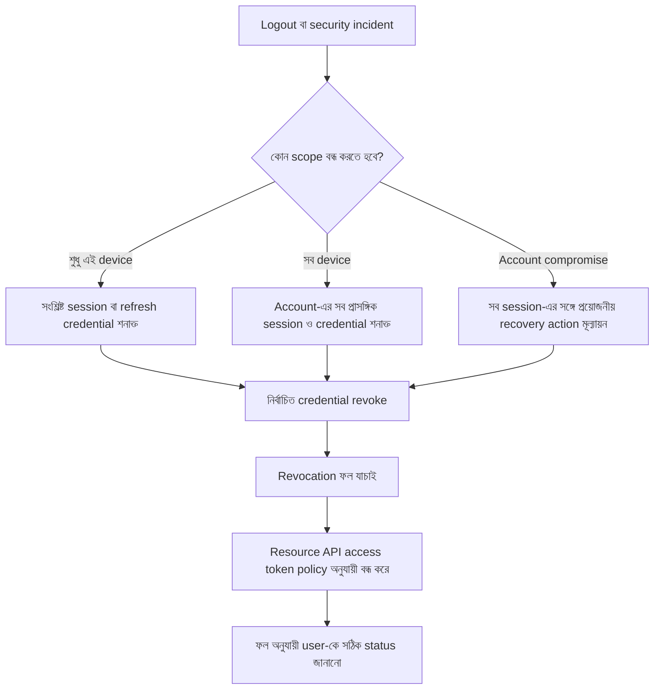

# Logout, Revocation এবং Session Recovery

রাফি KenaKata-র mobile app থেকে logout করল। App login screen-এ ফিরে গেল। রাফি ভাবল, “ব্যস, আমার account থেকে বের হয়ে গেছি। পুরোনো token-ও আর কাজ করবে না।”

কিন্তু আরিফের মাথায় প্রশ্ন: app কি শুধু device-এর local credential মুছে দিয়েছে, নাকি server-এও সংশ্লিষ্ট refresh token বা session বন্ধ হয়েছে? আর access token যদি self-contained JWT হয়, resource API কি প্রতিটি request-এ revocation-এর বর্তমান অবস্থা যাচাই করে?

এগুলো আলাদা প্রশ্ন। **Logout হলো user-facing action; revocation হলো server-side credential বা session-কে আর গ্রহণ না করার ব্যবস্থা; expiry হলো token-এর নির্ধারিত মেয়াদ শেষ হওয়া।** কোনো architecture-এ এই ঘটনাগুলো একসঙ্গে ঘটতে পারে, কিন্তু এগুলো একই ঘটনা নয়।

এই অধ্যায় KenaKata-র first-party mobile flow নিয়ে। OAuth standard-এর কিছু ধারণা তুলনার জন্য ব্যবহার করা হবে, কিন্তু KenaKata-র flow-কে OAuth token revocation protocol হিসেবে উপস্থাপন করা হবে না।

## এই অধ্যায়ে কী বুঝবে

- Client-side logout, server-side revocation ও expiry আলাদা ঘটনা।
- Refresh token revoke করলেই আগে issue করা access token সব architecture-এ সঙ্গে সঙ্গে বন্ধ হয় না।
- Single-device logout, all-device logout ও account-compromise recovery-র scope কীভাবে আলাদা করতে হয়।

## ১. Logout করলে আসলে কী শেষ হয়?

Logout-এ অন্তত তিনটি আলাদা স্তর থাকতে পারে:

- **Client-side logout:** app local credential ও authenticated UI state পরিষ্কার করে। এটি device-এ থাকা token-এর স্থানীয় কপি সরাতে পারে।
- **Server-side revocation:** server সংশ্লিষ্ট session, refresh token বা token family আর গ্রহণ না করার সিদ্ধান্ত নেয়।
- **Access token-এর অকার্যকর হওয়া:** protected resource API token-টি আর গ্রহণ করে না। কখন তা ঘটবে, তা token-এর ধরন এবং API revocation state যাচাই করে কি না তার ওপর নির্ভর করে।

Client-side logout গুরুত্বপূর্ণ। Shared বা হারানো device-এ local credential রেখে দিলে অন্য কেউ তা ব্যবহার করার চেষ্টা করতে পারে। কিন্তু local copy মুছে ফেলা মানেই অন্য জায়গায় কপি করা token মুছে গেছে, এমন নয়। Token আগে থেকেই চুরি হয়ে থাকলে local deletion সেটিকে server-এর কাছে invalid করে না।

অন্যদিকে server-side revocation সফল হলেও client-এর UI যদি authenticated state-এ থেকে যায়, user বিভ্রান্ত হতে পারে। তাই app-এর local state এবং server-side ফলাফল আলাদা করে পরিচালনা করতে হবে।

## ২. স্বাভাবিক logout flow

নিচের diagram-এ local logout এবং server-side revocation-এর ফল আলাদা রাখা হয়েছে।

```mermaid
sequenceDiagram
    participant U as User
    participant M as Mobile App
    participant T as Token-Issuing Component
    participant A as Protected Resource API

    U->>M: Logout চাপেন
    M->>M: Local credential ও authenticated UI state পরিষ্কার
    M->>T: Server-side refresh credential revoke করার অনুরোধ
    alt Revocation নিশ্চিত হয়েছে
        T-->>M: Revocation সফল
        M-->>U: এই device থেকে logout সম্পন্ন
    else Network failure বা ফল অনিশ্চিত
        T--xM: Response পাওয়া যায়নি
        M-->>U: Local logout হয়েছে; server-side revocation নিশ্চিত নয়
    end
    Note over A: Access token গ্রহণ বন্ধ হবে কি না তা API-র validation ও revocation policy-র ওপর নির্ভর করে
```

Diagram-টি ধারণাগত। বাস্তব app-এ local cleanup ও server request-এর ক্রম product policy অনুযায়ী বদলাতে পারে। গুরুত্বপূর্ণ বিষয় হলো, app যেন server-side revocation সফল হয়েছে বলে দাবি না করে যদি response বা অন্য নির্ভরযোগ্য সংকেত থেকে তা নিশ্চিত না হয়।

কখনো network unavailable থাকলেও user-কে device-এ local logout করতে দেওয়া উচিত হতে পারে। সে ক্ষেত্রে app local credential মুছে দিতে পারে, কিন্তু server-side credential revoke হয়েছে বলে নিশ্চিত করতে পারে না। App পরে পুনরায় চেষ্টা করবে কি না, তা নির্দিষ্ট recovery policy-র অংশ। Local logout আর server-side revocation-এর এই পার্থক্য UI copy-তেও সত্য থাকতে হবে।

## ৩. Refresh token revoke করলেই access token বন্ধ হয়?

সবসময় নয়। Refresh token নতুন access token পাওয়ার জন্য ব্যবহৃত হয়। সেটি revoke করলে ওই refresh credential দিয়ে ভবিষ্যতে token refresh বন্ধ হতে পারে। কিন্তু আগে issue করা access token-এর validity আলাদা বিষয়।

ধরা যাক, রাফির access token এখনও মেয়াদের মধ্যে আছে। Server তার refresh token revoke করেছে, কিন্তু protected resource API access token-এর revocation state পরীক্ষা করে না। API যদি কেবল token-এর signature, issuer, audience, expiry এবং প্রযোজ্য authorization policy যাচাই করে, তাহলে token অন্যভাবে valid থাকলে expiry পর্যন্ত গ্রহণ করতে পারে।

এটি সব JWT-এর জন্য অবধারিত আচরণ নয়। JWT হলো token format; system চাইলে JWT validation-এর পাশাপাশি server-side revocation state-ও পরীক্ষা করতে পারে। তাই “JWT revoke করা যায় না” বলার বদলে বলা ভালো: **self-contained access token-কে তাৎক্ষণিকভাবে অকার্যকর করতে চাইলে resource API-র কাছে revocation কার্যকর করার উপযুক্ত ব্যবস্থা থাকতে হবে।**

RFC 7009 OAuth context-এ revocation-এর কথা বলে এবং token-এর ধরন ও server policy অনুযায়ী সংশ্লিষ্ট token বা grant-এর প্রভাব বিবেচনা করে। এটি কোনো সাধারণ first-party app-এর সব access token সঙ্গে সঙ্গে invalid হওয়ার universal guarantee নয়। [RFC 7009](https://www.rfc-editor.org/rfc/rfc7009.html)

## ৪. Revocation কীভাবে কার্যকর করা যায়?

একটি architecture-এ একাধিক কৌশল থাকতে পারে। প্রতিটির সুবিধা ও খরচ আছে।

| কৌশল | সুবিধা | সীমা বা খরচ |
| --- | --- | --- |
| Opaque access token এবং server-side lookup | Server প্রতিটি request-এ token-এর active state দেখতে পারে | Lookup-এর latency ও service availability-র ওপর নির্ভরতা |
| Token introspection | Resource API trusted component-কে token active কি না জিজ্ঞেস করতে পারে | অতিরিক্ত network call; cache করলে stale result-এর ঝুঁকি |
| JWT-এর সঙ্গে revocation state/denylist পরীক্ষা | নির্দিষ্ট token বা session বন্ধ করার সুযোগ | Request-time lookup বা cache invalidation দরকার; self-contained token-এর কিছু সরলতা হারায় |
| তুলনামূলক ছোট access-token lifetime | Token স্বাভাবিকভাবে দ্রুত expire হয়, ফলে অবশিষ্ট exposure window সীমিত হতে পারে | Expiry পর্যন্ত token গ্রহণযোগ্য থাকার সম্ভাবনা থেকে যায় |
| Session/version state যাচাই | নির্দিষ্ট session বা account-এর token বাতিল করার policy প্রয়োগ করা যায় | Resource API-কে state জানতে হয় এবং state update দ্রুত ছড়িয়ে পড়তে হয় |

Token introspection-এর standard হলো RFC 7662। এটি token-এর active state যাচাই করার পদ্ধতি বর্ণনা করে, কিন্তু প্রতিটি system-কে প্রতিটি request-এ একইভাবে introspection করতেই হবে, এমন কথা এই অধ্যায়ে বলা হচ্ছে না। [RFC 7662](https://www.rfc-editor.org/rfc/rfc7662.html)

**Cache-এর trade-off:** Resource API revocation state cache করলে latency ও server load কমতে পারে। কিন্তু cache পুরোনো state ধরে রাখলে revoke করা token কিছু সময় আরও গ্রহণযোগ্য থাকতে পারে। তাই “তাৎক্ষণিক revocation” বলতে system আসলে কত দ্রুত revocation কার্যকর করে, তা architecture ও cache policy দিয়ে নির্ধারিত হয়।

## ৫. একটি device logout বনাম সব device logout

একটি account-এর একাধিক device বা session থাকতে পারে। রাফি নিজের পুরোনো ফোন থেকে logout করতে চাইলে সব device-এর session বাতিল করা প্রয়োজন নাও হতে পারে। কিন্তু ফোন হারিয়ে গেলে সে হয়তো শুধু ওই device-এর session revoke করতে চাইবে। Account compromise হলে সব active session বা credential বাতিল করার সিদ্ধান্ত যুক্তিযুক্ত হতে পারে।



“সব device logout” একটি শক্ত দাবি। System-কে জানতে হবে account-এর সঙ্গে যুক্ত কোন session ও credential আছে, সেগুলো revoke করার ব্যবস্থা কী, এবং সংশ্লিষ্ট resource API-গুলোতে revocation কীভাবে কার্যকর হবে। শুধু বর্তমান device-এর local state মুছে দিয়ে এই দাবি করা যাবে না।

এছাড়া refresh token family revoke হওয়া মানেই সব access token সঙ্গে সঙ্গে invalid, এমন নয়। Access token-এর জন্য আলাদা revocation mechanism না থাকলে সেগুলো expiry পর্যন্ত গৃহীত হতে পারে। UI-তে ফলাফলের scope স্পষ্ট করে বলা উচিত: যেমন “এই device থেকে logout হয়েছে” বা “সব পরিচিত session revoke করার অনুরোধ সম্পন্ন হয়েছে”। দ্বিতীয় বাক্যটিও system-এর বাস্তব নিশ্চয়তার সঙ্গে মিলতে হবে।

## ৬. Password reset, account compromise ও employee offboarding

সব incident-এ একই recovery policy প্রযোজ্য নয়।

- **Password reset:** Password বদলালে সব বিদ্যমান session স্বয়ংক্রিয়ভাবে বন্ধ হবে কি না, তা product policy ও architecture-র ওপর নির্ভর করে। সংবেদনশীল account-এ password reset-এর সঙ্গে active session revoke করার সিদ্ধান্ত নেওয়া যেতে পারে, তবে সেটি বাস্তবে প্রয়োগ করতে হবে।
- **Account compromise:** শুধু password বদলানো যথেষ্ট নাও হতে পারে। চুরি হওয়া refresh token, active session এবং ইতিমধ্যে issue হওয়া access token-এর ঝুঁকি আলাদাভাবে বিবেচনা করতে হবে।
- **হারানো device:** সংশ্লিষ্ট device/session শনাক্ত করা গেলে সেটি revoke করা যেতে পারে। যদি device-specific session আলাদা করে চেনা না যায়, account-এর আরও বিস্তৃত session revoke করতে হতে পারে।
- **Employee offboarding:** কর্মীর account access বন্ধ করার পাশাপাশি তার session ও credential revoke হয়েছে কি না যাচাই করতে হবে। Access token কীভাবে invalidate হবে, সেটিও system design-এর অংশ।

এগুলো policy decision, প্রতিটি application-এর জন্য একই বাধ্যতামূলক sequence নয়। Security requirement, session model এবং resource API-র revocation support অনুযায়ী আচরণ নির্ধারণ করতে হবে।

## ৭. Audit log ও user notification

Logout বা revocation incident-এর পর তদন্ত করতে হলে ঘটনার ফলাফল বোঝার মতো metadata দরকার। উদাহরণস্বরূপ, কখন request এসেছে, কোন internal session বা credential record সংশ্লিষ্ট, কোন action নেওয়া হয়েছে এবং তা সফল হয়েছে কি না। কিন্তু raw access token, refresh token বা bearer credential log-এ রাখা উচিত নয়। Logging নিজেই credential leak-এর নতুন পথ হয়ে উঠতে পারে।

User notification-ও বাস্তব ফলাফলের সঙ্গে মিলতে হবে। যদি server-side revocation ব্যর্থ বা অনিশ্চিত হয়, app বলতে পারে যে local logout হয়েছে, কিন্তু server-side revocation নিশ্চিত করা যায়নি। যদি account compromise-এর কারণে সব session revoke করার কাজ শুরু হয়, system সফলভাবে কাজটি শেষ না করা পর্যন্ত “সব session বন্ধ” বলে দাবি করা যাবে না।

## Security invariant

- Local logout সফল হওয়া মানেই server-side credential revoke হয়েছে, এমন নয়।
- Refresh token revoke করলে আগে issue করা প্রতিটি access token সব architecture-এ সঙ্গে সঙ্গে invalid হয় না।
- Revocation কার্যকর হবে কি না, তা resource API-র validation policy, server-side state এবং cache freshness-এর ওপর নির্ভর করতে পারে।
- “সব device logout” বলার আগে সংশ্লিষ্ট সব পরিচিত session/credential-এর scope ও revocation ফল নিশ্চিত করতে হবে।
- Audit log-এ raw access token বা refresh token রাখা যাবে না।

## নিজেকে যাচাই করো

1. Client-side logout আর server-side revocation-এর পার্থক্য কী?
2. Refresh token revoke করার পরও আগে issue করা access token কেন কাজ করতে পারে?
3. Self-contained JWT-কে তাৎক্ষণিকভাবে অকার্যকর করতে resource API-র কী ধরনের ব্যবস্থা দরকার হতে পারে?
4. Revocation state cache করলে latency-র সুবিধা ও security-র ঝুঁকি কী?
5. একটি device logout আর সব device logout-এর মধ্যে কী পার্থক্য?
6. Network failure হলে app কীভাবে user-কে logout-এর ফল সম্পর্কে সত্য তথ্য দিতে পারে?
7. Account compromise-এর সময় password reset-এর বাইরে আর কী কী credential/session বিবেচনা করা দরকার?


<details>
<summary>উত্তর মিলিয়ে দেখো</summary>

1. Client-side logout device-এর local credential/UI state পরিষ্কার করে। Server-side revocation server-কে নির্দিষ্ট session বা credential আর গ্রহণ না করতে বলে। একটির সফলতা অন্যটির প্রমাণ নয়।

2. Refresh token ভবিষ্যতে নতুন access token নেওয়ার পথ বন্ধ করতে পারে, কিন্তু আগে issue করা access token expiry পর্যন্ত গৃহীত হতে পারে যদি resource API revocation state না দেখে।

3. Architecture অনুযায়ী denylist, introspection/reference token, session version, short lifetime বা অন্য server-side validation mechanism দরকার হতে পারে। কোনটি উপযুক্ত তা latency ও security requirement-এর ওপর নির্ভর করে।

4. Cache latency কমায়, কিন্তু stale revocation state পুরোনো token-কে কিছু সময় গ্রহণযোগ্য রাখতে পারে। Cache TTL ও invalidation policy তাই security decision-এর অংশ।

5. Single-device logout নির্দিষ্ট session/credential scope বন্ধ করে; all-device logout-এর জন্য account-এর সঙ্গে যুক্ত সব প্রাসঙ্গিক session/credential শনাক্ত ও revoke করার ব্যবস্থা দরকার।

6. Network failure হলে app local credential মুছে দিতে পারে, কিন্তু server-side revocation নিশ্চিত না হলে সেটি নিশ্চিত হয়েছে বলে বলা যাবে না। UI-তে এই পার্থক্য সত্যভাবে জানাতে হবে।

7. Password reset-এর পাশাপাশি active sessions, refresh-token families, recovery channels, API keys বা অন্য persistent credential-ও threat model অনুযায়ী বিবেচনা করতে হবে.

</details>

## আরও পড়ো

- [RFC 7009: OAuth 2.0 Token Revocation](https://www.rfc-editor.org/rfc/rfc7009.html)
- [RFC 7662: OAuth 2.0 Token Introspection](https://www.rfc-editor.org/rfc/rfc7662.html)
- [RFC 7519, §4.1.4: Expiration Time](https://www.rfc-editor.org/rfc/rfc7519.html#section-4.1.4)
- [OWASP Session Management Cheat Sheet](https://cheatsheetseries.owasp.org/cheatsheets/Session_Management_Cheat_Sheet.html)

OAuth standards-এ থাকা protocol-specific নিয়মকে KenaKata-র first-party mobile flow-এর সরাসরি specification হিসেবে পড়া যাবে না। এখানে RFC-গুলো token expiry, revocation ও introspection-এর ধারণা যাচাই করার authoritative reference।

## ধারাবাহিকতা

আগে: [অধ্যায় ১৪: Refresh Token Rotation এবং Reuse Detection](../14-refresh-token-rotation/README.md)

পরে: [অধ্যায় ১৬: IDOR/BOLA এবং Authorization Design](../16-idor-bola-authorization/README.md)

[Product timeline](../../../product/timeline.md) অনুযায়ী mobile app-এ access token ও refresh token আগে থেকেই আছে। এই অধ্যায় first-party mobile flow-তে logout, revocation ও recovery-র ধারণা ব্যাখ্যা করে, OAuth token revocation endpoint-এর tutorial নয়।

