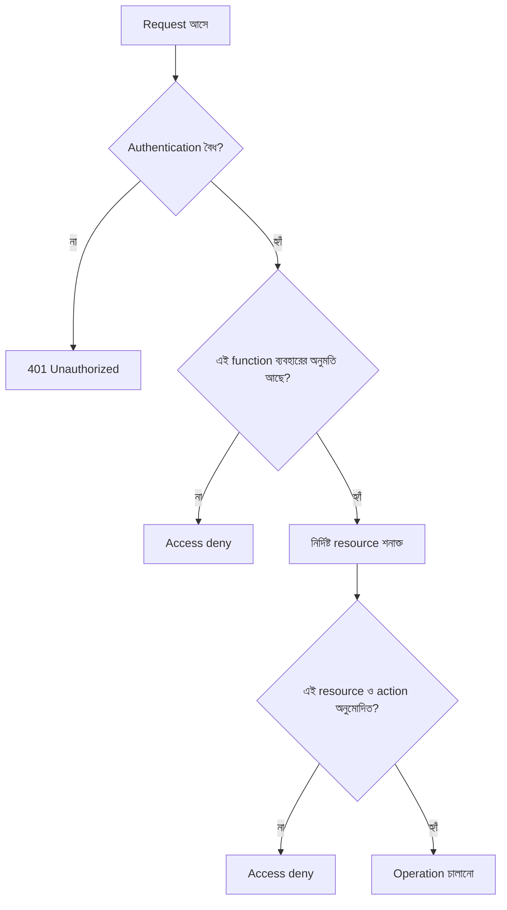
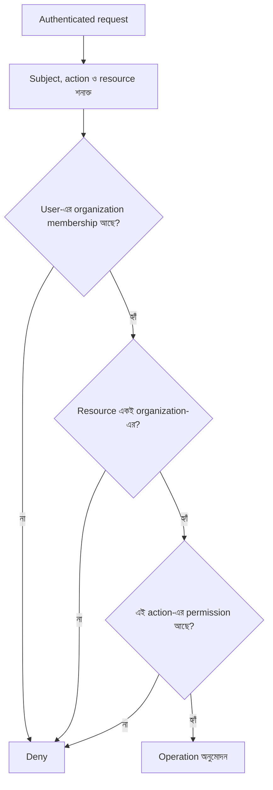
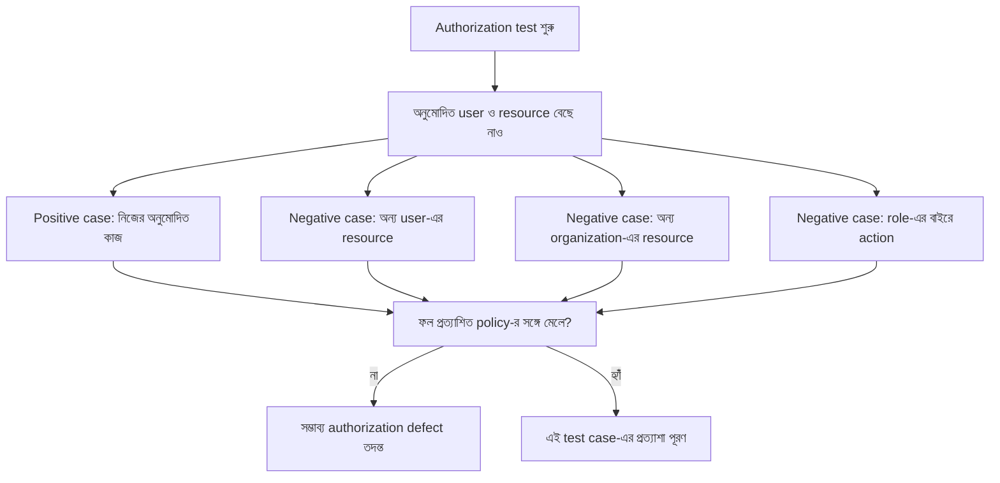

# IDOR/BOLA এবং Authorization Design

রাফি KenaKata-তে ঠিকভাবেই login করেছে। সে নিজের order দেখার সময় request-এ থাকা order ID বদলে আরেকটি order দেখতে পেল। Login সফল, access token বৈধ, endpoint-ও ব্যবহার করার অনুমতি তার আছে। তবু অন্য customer-এর order দেখা উচিত ছিল না।

সমস্যাটি পরিচয় যাচাইয়ে নয়। **Server যাচাই করেনি, রাফির এই নির্দিষ্ট order-এ access পাওয়ার অধিকার আছে কি না।** এই ধরনের ব্যর্থতা IDOR বা API-র ভাষায় BOLA হিসেবে পরিচিত।

পরে KenaKata এক দোকান থেকে বহু organization-কে সেবা দেওয়া SaaS-এ পরিণত হয়। এখন order নির্দিষ্ট organization-এরও অন্তর্ভুক্ত। User একটি organization-এর member হতে পারে, অন্যটির নয়। তাই authorization-এ আরও একটি প্রশ্ন যোগ হয়: এই resource কোন tenant-এর, আর এই user সেই tenant-এ কী করতে পারে?

## ১. IDOR এবং BOLA কী?

**IDOR (Insecure Direct Object Reference)** হলো এমন vulnerability, যেখানে client কোনো object-এর reference পাঠায়, কিন্তু server যাচাই করে না যে request করা user ওই object-এ access বা পরিবর্তনের অনুমতি রাখে কি না।

**BOLA (Broken Object Level Authorization)** হলো API security-তে object-level authorization ব্যর্থতার নাম। OWASP API Security Top 10-এ এটি আলাদা ঝুঁকি হিসেবে চিহ্নিত। IDOR ও BOLA ধারণাগতভাবে ঘনিষ্ঠ, যদিও তাদের ব্যবহারিক context এক নয়। এই অধ্যায়ের সাধারণ শিক্ষা: object ID পাওয়া মানেই object ব্যবহারের অনুমতি পাওয়া নয়। [OWASP: API1:2023 BOLA](https://api-security.owasp.org/editions/2023/en/0xa1-broken-object-level-authorization/)

একটি object হতে পারে order, invoice, support ticket, profile, document বা অন্য কোনো record। Reference হতে পারে URL-এর ID, query parameter, request body-র field, header বা অন্য identifier।

Sequential ID বদলানো একটি পরিচিত উদাহরণ, কিন্তু vulnerability শুধু সহজে অনুমান করা ID-তে সীমাবদ্ধ নয়। UUID বা জটিল identifier-ও যদি ফাঁস হয় বা জানা যায়, authorization check না থাকলে সমস্যা থেকে যায়। Identifier অনুমান করা কঠিন করা কিছু exposure কমাতে পারে, কিন্তু permission-এর বিকল্প নয়।

## ২. Authentication ঠিক থাকলেও authorization ভুল হতে পারে

এই তিনটি প্রশ্ন আলাদা:

- **Authentication:** request-টি কোন user বা subject-এর?
- **Function-level authorization:** এই user কি endpoint বা কাজটি ব্যবহার করতে পারে?
- **Object-level authorization:** এই user কি এই নির্দিষ্ট object-এর ওপর এই action করতে পারে?

একজন customer order দেখার endpoint ব্যবহার করতে পারে। এটি function-level permission। কিন্তু তার মানে এই নয় যে সে অন্য customer-এর যেকোনো order দেখতে পারবে। প্রতিটি order-এর ওপর তার অনুমতি আলাদাভাবে যাচাই করতে হবে।

এটি একটি ধারণাগত flow, নির্দিষ্ট HTTP response-এর সম্পূর্ণ নিয়ম নয়। 401 সাধারণত authentication প্রয়োজন বা ব্যর্থ হওয়ার সঙ্গে সম্পর্কিত। Authenticated user-এর permission না থাকলে 403 ব্যবহার করা যেতে পারে। কিছু system resource আছে কি না তা গোপন রাখতে 404-ও দিতে পারে। Response code বাছাইয়ের চেয়ে গুরুত্বপূর্ণ হলো অননুমোদিত operation যেন কোনো অবস্থাতেই না চলে এবং response policy consistent থাকে।

## ৩. Authorization decision কীভাবে ভাববে?

প্রতিটি sensitive request-এ চারটি বিষয় বিবেচনা করা সহায়ক:

- **Subject:** কে কাজটি করতে চাইছে?
- **Action:** কী করতে চাইছে, যেমন read, update, delete বা export?
- **Resource:** কোন order, invoice বা document নিয়ে কাজ?
- **Context:** কোন organization, membership, resource state বা অতিরিক্ত business condition প্রযোজ্য?

একই user একই object-এ read করার অনুমতি পেতে পারে, কিন্তু delete করার অনুমতি নাও পেতে পারে। আবার user organization A-তে Admin হলেও organization B-তে Member হতে পারে, কিংবা B-তে তার কোনো membership-ই নাও থাকতে পারে। তাই শুধু “user-এর role Admin” দেখেই সব resource-এর access অনুমোদন করা ভুল হতে পারে।

## ৪. Multi-tenant system-এ boundary যাচাই

KenaKata এখন একাধিক organization-কে সেবা দেয়। প্রতিটি order একটি নির্দিষ্ট organization-এর অন্তর্ভুক্ত। User-এর active organization বা request-এ পাঠানো organization ID একাই trusted permission নয়। Server-কে যাচাই করতে হবে user-এর membership আছে কি না, resource ওই organization-এর কি না এবং ওই action-এর জন্য তার যথেষ্ট permission আছে কি না।

এখানে active organization client বেছে দিতে পারে, কিন্তু সেটিকে server-এর authorization decision-এর বিকল্প করা যাবে না। User request-এ organization ID পাঠালেই সে ওই organization-এর member হয়ে যায় না।

**Tenant isolation invariant:** authenticated subject-এর অনুমোদিত membership, resource-এর tenant এবং requested action মিলিয়ে যাচাই না করে tenant-এর data পড়া বা বদলানো যাবে না।

## ৫. কোন কোন endpoint-এ পরীক্ষা দরকার?

Object-level authorization শুধু “একটি order দেখাও” ধরনের endpoint-এ সীমাবদ্ধ নয়।

- **Read:** অন্য user-এর order বা invoice পড়ার চেষ্টা।
- **List/search:** list endpoint যেন ভুল করে অন্য tenant-এর record ফিরিয়ে না দেয়।
- **Update:** order-এর ID বদলে অন্যের order পরিবর্তনের চেষ্টা।
- **Delete:** resource মুছে ফেলার আগে তার ওপর delete permission যাচাই।
- **Export/download:** report, attachment বা export file-এ একই access boundary বজায় রাখা।
- **Nested resource:** কোনো order-এর অধীনে থাকা item, comment বা attachment সত্যিই সেই order-এর অংশ কি না যাচাই করা।

একটি endpoint-এ check থাকলেই অন্য endpoint নিরাপদ হয়ে যায় না। Read endpoint সঠিক হলেও export endpoint বা nested resource endpoint-এ একই authorization boundary ভুলে যাওয়া সম্ভব।

## ৬. Query scoping এবং authorization logic

Tenant-ভিত্তিক system-এ resource খোঁজার সময় query-কে অনুমোদিত organization বা user scope-এর মধ্যে সীমাবদ্ধ রাখা একটি কার্যকর প্রতিরক্ষামূলক কৌশল। এতে ভুল tenant-এর resource accidentally পাওয়া বা পরের ধাপে ব্যবহার হওয়ার ঝুঁকি কমতে পারে।

তবে query scoping-কে সম্পূর্ণ authorization policy ধরে নেওয়া যাবে না। একই organization-এর সব member-এর সব action করার অনুমতি নাও থাকতে পারে। Resource-level ownership, role, action এবং business condition-ও প্রাসঙ্গিক হতে পারে। Centralized authorization component policy এক জায়গায় রাখতে সাহায্য করতে পারে, কিন্তু সেটি সঠিকভাবে প্রতিটি relevant request-এ প্রয়োগ হচ্ছে কি না, তা নিশ্চিত করতে হবে।

মূল নীতি হলো **deny by default**: কোনো request অনুমোদিত হওয়ার যথেষ্ট ভিত্তি না থাকলে operation চালানো হবে না। Permission প্রতিটি প্রাসঙ্গিক request-এ যাচাই করতে হবে, কারণ user-এর role, membership বা resource state বদলে যেতে পারে। OWASP-ও least privilege, deny by default এবং প্রতি request-এ permission validation-এর ওপর জোর দেয়। [OWASP Authorization Cheat Sheet](https://cheatsheetseries.owasp.org/cheatsheets/Authorization_Cheat_Sheet.html)

## ৭. Authorization failure কীভাবে পরীক্ষা করবে?

এই অধ্যায়ের উদ্দেশ্য runnable test code লেখা নয়। বরং test case কী প্রশ্ন করবে, তা স্পষ্ট করা।

ধরা যাক, দুটি user আছে: A এবং B। তাদের আলাদা order আছে। একইভাবে organization A ও organization B-তে আলাদা resource আছে। Negative test-এ অন্তত নিচের পরিস্থিতি বিবেচনা করতে হবে:

- User A নিজের order পড়তে পারে কি?
- User A, user B-এর order ID দিলে read, update বা delete প্রত্যাখ্যাত হয় কি?
- Organization A-এর member organization B-এর resource access করতে পারে কি?
- একই organization-এ Member role-এর user এমন action করতে পারে কি, যা কেবল Admin-এর জন্য?
- List, search, export এবং nested resource-এও একই boundary বজায় থাকে কি?
- Resource ID বৈধ হলেও permission না থাকলে operation বন্ধ হয় কি?

Positive test গুরুত্বপূর্ণ, কারণ সব request reject করে দিলেই system নিরাপদ হয়ে যায় না। Test-কে নিশ্চিত করতে হবে অনুমোদিত কাজ চলে এবং অননুমোদিত কাজ বন্ধ হয়। এই diagram test-planning-এর ধারণা দেখায়, বাস্তবে test suite চালানোর দাবি নয়।

## Security invariant

- Resource ID বা UUID জানা মানেই resource access করার অনুমতি পাওয়া নয়।
- প্রতিটি relevant request-এ subject, action ও resource-এর permission যাচাই করতে হবে।
- Multi-tenant system-এ user-এর membership এবং resource-এর tenant boundary যাচাই না করে operation চালানো যাবে না।
- Function-level permission থাকলেও object-level permission আলাদা করে প্রয়োজন হতে পারে।
- Authorization policy স্পষ্টভাবে অনুমতি না দিলে access deny হবে।

## নিজেকে যাচাই করো

1. Authentication সফল হলেও BOLA কীভাবে ঘটতে পারে?
2. UUID ব্যবহার করলে IDOR/BOLA কেন পুরোপুরি দূর হয় না?
3. Function-level authorization আর object-level authorization-এর পার্থক্য কী?
4. Organization A-এর Admin কি স্বয়ংক্রিয়ভাবে organization B-এর resource access করতে পারবে? কেন?
5. List endpoint ও single-resource endpoint-এ একই authorization boundary বজায় রাখা কেন জরুরি?
6. Query scoping কীভাবে সাহায্য করে, আর কেন এটি সব business permission-এর বিকল্প নয়?
7. Negative test-এ cross-user, cross-organization ও role-based কোন কোন case রাখা উচিত?

## আরও পড়ো

- [OWASP API Security Top 10: API1:2023 Broken Object Level Authorization](https://api-security.owasp.org/editions/2023/en/0xa1-broken-object-level-authorization/)
- [OWASP IDOR Prevention Cheat Sheet](https://cheatsheetseries.owasp.org/cheatsheets/Insecure_Direct_Object_Reference_Prevention_Cheat_Sheet.html)
- [OWASP API Security Top 10: API5:2023 Broken Function Level Authorization](https://api-security.owasp.org/editions/2023/en/0xa5-broken-function-level-authorization/)
- [OWASP Authorization Cheat Sheet](https://cheatsheetseries.owasp.org/cheatsheets/Authorization_Cheat_Sheet.html)

OWASP-এর guidance এই অধ্যায়ের conceptual reference। এগুলো KenaKata-র জন্য নির্দিষ্ট framework বা database implementation নির্দেশ করে না।

## ধারাবাহিকতা

আগে: [অধ্যায় ১৪: Logout, Revocation এবং Session Recovery](../15-logout-revocation/README.md)

পরে: [অধ্যায় ১৬: OAuth 2.0 কেন?](../../season-2-oauth-oidc/17-oauth/README.md)

[Product timeline](../../../product/timeline.md) অনুযায়ী KenaKata এখন organization, membership এবং Owner, Admin, Member, Viewer role-সহ multi-organization SaaS। এই অধ্যায় সেই product model-এ authorization failure ব্যাখ্যা করে। OAuth delegation বা external identity flow এখানে আলোচ্য নয়।

## লেখার অবস্থা

- [x] পূর্ণাঙ্গ Draft
- [x] Technical Review (source-based conceptual review)
- [x] Security Review (source-based threat-model review)
- [ ] Published

রিভিউয়ের সীমা: OWASP-এর BOLA, IDOR prevention, function-level authorization এবং authorization guidance-এর সঙ্গে মূল security claim মিলিয়ে দেখা হয়েছে। এটি production implementation audit নয়; কোনো application test suite চালানো হয়নি।
